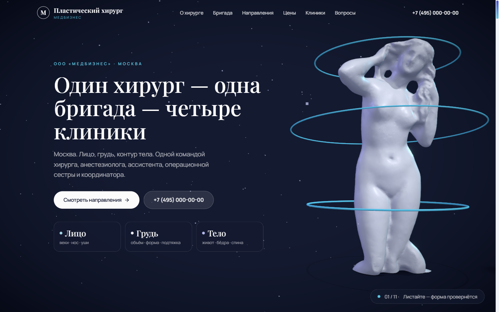
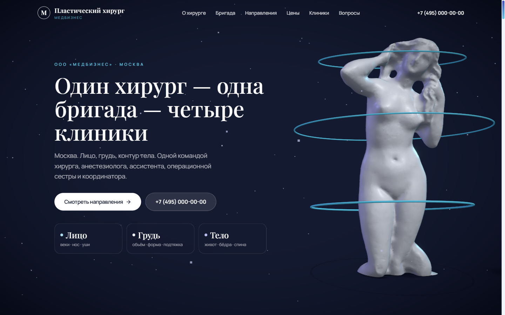
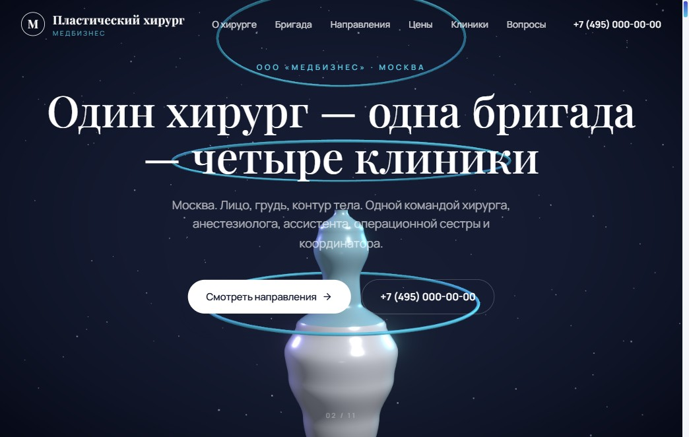

# Пластический хирург — информационный сайт «Медбизнес»

**Live:** [mary-rnd.github.io/vebinar-ii-analitik-landing/plastic](https://mary-rnd.github.io/vebinar-ii-analitik-landing/plastic/)

Информационный сайт практики пластической хирургии: тёмный «музейный» первый экран
с интерактивной 3D-скульптурой и одиннадцать секций — от обещаний хирурга до прайса
и FAQ. По ТЗ сайт информационный, без онлайн-записи: обращения идут в Telegram и по телефону.

---

## Скриншоты

### Первый экран — интерактивная 3D-скульптура



### Первый экран с зонами тела (веки / грудь / контур)



### Мобильная версия



---

## Что внутри

- **3D-герой на React Three Fiber** — скульптура на тёмном фоне с орбитальными
  кольцами. Наведение на зону тела подсвечивает её и показывает направление:
  веки, нос, уши, грудь, живот, бёдра, спина, интимная зона.
- **Одиннадцать секций**: обещания (четыре принципа хирурга), о хирурге, бригада
  из пяти человек, направления, прайс с аккордеоном по группам, четыре клиники,
  путь пациента из шести шагов, кейсы «до и после», отзывы, FAQ, финальный блок
  с переходом в Telegram.
- **Прайс с рыночными ориентирами** — десять операций по группам (лицо, нос и уши,
  грудь, тело, прочее), к каждой указана средняя цена по рынку и длительность.
  Отдельным блоком — импланты и стационар. Есть пометка, что цены не являются офертой.
- **Без формы и онлайн-записи** — по ТЗ заказчика («на данной стадии не нужно,
  чтобы была опция записи на консультацию»). CTA ведёт в Telegram и на телефон.
- **Анимации** — reveal-появление блоков, индикатор прогресса скролла, аккордеоны
  прайса и FAQ, hover-состояния карточек.
- **Адаптив** — mobile / tablet / desktop; на слабых устройствах 3D-сцена упрощается.
- **SEO** — title, description, Open Graph, favicon. Сайт одностраничный.

## Стек

| Слой | Технологии |
| --- | --- |
| Фреймворк | Next.js 16 (App Router), React 19, TypeScript |
| Стили | Tailwind v4, палитра paper / fog / mist / ink / indigo / sky / lilac |
| 3D | three.js, React Three Fiber, drei, postprocessing |
| Анимации | GSAP, CSS-transitions, IntersectionObserver |
| Шрифты | Playfair Display (display) + Manrope (sans) |
| Хостинг | GitHub Pages, статический экспорт + GitHub Actions |

## Локальный запуск

```bash
cd "Plastic Surgery land/site"
npm install --legacy-peer-deps
npm run dev        # http://localhost:3000
```

```bash
npm run build      # статический экспорт в out/ (+ postbuild-фикс RSC-алиасов)
npm run build:sculpture   # пересобрать 3D-скульптуру, если менялись ассеты
```

### Сборка с префиксом пути

Сайт публикуется в подпапке, поэтому сборка идёт с `NEXT_PUBLIC_BASE_PATH`:

```bash
# Linux / macOS / GitHub Actions
NEXT_PUBLIC_BASE_PATH=/vebinar-ii-analitik-landing/plastic npm run build

# Windows PowerShell
$env:NEXT_PUBLIC_BASE_PATH='/vebinar-ii-analitik-landing/plastic'; npm run build
```

## Деплой

Пуш в `main` с изменениями в `Plastic Surgery land/site/**` запускает GitHub Actions
(`.github/workflows/deploy-surgery-pages.yml`). Workflow собирает оба Next-сайта
репозитория и раскладывает их так:

| Путь на сайте | Что это |
| --- | --- |
| `/vebinar-ii-analitik-landing/` | Surgery landing (3D-редизайн сайта хирурга) |
| `/vebinar-ii-analitik-landing/plastic/` | этот сайт |

Второй Pages-workflow в одном репозитории добавлять нельзя — они начнут перезаписывать
сайт друг друга, поэтому деплой общий.

## Структура

```
Plastic Surgery land/
├── README.md                  ← этот файл
├── screenshots/               ← скриншоты для портфолио
│   └── dev/                   ← рабочие материалы: итерации первого экрана, референсы
├── content/prices.md          ← черновик прайса с рыночными ценами
├── tools/                     ← генерация фото (FLUX) и промпты
├── Тексты для сайта пластического хирурга.docx  ← исходные тексты
└── site/
    ├── src/app/               # layout, globals.css, единственный маршрут /
    ├── src/components/        # Header, Footer, Reveal, ScrollProgress, ui/Button
    ├── src/components/sections/  # 11 секций страницы
    ├── src/components/three/  # HeroScene, HeroSection, BodyMap, driver
    ├── src/lib/site.ts        # вся модель контента в одном файле
    ├── src/hooks/useWebGL.ts  # определение поддержки WebGL
    ├── public/images/         # фото хирурга и бригады
    ├── scripts/               # postbuild-фикс экспорта
    └── out/                   # собранный статический сайт (не в git)
```

## Важно

Все данные на сайте — **демонстрационные**: имена, телефоны, адреса клиник, отзывы
и цены придуманы для портфолио. Медицинские утверждения не являются публичной офертой
и не заменяют консультацию врача.

Фотографии хирурга и бригады сгенерированы специально под палитру проекта
(FLUX, `tools/gen-images.mjs`), поэтому у них нет лицензионных ограничений.
