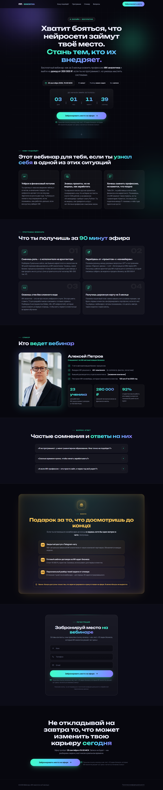
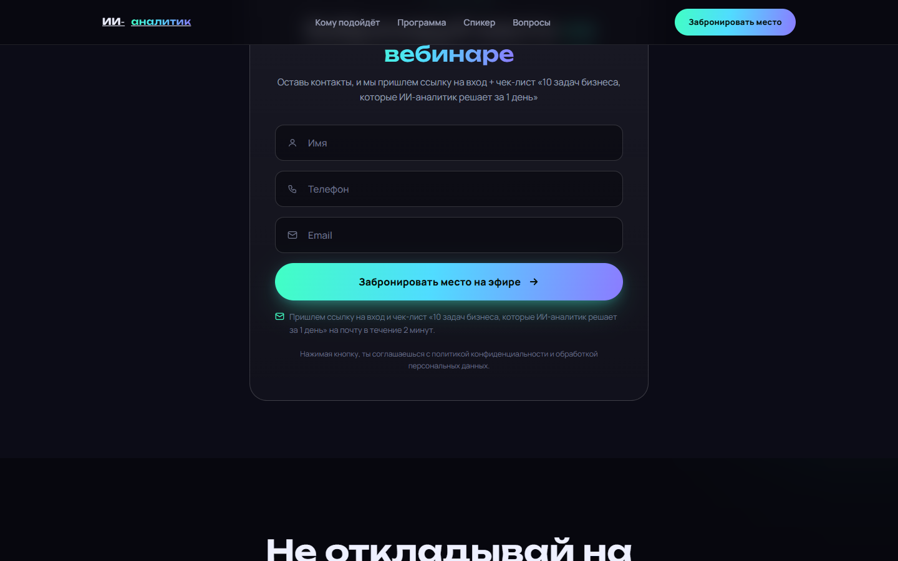

> [← Портфолио Марины Петрушиной](https://mary-rnd.github.io/portfolio/) — сайты, ИИ-боты, трекеры и автоматизация для малого бизнеса и MedTech.

# Лендинг вебинара «Аналитик» — рекламный лендинг под ключ

**Live:** [mary-rnd.github.io/vebinar-ii-analitik-landing](https://mary-rnd.github.io/vebinar-ii-analitik-landing/)

**Зеркало:** [restless-hat-0282.mar-petrushina.workers.dev](https://restless-hat-0282.mar-petrushina.workers.dev/) — Cloudflare Workers (домен `workers.dev` в РФ не открывается, поэтому основная ссылка — GitHub Pages).

Рекламный лендинг бесплатного вебинара по аналитике: тёмная тема, честная продающая
структура, обратный отсчёт до старта и форма регистрации. Один файл на чистом
HTML/CSS/JS — без фреймворков, сборщиков и бэкенда.



---

## Что решает

- **Собирает регистрации** — форма «имя + телефон» с валидацией номера; заявки уходят
  на почту через Web3Forms, свой сервер не нужен.
- **Держит внимание** — обратный отсчёт до старта вебинара, reveal-анимации блоков
  по мере прокрутки, плавающая CTA-кнопка.
- **Снимает возражения** — блок «для кого», программа вебинара, спикер с фактами-кейсами,
  FAQ-аккордеон.
- **Быстро грузится** — один HTML-файл, никаких библиотек, шрифтов из внешних CDN
  и тяжёлых сборок.
- **Выглядит современно** — тёмная тема, аккуратная типографика, адаптив под
  mobile / tablet / desktop, Open Graph для соцсетей.

## Скриншоты

### Полная страница (desktop)


### Форма регистрации



### Мобильная версия


## Как устроена продающая структура

```
Герой с оффером + обратный отсчёт
   -->
Для кого (боли и задачи ЦА)
   -->
Программа вебинара
   -->
Спикер + факты-кейсы
   -->
FAQ
   -->
Форма регистрации с таймером
   -->
Плавающая CTA-кнопка при прокрутке
```

## Возможности

- Обратный отсчёт до даты старта вебинара (25.09.2026, 19:00 МСК) с автосбросом после истечения.
- Форма «Имя + телефон» с валидацией номера и отправкой заявки на почту через **Web3Forms**.
- Спикер-блок с фото и аккордеоном видео-фактов.
- FAQ-аккордеон с плавной анимацией раскрытия.
- Плавающая CTA-кнопка, появляющаяся при прокрутке.
- Reveal-анимации появления блоков (IntersectionObserver).
- Полностью адаптивная вёрстка (mobile / tablet / desktop).
- Open Graph-разметка и og:image для соцсетей.

## Стек

| | |
|---|---|
| Разметка | HTML5 (семантические блоки, Open Graph) |
| Стили | CSS3: custom properties, grid, flexbox, тёмная тема |
| Логика | JavaScript (vanilla): таймер, валидация, аккордеон, reveal |
| Форма | Web3Forms — приём заявок на email, без бэкенда |
| Деплой | Cloudflare Workers (живая версия) + GitHub Pages (зеркало) |

## Запуск

```bash
# локальный просмотр
python -m http.server 8000
# http://localhost:8000/index.html
```

Для деплоя достаточно выложить один файл `index.html` на любой статический хостинг.
Ключ формы подставляется в `WEB3FORMS_KEY` (получить бесплатно на web3forms.com).

## Деплой

- **Живая версия** — GitHub Pages: `https://mary-rnd.github.io/vebinar-ii-analitik-landing/`
  — пуш в `main` с изменениями в `index.html` или `dist/**` запускает
  `.github/workflows/deploy-webinar-pages.yml` и публикует `dist/` автоматически.
- **Зеркало** — Cloudflare Workers: `https://restless-hat-0282.mar-petrushina.workers.dev/`
  (домен `workers.dev` в РФ не открывается, поэтому основной Live — на GitHub Pages).

## Структура

```
.
├─ index.html                 # весь лендинг (стили + разметка + скрипты)
├─ dist/
│  └─ index.html              # копия для деплоя
├─ screenshots/
│  ├─ desktop-full.png        # полная версия (desktop, 1440×6947)
│  ├─ desktop-form.png        # секция формы регистрации
│  └─ mobile-full.png         # полная версия (mobile)
├─ .github/workflows/         # публикация зеркала на GitHub Pages
├─ README.md
└─ LICENSE                    # MIT
```

## Лицензия

MIT — см. `LICENSE`.
