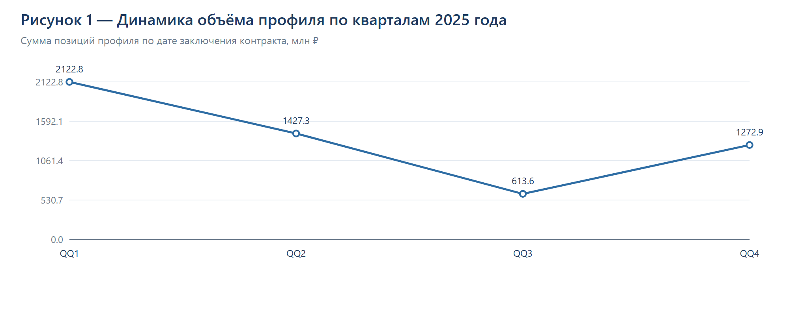
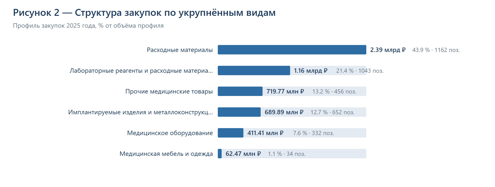
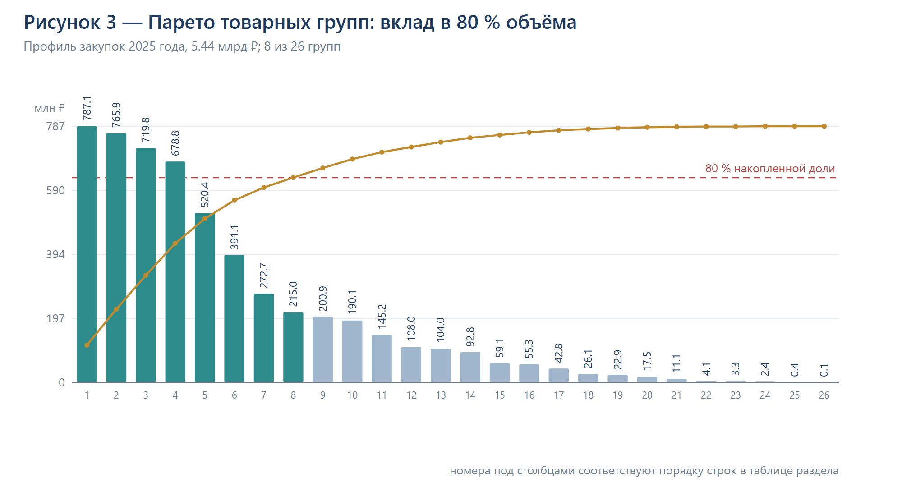
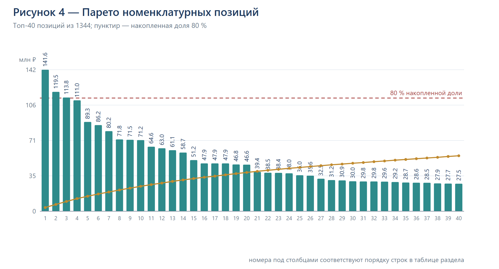
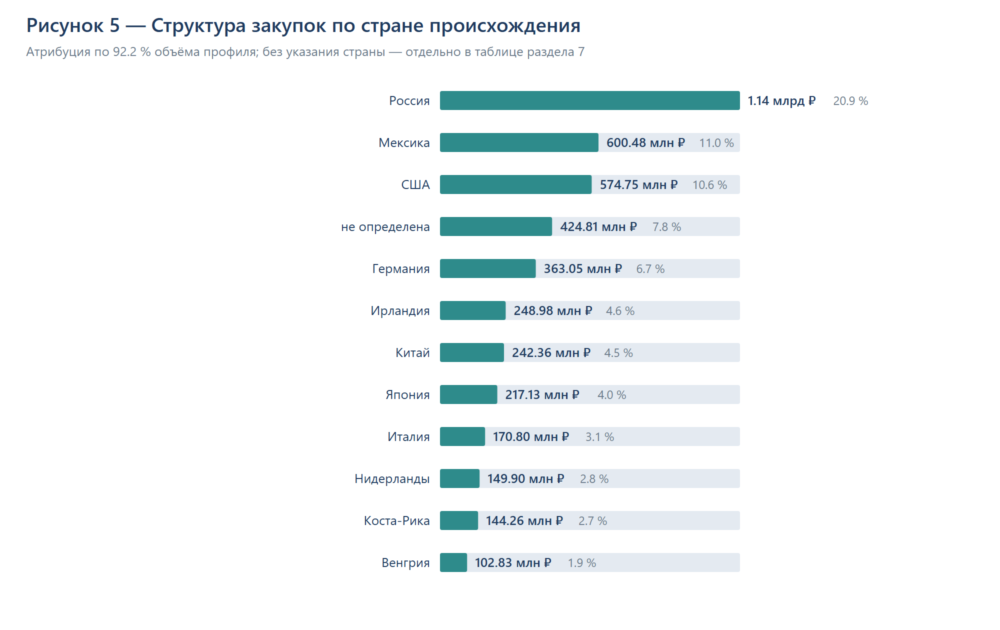
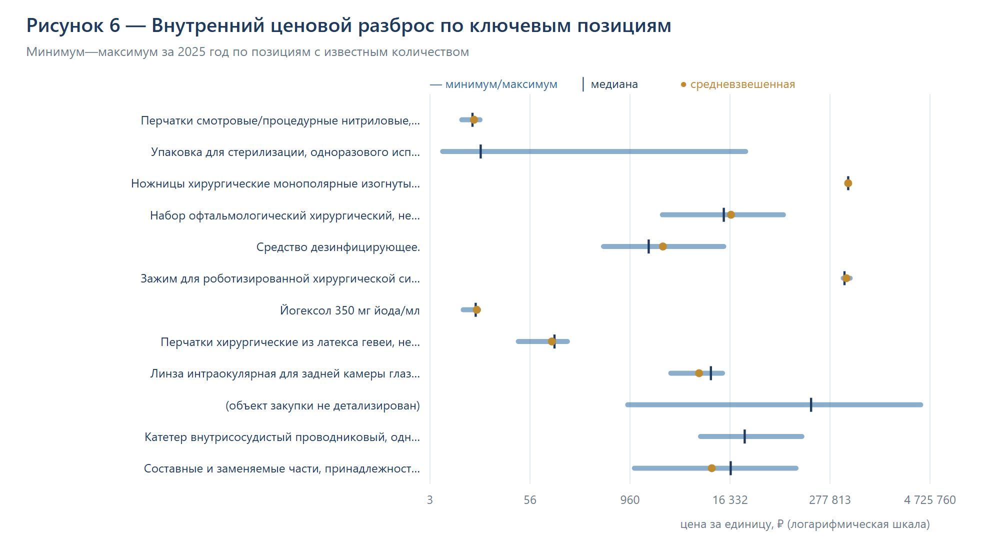

# Анализ закупок медицинских товаров
## МНКЦ им. С.П. Боткина, 2025 год

| Параметр | Значение |
|---|---|
| Заказчик | ГОСУДАРСТВЕННОЕ БЮДЖЕТНОЕ УЧРЕЖДЕНИЕ ЗДРАВООХРАНЕНИЯ ГОРОДА МОСКВЫ "МОСКОВСКИЙ МНОГОПРОФИЛЬНЫЙ НАУЧНО-КЛИНИЧЕСКИЙ ЦЕНТР ИМЕНИ С.П. БОТКИНА" ДЕПАРТАМЕНТА ЗДРАВООХРАНЕНИЯ ГОРОДА МОСКВЫ |
| ИНН / КПП | 7714082636 / 771401001 |
| Период | 01.01.2025 – 31.12.2025 |
| Учёт | по дате заключения контракта (договора) |
| Источники | ЕИС: реестр контрактов 44-ФЗ и реестр договоров 223-ФЗ |
| Дата выгрузки | 2026-10-22 |
| Версия | 1.0 |

**Расшифровка классов достоверности.** *Факт* — данные первичного источника ЕИС без изменений. *Оценка* — расчётное, агрегированное или неполное значение (например, сумма позиции, распределённая по цене контракта, если количество не опубликовано). Оценочные значения не предназначены для официальной отчётности.

---

## Содержание

- **1.** Основные показатели
- **2.** Методика и источники
- **3.** Общий объём закупок
- **4.** Структура по видам закупок
- **5.** Категории по правилу 80 %
- **6.** Номенклатура по правилу 80 %
- **7.** Страна происхождения
- **8.** Внутренние ценовые бенчмарки
- **9.** Ключевая номенклатура
- **10.** Приложения

[[pagebreak]]

## 1. Основные показатели

В 2025 году по дате заключения учтено 2 306 контрактов и договоров, в том числе 1 708 по 44-ФЗ и 598 по 223-ФЗ. Профильные медицинские товары присутствуют в 1 262 контрактах.

Суммарный объём профильных позиций — 5 436 685 542,52 ₽ (39,5 % от суммы всех позиций). Основной профиль формирует 4 210 412 297,71 ₽, пограничные категории — 1 226 273 244,81 ₽. Исключённые позиции (фармация, хозяйственные расходы, услуги и работы) — 8 340 285 702,34 ₽.

**Таблица 1.1. Основные показатели закупок МНКЦ им. С.П. Боткина за 2025 год**

Единицы измерения: ₽, шт., %, шт./поз.. Период: 01.01.2025 – 31.12.2025. Источник: ЕИС: реестр контрактов 44-ФЗ и реестр договоров 223-ФЗ.

| Показатель | Значение |
|:---|---:|
| Контрактов и договоров всего | 2 306 |
| в том числе 44-ФЗ | 1 708 |
| в том числе 223-ФЗ | 598 |
| Контрактов с профильными товарами | 1 262 |
| Профильный объём | 5 436 685 542,52 ₽ |
| в том числе основной профиль | 4 210 412 297,71 ₽ |
| в том числе пограничные категории | 1 226 273 244,81 ₽ |
| Исключённые позиции | 8 340 285 702,34 ₽ |
| Позиций всего | 6 275 |
| Позиций в профиле | 3 679 |
| Поставщиков в профиле | 339 |
| Медиана цены контракта | 689 392,00 ₽ |
| Средняя сумма позиции | 1 477 761,77 ₽ |
| Медианная сумма позиции | 363 990,00 ₽ |
| Категорий в 80 %-наборе | 8 из 26 |
| Позиций в 80 %-наборе | 256 из 1 344 |
| Охват страной происхождения | 92,2 % |

Примечания: показатели рассчитаны по позициям закупок (единица учёта — позиция). Медиана и средняя сумма позиции — по профильным позициям; счётчик поставщиков относится к контрактам 44-ФЗ (в реестре договоров 223-ФЗ ЕИС не публикует поставщика).
**Структура.** Наибольшие виды: расходные материалы — 2,4 млрд ₽ (43,9 % профиля); лабораторные реагенты и расходные материалы — 1,2 млрд ₽ (21,4 % профиля); прочие медицинские товары — 719,8 млн ₽ (13,2 % профиля).

**80 %-набор.** Профильный объём концентрируется в группе «Реагенты диагностические (ИВД)» — 787,1 млн ₽ (14,5 %); группе «Инструменты и приспособления медицинские» — 765,9 млн ₽ (14,1 %); группе «Изделия медицинские прочие» — 719,8 млн ₽ (13,2 %). Всего в набор входят 8 групп и 256 позиций.

**Страна происхождения.** Россия — 1,1 млрд ₽ (22,7 % объёма с указанной страной), импорт — 3,9 млрд ₽. Страна не указана для 424,8 млн ₽ (7,8 % профиля).

**Цены.** Медиана цены контракта — 689 392,00 ₽, средняя сумма позиции — 1 477 761,77 ₽, медианная — 363 990,00 ₽. Бенчмарки рассчитаны по 163 позициям 80 %-набора с двумя и более закупками.

[[pagebreak]]

## 2. Методика и источники

### 2.1. Период и единица учёта

Период анализа — 01.01.2025–31.12.2025. Единица учёта — контракт (договор) по дате заключения. Для 223-ФЗ дата размещения использовалась только как окно отбора; в выборку попали договоры с датой заключения в 2025 году. Позиция контракта — отдельная строка спецификации; если спецификация не опубликована, сумма распределяется по цене контракта и помечается как оценка.

### 2.2. Источники

44-ФЗ — реестр контрактов ЕИС (zakupki.gov.ru/epz/contract/search/results.html), карточки «Общая информация» и «Платёжная информация и объект закупки». 223-ФЗ — реестр договоров ЕИС (zakupki.gov.ru/epz/contractfz223/search/results.html), карточки «Информация о договоре» и «Предмет договора». Поиск вёлся по наименованию заказчика с проверкой ИНН, КПП и ОГРН; одноимённые учреждения в других регионах исключены.

Параметры выборки. 44-ФЗ: строка поиска «Боткина» с морфологией, признак «закупки по 44-ФЗ», все публикуемые этапы контракта, интервал даты заключения 01.01.2025 – 31.12.2025, сортировка по дате обновления, постраничный обход реестра. 223-ФЗ: строка поиска «Боткина» с морфологией, интервал даты размещения 01.01.2025 – 31.12.2025 с последующим отбором по дате заключения 2025 года, постраничный обход реестра. Отбор заказчика — по совпадению ИНН 7714082636 и КПП 771401001; записи с другими реквизитами отброшены. Из каждой карточки извлекались цена и дата заключения, поставщик, способ закупки и позиции с количеством, ценой за единицу, суммой, ОКПД2, КТРУ и страной происхождения.

### 2.3. Область анализа

main — основной медицинский профиль: медицинское оборудование, расходные материалы, имплантируемые изделия и металлоконструкции, прочие медицинские товары. borderline — лабораторные реагенты, дезинфекция, медицинская мебель и одежда, запчасти к оборудованию. excluded — фармация, хозяйственные расходы, услуги и работы, прочее вне профиля. Профильный объём — сумма main и borderline.

### 2.4. Классификатор

Три уровня: L1 — вид закупки (шесть укрупнённых видов и отдельно пограничные категории, § 6.2 ТЗ); L2 — товарная группа по ОКПД2 и маркерам наименования; L3 — номенклатурная позиция (КТРУ + нормализованное наименование). Каждая позиция получает вид, группу, область и признак достоверности. Правила классификации и полный перечень групп приведены в приложении Б.

### 2.5. Нормализация и дедупликация

Единицы измерения приводятся к базовым (шт., мл, г, м, упаковка) с сохранением исходного значения. Повторные публикации, лоты, дополнительные соглашения и расторжения не создают новых позиций. Контроль — по номеру реестровой записи и набору «наименование + ОКПД2 + количество + цена + сумма». Контрактная детализация (номера, даты, предметы, цены контрактов) в результат не выводится.

### 2.6. Страна происхождения

Приоритет — поле страны в контракте или спецификации. Если поле не заполнено, страна не подставляется по догадке и указывается как «не определена». Для каждой позиции фиксируется источник атрибуции; охват страной показан в разделе 7 и в паспорте данных.

### 2.7. Внутренние бенчмарки

Рассчитываются только по закупкам учреждения за 2025 год: средневзвешенная цена, медиана, минимум, максимум, P25, P75, количество закупок и поставщиков, разброс max/min, коэффициент вариации, расчётная разница к медиане и минимуму. Средневзвешенная цена считается по позициям с опубликованным количеством; оценочные суммы в расчёт не входят. Внешние прайс-листы и данные других учреждений не используются.

### 2.8. Классы достоверности и ограничения

«Факт» — данные первичного источника без изменений. «Оценка» — расчётное, агрегированное или неполное значение; оценочные позиции помечены в реестре. Закрытые закупки и закупки, не подлежащие публикации, в реестрах отсутствуют; закупки на Портале поставщиков Москвы в ЕИС не публикуются. Часть контрактов не содержит количества и суммы позиций; ставка НДС в реестре контрактов не публикуется, поэтому не рассчитывается. Полный паспорт данных — в приложении В.

Отдельно ограничение по поставщикам: в реестре договоров 223-ФЗ ЕИС не публикует наименование и ИНН поставщика — ни в карточке договора, ни в печатной форме, ни в реестре. Поэтому для 711 позиций 223-ФЗ (645 562 848,84 ₽, 11,9 % профиля) поставщик указан как «не указан в ЕИС (реестр 223-ФЗ)». Число поставщиков профиля (339) относится к контрактам 44-ФЗ, где реквизиты поставщика опубликованы.

[[pagebreak]]

## 3. Общий объём закупок

Сумма всех позиций за 2025 год — 13 776 971 244,86 ₽, из них профильных — 5 436 685 542,52 ₽ (39,5 %). Разница между суммой позиций и суммой цен контрактов — -0,08 ₽ (-0,0 %), что связано с округлениями и неопубликованными спецификациями.

### 3.1. По источникам

**Таблица 3.1. Профильный объём закупок по источникам данных**

Единицы измерения: ₽, позиции, %. Период: 01.01.2025 – 31.12.2025. Источник: ЕИС: реестр контрактов 44-ФЗ и реестр договоров 223-ФЗ.

| Источник | Позиций | Сумма | Доля профиля |
|:---|---:|---:|---:|
| 44-ФЗ | 3 043 | 5 155 961 273,92 ₽ | 94,8 % |
| 223-ФЗ | 636 | 280 724 268,60 ₽ | 5,2 % |
| Итого | 3 679 | 5 436 685 542,52 ₽ | 100,0 % |

Примечания: учёт — по дате заключения контракта (договора); доля рассчитана от профильного объёма.
44-ФЗ: 1 708 контрактов; 223-ФЗ: 598 договоров. Позиции 223-ФЗ составляют 5,2 % профильного объёма.

### 3.2. По кварталам

**Таблица 3.2. Профильный объём закупок по кварталам 2025 года**

Единицы измерения: ₽, позиции, %. Период: 01.01.2025 – 31.12.2025. Источник: ЕИС: реестр контрактов 44-ФЗ и реестр договоров 223-ФЗ.

| Квартал | Позиций | Сумма | Доля профиля |
|:---|---:|---:|---:|
| 2025-Q1 | 1 176 | 2 122 842 937,44 ₽ | 39,0 % |
| 2025-Q2 | 918 | 1 427 291 913,28 ₽ | 26,3 % |
| 2025-Q3 | 776 | 613 628 457,47 ₽ | 11,3 % |
| 2025-Q4 | 809 | 1 272 922 234,33 ₽ | 23,4 % |

Примечания: квартал определяется по дате заключения контракта (договора).

По месяцам объём распределён неравномерно: февраль 2025 — 908,1 млн ₽; апрель 2025 — 653,6 млн ₽; декабрь 2025 — 646,6 млн ₽.

### 3.3. По размеру контрактов

**Таблица 3.3. Распределение закупок по цене контракта**

Единицы измерения: ₽, контракты, %. Период: 01.01.2025 – 31.12.2025. Источник: ЕИС: реестр контрактов 44-ФЗ и реестр договоров 223-ФЗ.

| Цена контракта | Контрактов | Доля по количеству | Сумма контрактов | Профильные позиции |
|:---|---:|---:|---:|---:|
| до 100 тыс. ₽ | 313 | 13,6 % | 16 562 077,55 ₽ | 11 009 048,34 ₽ |
| 100–600 тыс. ₽ | 658 | 28,5 % | 187 733 382,65 ₽ | 109 651 271,28 ₽ |
| 600 тыс. – 1 млн ₽ | 167 | 7,2 % | 127 879 691,52 ₽ | 59 860 933,88 ₽ |
| 1–5 млн ₽ | 622 | 27,0 % | 1 487 028 468,74 ₽ | 717 976 724,60 ₽ |
| 5–10 млн ₽ | 191 | 8,3 % | 1 352 174 803,00 ₽ | 755 931 871,63 ₽ |
| 10–50 млн ₽ | 314 | 13,6 % | 6 368 510 814,62 ₽ | 2 945 365 374,37 ₽ |
| свыше 50 млн ₽ | 41 | 1,8 % | 4 237 082 006,86 ₽ | 836 890 318,42 ₽ |

Примечания: границы ценовых групп заданы исполнителем для описания распределения; последняя группа — все контракты дороже верхней границы.
Медиана цены контракта — 689 392,00 ₽, средняя — 4 314 345,05 ₽, максимальная — 275 458 976,10 ₽. Средний срок исполнения — 240 дней.

### 3.4. Сверка

Профильные позиции (5 436 685 542,52 ₽) и исключённые (8 340 285 702,34 ₽) в сумме дают 13 776 971 244,86 ₽ — общее значение по всем позициям; отклонение от суммы профиля и исключений равно нулю. Отдельно сумма всех позиций сопоставлена с суммой цен контрактов (13 776 971 244,94 ₽): расхождение — -0,08 ₽, или 0,0 %. Оценочные позиции: 1 681 (45,7 % профиля). Смешанных контрактов, где вместе с товарами закупаются услуги, — 0; они разделены по позициям, услуги исключены.

Сверка с первичным источником выполнена по всем 2 306 контрактам и договорам, а не по выборке: сумма позиций каждого контракта сопоставлена с ценой контракта в карточке ЕИС. Расхождений не выявлено — итоговое расхождение -0,08 ₽. Дополнительно по 26 контрактам с неполной спецификацией выполнена дозагрузка позиций с ценами из платёжной информации; до дозагрузки расхождение составляло около 561 млн ₽ (5,6 % общей суммы), после — -0,08 ₽.

[[pagebreak]]

## 4. Структура по видам закупок

Виды выделены по § 6.2 ТЗ. Сумма и доля считаются по профильному объёму; пограничные виды включены в общую структуру и отмечены в таблице.

**Таблица 4.1. Структура профильных закупок по видам**

Единицы измерения: ₽, позиции, %, поставщики. Период: 01.01.2025 – 31.12.2025. Источник: ЕИС: реестр контрактов 44-ФЗ и реестр договоров 223-ФЗ.

| № | Вид | Сумма | Доля | Позиций | Поставщиков | Средняя позиция | Область |
|---:|:---|---:|---:|---:|---:|---:|:---|
| 1 | Расходные материалы | 2 389 342 066,71 ₽ | 43,9 % | 1 162 | 175 | 2 056 232,42 ₽ | основной |
| 2 | Лабораторные реагенты и расходные материалы | 1 163 806 244,83 ₽ | 21,4 % | 1 043 | 77 | 1 115 825,74 ₽ | пограничный |
| 3 | Прочие медицинские товары | 719 773 229,27 ₽ | 13,2 % | 456 | 105 | 1 578 450,06 ₽ | основной |
| 4 | Имплантируемые изделия и металлоконструкции | 689 885 776,87 ₽ | 12,7 % | 652 | 63 | 1 058 107,02 ₽ | основной |
| 5 | Медицинское оборудование | 411 411 224,86 ₽ | 7,6 % | 332 | 33 | 1 239 190,44 ₽ | основной |
| 6 | Медицинская мебель и одежда | 62 466 999,98 ₽ | 1,1 % | 34 | 10 | 1 837 264,71 ₽ | пограничный |
|  | Итого | 5 436 685 542,52 ₽ | 100,0 % | 3 679 | 339 | 1 477 761,77 ₽ |  |
|  | В том числе пограничные категории (справочно) | 1 226 273 244,81 ₽ | 22,6 % | 1 077 | 86 | 1 138 600,97 ₽ | справочно |

Примечания: строка «в том числе пограничные категории» — справочная, её сумма уже учтена в видах выше и не суммируется с итогом. Счётчик поставщиков относится к контрактам 44-ФЗ.
Строка «в том числе пограничные» справочная: её сумма уже учтена в видах выше и не суммируется с итогом. Без пограничных категорий профильный объём составляет 4 210 412 297,71 ₽.

### 4.1. Расходные материалы

Объём — 2 389 342 066,71 ₽ (43,9 % профиля), 1 162 позиции, 175 поставщиков; средняя сумма позиции — 2 056 232,42 ₽.

Ведущие товарные группы: «Инструменты и приспособления медицинские» — 765,9 млн ₽ (32,1 %); «Инструменты для роботизированной хирургии» — 520,4 млн ₽ (21,8 %); «Катетеры, дренажи и троакары» — 391,1 млн ₽ (16,4 %).

Крупнейшие позиции: Перчатки смотровые/процедурные нитриловые, неопудренные, антибактериа… — 141,6 млн ₽; Ножницы хирургические монополярные изогнутые для роботизированной хир… — 113,8 млн ₽; Набор офтальмологический хирургический, не содержащий лекарственные с… — 111,0 млн ₽.

Основные месяцы закупки: февраль 2025 — 401,9 млн ₽; ноябрь 2025 — 366,0 млн ₽.

### 4.2. Лабораторные реагенты и расходные материалы

Объём — 1 163 806 244,83 ₽ (21,4 % профиля), 1 043 позиции, 77 поставщиков; средняя сумма позиции — 1 115 825,74 ₽.

Ведущие товарные группы: «Реагенты диагностические (ИВД)» — 787,1 млн ₽ (67,6 %); «Реагенты лабораторные прочие» — 272,7 млн ₽ (23,4 %); «Материалы диагностические» — 104,0 млн ₽ (8,9 %).

Крупнейшие позиции: Йогексол 350 мг йода/мл — 80,2 млн ₽; Фибриноген-С XL для работы на анализаторах ACL, производства "Instrum… — 28,6 млн ₽; Гадотеровая кислота 0.5 ммоль/мл — 27,9 млн ₽.

Основные месяцы закупки: февраль 2025 — 228,1 млн ₽; апрель 2025 — 201,2 млн ₽.

### 4.3. Прочие медицинские товары

Объём — 719 773 229,27 ₽ (13,2 % профиля), 456 позиций, 105 поставщиков; средняя сумма позиции — 1 578 450,06 ₽.

Ведущие товарные группы: «Изделия медицинские прочие» — 719,8 млн ₽ (100,0 %).

Крупнейшие позиции: Упаковка для стерилизации, одноразового использования. — 119,5 млн ₽; Набор для общехирургических/пластических процедур, не содержащий лека… — 51,2 млн ₽; Насос инфузионный эластомерный — 46,6 млн ₽.

Основные месяцы закупки: май 2025 — 145,2 млн ₽; апрель 2025 — 134,5 млн ₽.

### 4.4. Имплантируемые изделия и металлоконструкции

Объём — 689 885 776,87 ₽ (12,7 % профиля), 652 позиции, 63 поставщика; средняя сумма позиции — 1 058 107,02 ₽.

Ведущие товарные группы: «Имплантаты, стенты и эндопротезы» — 678,8 млн ₽ (98,4 %); «Приспособления ортопедические» — 11,1 млн ₽ (1,6 %).

Крупнейшие позиции: Линза интраокулярная для задней камеры глаза, псевдофакичная. — 71,5 млн ₽; Биопротез сердечного аортального клапана для транскатетерной импланта… — 38,4 млн ₽; Стент для коронарных артерий, выделяющий лекарственное средство — 30,0 млн ₽.

Основные месяцы закупки: январь 2025 — 154,3 млн ₽; февраль 2025 — 111,2 млн ₽.

### 4.5. Медицинское оборудование

Объём — 411 411 224,86 ₽ (7,6 % профиля), 332 позиции, 33 поставщика; средняя сумма позиции — 1 239 190,44 ₽.

Ведущие товарные группы: «Медицинское оборудование» — 190,1 млн ₽ (46,2 %); «Оборудование для анестезии, ИВЛ и реанимации» — 108,0 млн ₽ (26,2 %); «Оборудование для функциональной диагностики» — 42,8 млн ₽ (10,4 %).

Крупнейшие позиции: (объект закупки не детализирован) — 71,2 млн ₽; Растворы плазмозамещающие и перфузионные Посмотреть все (6) — 46,8 млн ₽; Обжимающая жидкость (Urine Sediment Analyzer Reagent Sheath), для ана… — 29,8 млн ₽.

Основные месяцы закупки: март 2025 — 100,3 млн ₽; февраль 2025 — 91,2 млн ₽.

### 4.6. Медицинская мебель и одежда

Объём — 62 466 999,98 ₽ (1,1 % профиля), 34 позиции, 10 поставщиков; средняя сумма позиции — 1 837 264,71 ₽.

Ведущие товарные группы: «Медицинская одежда и белье» — 59,1 млн ₽ (94,7 %); «Мебель медицинская» — 3,3 млн ₽ (5,3 %).

Крупнейшие позиции: Халат операционный, одноразового использования. — 39,4 млн ₽; Костюм хирургический одноразового использования, нестерильный. — 14,6 млн ₽; Шкаф для хранения лекарственных средств. — 2,7 млн ₽.

Основные месяцы закупки: май 2025 — 39,3 млн ₽; апрель 2025 — 19,6 млн ₽.

### 4.7. Пограничные категории (справочно)

К пограничным отнесены лабораторные реагенты и расходные материалы, медицинская мебель и одежда, а также отдельные спорные группы. Их сумма — 1 226 273 244,81 ₽ (22,6 % профиля), 1 077 позиций, 86 поставщиков. Эти позиции уже входят в виды выше; строка приводится для оценки «чистого» профиля.

**Таблица 4.2. Пограничные категории в разрезе товарных групп**

Единицы измерения: ₽, %. Период: 01.01.2025 – 31.12.2025. Источник: ЕИС: реестр контрактов 44-ФЗ и реестр договоров 223-ФЗ.

| Товарная группа | Сумма | Доля пограничных |
|:---|---:|---:|
| Реагенты диагностические (ИВД) | 787 078 979,72 ₽ | 64,2 % |
| Реагенты лабораторные прочие | 272 737 327,50 ₽ | 22,2 % |
| Материалы диагностические | 103 989 937,61 ₽ | 8,5 % |
| Медицинская одежда и белье | 59 141 588,19 ₽ | 4,8 % |
| Мебель медицинская | 3 325 411,79 ₽ | 0,3 % |

Примечания: доля рассчитана от суммы пограничных позиций; эти позиции входят в общий объём профиля и выделены признаком scope = borderline.
Без пограничных категорий профильный объём — 4 210 412 297,71 ₽ (77,4 % профиля).

### 4.8. Разрез по способу закупки

Профильный объём в разрезе способа закупки и закона (44-ФЗ / 223-ФЗ). Способ закупки указан в карточке контракта; для части записей поле не заполнено — такие позиции отнесены к строке «не указан».

**Таблица 4.3. Профильный объём в разрезе способа закупки и закона**

Единицы измерения: ₽, позиции, %. Период: 01.01.2025 – 31.12.2025. Источник: ЕИС: реестр контрактов 44-ФЗ и реестр договоров 223-ФЗ.

| Способ закупки | 44-ФЗ | 223-ФЗ | Итого | Доля | Позиций |
|:---|---:|---:|---:|---:|---:|
| Электронный аукцион | 4 342 775 473,42 ₽ | 0,00 ₽ | 4 342 775 473,42 ₽ | 79,9 % | 2 224 |
| не указан | 364 838 580,24 ₽ | 77 487 281,13 ₽ | 442 325 861,37 ₽ | 8,1 % | 354 |
| Запрос котировок | 423 713 376,51 ₽ | 0,00 ₽ | 423 713 376,51 ₽ | 7,8 % | 683 |
| Аукцион | 0,00 ₽ | 167 247 702,02 ₽ | 167 247 702,02 ₽ | 3,1 % | 143 |
| Единственный поставщик | 14 614 538,75 ₽ | 32 679 160,19 ₽ | 47 293 698,94 ₽ | 0,9 % | 254 |
| Закупка, осуществляемая в соответствии с частью 12 статьи 93 | 10 019 305,00 ₽ | 0,00 ₽ | 10 019 305,00 ₽ | 0,2 % | 10 |
| Иной способ закупки, предусмотренный правовым актом заказчик | 0,00 ₽ | 3 310 125,26 ₽ | 3 310 125,26 ₽ | 0,1 % | 11 |
| Итого | 5 155 961 273,92 ₽ | 280 724 268,60 ₽ | 5 436 685 542,52 ₽ | 100,0 % | 3 679 |

Примечания: способ закупки указан в карточке контракта ЕИС; для части записей поле не заполнено — такие позиции отнесены к строке «не указан». Карточки контрактов, номера и даты в отчёт не выводятся.
[[pagebreak]]

## 5. Категории по правилу 80 %

Правило 80 % применено к товарным группам: группы отсортированы по сумме, в набор включаются все группы до достижения 80 % профильного объёма. Это не фиксированный топ-10; группы с равной суммой на границе включаются вместе. Группы за пределами набора приведены в Excel и дашборде.

**Таблица 5.1. Товарные группы 80 %-набора: объём, накопленная доля и характеристика группы**

Единицы измерения: ₽, позиции, %, поставщики. Период: 01.01.2025 – 31.12.2025. Источник: ЕИС: реестр контрактов 44-ФЗ и реестр договоров 223-ФЗ.

| № | Товарная группа | Сумма | Доля | Накопленно | Позиций | Поставщиков | Средняя позиция | В 80 % | Комментарий |
|---:|:---|---:|---:|---:|---:|---:|---:|:---:|:---|
| 1 | Реагенты диагностические (ИВД) | 787 078 979,72 ₽ | 14,5 % | 14,5 % | 538 | 48 | 1 462 972,08 ₽ | да | импортные закупки — 69,9 % объёма; группа пограничная |
| 2 | Инструменты и приспособления медицинские | 765 852 114,59 ₽ | 14,1 % | 28,6 % | 653 | 138 | 1 172 821,00 ₽ | да | импортные закупки — 85,2 % объёма |
| 3 | Изделия медицинские прочие | 719 773 229,27 ₽ | 13,2 % | 41,8 % | 456 | 105 | 1 578 450,06 ₽ | да | импортные закупки — 55,6 % объёма |
| 4 | Имплантаты, стенты и эндопротезы | 678 760 355,30 ₽ | 12,5 % | 54,3 % | 650 | 62 | 1 044 246,70 ₽ | да | импортные закупки — 69,1 % объёма; страна не указана для 15,4 % объёма |
| 5 | Инструменты для роботизированной хирургии | 520 370 656,13 ₽ | 9,6 % | 63,9 % | 27 | 2 | 19 272 987,26 ₽ | да | импортные закупки — 100,0 % объёма; концентрация: TOP-1 поставщик — 99,9 % объёма |
| 6 | Катетеры, дренажи и троакары | 391 105 310,84 ₽ | 7,2 % | 71,1 % | 261 | 36 | 1 498 487,78 ₽ | да | импортные закупки — 95,9 % объёма |
| 7 | Реагенты лабораторные прочие | 272 737 327,50 ₽ | 5,0 % | 76,1 % | 332 | 22 | 821 497,97 ₽ | да | импортные закупки — 95,8 % объёма; группа пограничная |
| 8 | Перчатки и изделия медицинские из резины | 214 973 521,35 ₽ | 4,0 % | 80,0 % | 56 | 3 | 3 838 812,88 ₽ | да | концентрация: TOP-1 поставщик — 99,1 % объёма |
| 9 | Офтальмологические наборы и инструменты | 200 863 276,44 ₽ | 3,7 % | 83,7 % | 73 | 11 | 2 751 551,73 ₽ | нет | импортные закупки — 87,3 % объёма; концентрация: TOP-1 поставщик — 47,1 % объёма |
| 10 | Медицинское оборудование | 190 059 366,35 ₽ | 3,5 % | 87,2 % | 263 | 1 | 722 659,19 ₽ | нет | концентрация: TOP-1 поставщик — 100,0 % объёма; страна не указана для 100,0 % объёма |
| 11 | Расходные материалы прочие | 145 216 166,46 ₽ | 2,7 % | 89,9 % | 35 | 6 | 4 149 033,33 ₽ | нет | концентрация: TOP-1 поставщик — 89,9 % объёма; страна не указана для 89,6 % объёма |
| 12 | Оборудование для анестезии, ИВЛ и реанимации | 107 952 825,02 ₽ | 2,0 % | 91,9 % | 43 | 20 | 2 510 530,81 ₽ | нет | импортные закупки — 97,6 % объёма |
| 13 | Материалы диагностические | 103 989 937,61 ₽ | 1,9 % | 93,8 % | 173 | 22 | 601 097,91 ₽ | нет | импортные закупки — 70,4 % объёма; группа пограничная |
| 14 | Дезинфицирующие средства и антисептики | 92 782 498,88 ₽ | 1,7 % | 95,5 % | 28 | 6 | 3 313 660,67 ₽ | нет | импортные закупки — 62,6 % объёма; концентрация: TOP-1 поставщик — 38,2 % объёма |
| 15 | Медицинская одежда и белье | 59 141 588,19 ₽ | 1,1 % | 96,6 % | 31 | 8 | 1 907 793,17 ₽ | нет | преимущественно российское производство; концентрация: TOP-1 поставщик — 32,7 % объёма; группа пограничная |
| 16 | Трубки, шланги и расходные материалы полимерные | 55 293 952,74 ₽ | 1,0 % | 97,6 % | 20 | 6 | 2 764 697,64 ₽ | нет | импортные закупки — 96,5 % объёма; концентрация: TOP-1 поставщик — 51,5 % объёма |
| 17 | Оборудование для функциональной диагностики | 42 766 912,32 ₽ | 0,8 % | 98,4 % | 7 | 5 | 6 109 558,90 ₽ | нет | импортные закупки — 98,0 % объёма; концентрация: TOP-1 поставщик — 79,4 % объёма |
| 18 | Оборудование лучевое и электротерапевтическое | 26 067 225,00 ₽ | 0,5 % | 98,9 % | 2 | 2 | 13 033 612,50 ₽ | нет | преимущественно российское производство; концентрация: TOP-1 поставщик — 97,6 % объёма |
| 19 | Оптика и оптические приборы | 22 886 200,00 ₽ | 0,4 % | 99,3 % | 3 | 2 | 7 628 733,33 ₽ | нет | импортные закупки — 100,0 % объёма; концентрация: TOP-1 поставщик — 98,7 % объёма |
| 20 | Оборудование кардиологическое | 17 537 156,17 ₽ | 0,3 % | 99,6 % | 11 | 3 | 1 594 286,92 ₽ | нет | импортные закупки — 62,1 % объёма; концентрация: TOP-1 поставщик — 62,1 % объёма |
| 21 | Приспособления ортопедические | 11 125 421,57 ₽ | 0,2 % | 99,8 % | 2 | 2 | 5 562 710,79 ₽ | нет | импортные закупки — 100,0 % объёма; концентрация: TOP-1 поставщик — 93,2 % объёма |
| 22 | Приборы и инструменты медицинские | 4 075 575,00 ₽ | 0,1 % | 99,9 % | 2 | 2 | 2 037 787,50 ₽ | нет | импортные закупки — 55,2 % объёма; концентрация: TOP-1 поставщик — 55,2 % объёма |
| 23 | Мебель медицинская | 3 325 411,79 ₽ | 0,1 % | 99,9 % | 3 | 2 | 1 108 470,60 ₽ | нет | преимущественно российское производство; концентрация: TOP-1 поставщик — 91,9 % объёма; группа пограничная |
| 24 | Приспособления медицинские | 2 435 308,08 ₽ | 0,0 % | 100,0 % | 8 | 1 | 304 413,51 ₽ | нет | преимущественно российское производство; концентрация: TOP-1 поставщик — 100,0 % объёма |
| 25 | Инструменты хирургические | 449 261,20 ₽ | 0,0 % | 100,0 % | 1 | 1 | 449 261,20 ₽ | нет | импортные закупки — 100,0 % объёма; концентрация: TOP-1 поставщик — 100,0 % объёма |
| 26 | Оборудование электрическое прочее | 65 965,00 ₽ | 0,0 % | 100,0 % | 1 | 1 | 65 965,00 ₽ | нет | преимущественно российское производство; концентрация: TOP-1 поставщик — 100,0 % объёма |

Примечания: правило 80 % — в таблицу включены все товарные группы до достижения 80 % профильного объёма, а не фиксированный «топ-10»; группы с равной суммой на границе включены вместе. Столбец «Комментарий» — краткая характеристика группы (импортозависимость, концентрация поставщика, состояние атрибуции страны). Суммы и доли — по позициям профиля.
В 80 %-набор входят 8 групп с суммарным объёмом 4 350 651 494,70 ₽ (80,0 % профиля).

### 5.1. Реагенты диагностические (ИВД)

Сумма — 787 078 979,72 ₽ (14,5 % профиля; накопленная доля — 14,5 %), 538 позиций, 48 поставщиков; средняя сумма позиции — 1 462 972,08 ₽. Основной профиль — 0,0 %, пограничные позиции — 100,0 %.

Ведущие позиции: Йогексол 350 мг йода/мл — 80,2 млн ₽; Фибриноген-С XL для работы на анализаторах ACL, производства "Instrum… — 28,6 млн ₽; Гадотеровая кислота 0.5 ммоль/мл — 27,9 млн ₽; Йопромид 370 мг йода/мл — 24,2 млн ₽.

Поставщики: ОБЩЕСТВО С ОГРАНИЧЕННОЙ ОТВЕТСТВЕННОСТЬЮ "ХЕКА" (ООО "… — 103,3 млн ₽ (13,1 %); ОБЩЕСТВО С ОГРАНИЧЕННОЙ ОТВЕТСТВЕННОСТЬЮ "МАРТФАРМ" (О… — 80,2 млн ₽ (10,2 %); ОБЩЕСТВО С ОГРАНИЧЕННОЙ ОТВЕТСТВЕННОСТЬЮ "АПЛЛАБ" (ООО… — 76,4 млн ₽ (9,7 %).

Основные месяцы: апрель 2025 — 177,8 млн ₽; февраль 2025 — 168,4 млн ₽.

### 5.2. Инструменты и приспособления медицинские

Сумма — 765 852 114,59 ₽ (14,1 % профиля; накопленная доля — 28,6 %), 653 позиции, 138 поставщиков; средняя сумма позиции — 1 172 821,00 ₽. Основной профиль — 100,0 %, пограничные позиции — 0,0 %.

Ведущие позиции: Составные и заменяемые части, принадлежности и комплектующие для мони… — 63,0 млн ₽; Набор для замещения водянистой влаги/жидкости стекловидного тела глаз… — 38,5 млн ₽; Проводник для доступа к коронарным/периферическим сосудам, одноразово… — 38,0 млн ₽; Игла для биопсии мягких тканей, одноразового использования. — 36,0 млн ₽.

Поставщики: ОБЩЕСТВО С ОГРАНИЧЕННОЙ ОТВЕТСТВЕННОСТЬЮ "ПАРТНЕРЫ ЗДО… — 67,4 млн ₽ (8,8 %); ИП ВОЛТОВ АЛЕКСАНДР ВЛАДИМИРОВИЧ — 41,6 млн ₽ (5,4 %); не указан в ЕИС (реестр 223-ФЗ) — 39,3 млн ₽ (5,1 %).

Основные месяцы: ноябрь 2025 — 113,5 млн ₽; февраль 2025 — 101,3 млн ₽.

### 5.3. Изделия медицинские прочие

Сумма — 719 773 229,27 ₽ (13,2 % профиля; накопленная доля — 41,8 %), 456 позиций, 105 поставщиков; средняя сумма позиции — 1 578 450,06 ₽. Основной профиль — 100,0 %, пограничные позиции — 0,0 %.

Ведущие позиции: Упаковка для стерилизации, одноразового использования. — 119,5 млн ₽; Набор для общехирургических/пластических процедур, не содержащий лека… — 51,2 млн ₽; Насос инфузионный эластомерный — 46,6 млн ₽; Стерилизующий агент. — 32,5 млн ₽.

Поставщики: ИП МУКСИНОВА ДАРЬЯ ИГОРЕВНА — 70,4 млн ₽ (9,8 %); ИП АЗАРНОВ ДМИТРИЙ АЛЕКСАНДРОВИЧ — 54,5 млн ₽ (7,6 %); ИП ЧУПАХИН ОЛЕГ ВЛАДИМИРОВИЧ — 47,9 млн ₽ (6,6 %).

Основные месяцы: май 2025 — 145,2 млн ₽; апрель 2025 — 134,5 млн ₽.

### 5.4. Имплантаты, стенты и эндопротезы

Сумма — 678 760 355,30 ₽ (12,5 % профиля; накопленная доля — 54,3 %), 650 позиций, 62 поставщика; средняя сумма позиции — 1 044 246,70 ₽. Основной профиль — 100,0 %, пограничные позиции — 0,0 %.

Ведущие позиции: Линза интраокулярная для задней камеры глаза, псевдофакичная. — 71,5 млн ₽; Биопротез сердечного аортального клапана для транскатетерной импланта… — 38,4 млн ₽; Стент для коронарных артерий, выделяющий лекарственное средство — 30,0 млн ₽; Кардиовертер-дефибриллятор имплантируемый с функцией ресинхронизации… — 27,1 млн ₽.

Поставщики: не указан в ЕИС (реестр 223-ФЗ) — 168,7 млн ₽ (24,9 %); ОБЩЕСТВО С ОГРАНИЧЕННОЙ ОТВЕТСТВЕННОСТЬЮ "МЕДИЦИНА.МЕН… — 52,1 млн ₽ (7,7 %); ИП ЧЕРЕМИСОВ ВЛАДИСЛАВ ЮРЬЕВИЧ — 32,3 млн ₽ (4,8 %).

Основные месяцы: январь 2025 — 154,3 млн ₽; февраль 2025 — 110,4 млн ₽.

### 5.5. Инструменты для роботизированной хирургии

Сумма — 520 370 656,13 ₽ (9,6 % профиля; накопленная доля — 63,9 %), 27 позиций, 2 поставщика; средняя сумма позиции — 19 272 987,26 ₽. Основной профиль — 100,0 %, пограничные позиции — 0,0 %.

Ведущие позиции: Ножницы хирургические монополярные изогнутые для роботизированной хир… — 113,8 млн ₽; Зажим для роботизированной хирургической системы da Vinci. — 86,2 млн ₽; Иглодержатель для роботизированной хирургической системы. — 61,1 млн ₽; Щипцы хирургические биополярные с загнутыми браншами для роботизирова… — 58,7 млн ₽.

Поставщики: ОБЩЕСТВО С ОГРАНИЧЕННОЙ ОТВЕТСТВЕННОСТЬЮ "М.П.А. МЕДИЦ… — 520,0 млн ₽ (99,9 %); ОБЩЕСТВО С ОГРАНИЧЕННОЙ ОТВЕТСТВЕННОСТЬЮ "КОРМЕД" (ООО… — 364 тыс. ₽ (0,1 %).

Основные месяцы: январь 2025 — 275,5 млн ₽; ноябрь 2025 — 233,2 млн ₽.

### 5.6. Катетеры, дренажи и троакары

Сумма — 391 105 310,84 ₽ (7,2 % профиля; накопленная доля — 71,1 %), 261 позиция, 36 поставщиков; средняя сумма позиции — 1 498 487,78 ₽. Основной профиль — 100,0 %, пограничные позиции — 0,0 %.

Ведущие позиции: Катетер внутрисосудистый проводниковый, одноразового использования. — 64,6 млн ₽; Набор для установки нефростомического катетера — 35,6 млн ₽; Троакар эндоскопический, одноразового использования. VOLKMANN — 29,8 млн ₽; Криокатетер. отсутствует — 26,8 млн ₽.

Поставщики: ОБЩЕСТВО С ОГРАНИЧЕННОЙ ОТВЕТСТВЕННОСТЬЮ "САЛМЕДИКС" (… — 65,2 млн ₽ (16,7 %); ОБЩЕСТВО С ОГРАНИЧЕННОЙ ОТВЕТСТВЕННОСТЬЮ "ФИРМА "ФИНКО… — 54,8 млн ₽ (14,0 %); ОБЩЕСТВО С ОГРАНИЧЕННОЙ ОТВЕТСТВЕННОСТЬЮ "М.П.А. МЕДИЦ… — 35,6 млн ₽ (9,1 %).

Основные месяцы: апрель 2025 — 120,4 млн ₽; февраль 2025 — 104,3 млн ₽.

### 5.7. Реагенты лабораторные прочие

Сумма — 272 737 327,50 ₽ (5,0 % профиля; накопленная доля — 76,1 %), 332 позиции, 22 поставщика; средняя сумма позиции — 821 497,97 ₽. Основной профиль — 0,0 %, пограничные позиции — 100,0 %.

Ведущие позиции: Реагент для лабораторных исследований. — 18,1 млн ₽; Контрольный образец для работы на иммунохимических анализаторах Vitro… — 13,4 млн ₽; Первичное моноклональное антитело к аппаратам Ventana BenchMark ULTRA… — 13,0 млн ₽; Хромогенный агар для селективного выделения и дифференциации сальмоне… — 9,4 млн ₽.

Поставщики: ОБЩЕСТВО С ОГРАНИЧЕННОЙ ОТВЕТСТВЕННОСТЬЮ "ХЕКА" (ООО "… — 70,1 млн ₽ (25,7 %); ИП БАБАЕВА СОФЬЯ СОЛТАНОВНА — 26,1 млн ₽ (9,6 %); ОБЩЕСТВО С ОГРАНИЧЕННОЙ ОТВЕТСТВЕННОСТЬЮ "ЛАБДИАЛОГ" (… — 23,2 млн ₽ (8,5 %).

Основные месяцы: март 2025 — 103,2 млн ₽; декабрь 2025 — 48,8 млн ₽.

### 5.8. Перчатки и изделия медицинские из резины

Сумма — 214 973 521,35 ₽ (4,0 % профиля; накопленная доля — 80,0 %), 56 позиций, 3 поставщика; средняя сумма позиции — 3 838 812,88 ₽. Основной профиль — 100,0 %, пограничные позиции — 0,0 %.

Ведущие позиции: Перчатки смотровые/процедурные нитриловые, неопудренные, антибактериа… — 141,6 млн ₽; Перчатки хирургические из латекса гевеи, неопудренные. — 71,8 млн ₽; Перчатки хирургические из полихлорпрена, неопудренные. — 888 тыс. ₽; Перчатки смотровые/процедурные из латекса гевеи, неопудренные, нестер… — 563 тыс. ₽.

Поставщики: ОБЩЕСТВО С ОГРАНИЧЕННОЙ ОТВЕТСТВЕННОСТЬЮ "АНКОМ-МЕД" (… — 213,1 млн ₽ (99,1 %); ОБЩЕСТВО С ОГРАНИЧЕННОЙ ОТВЕТСТВЕННОСТЬЮ "АЛЬЯНС ПЛЮС"… — 1,5 млн ₽ (0,7 %); не указан в ЕИС (реестр 223-ФЗ) — 348 тыс. ₽ (0,2 %).

Основные месяцы: декабрь 2025 — 131,8 млн ₽; февраль 2025 — 82,7 млн ₽.

[[pagebreak]]

## 6. Номенклатура по правилу 80 %

Правило 80 % применено к номенклатурным позициям: позиции отсортированы по сумме, в набор включаются все позиции до достижения 80 % профильного объёма. Позиции с одинаковой суммой на границе включаются вместе. Полный набор приведён в приложении Д.

В набор входят 256 позиций на 4 351 899 768,15 ₽ (80,0 % профиля). Первые 10 позиций дают 22,0 % объёма 80 %-набора, первые 50 — 54,8 %. Единственная закупка — у 93 позиций; два и более поставщика — у 81.

Ключевыми позициями набора считаются позиции, которые дают наибольшую часть профильного объёма и одновременно имеют признаки, важные для проверки закупочной деятельности: объём (доля в профиле), повторяемость (число закупок и поставщиков), зависимость от импорта (страна происхождения и число поставщиков), уровень и разброс цены (средневзвешенная цена, медиана, минимум и максимум по закупкам). В наборе: повторные закупки (две и более) — у 163 позиций; единственный поставщик — у 175 позиций; преимущественно импортные (доля импорта в позиции свыше 90 %) — у 177 позиций; средневзвешенная цена выше медианы по своей позиции — у 54 позиций; без расчётной цены за единицу (нет количества) — у 112 позиций.

**Таблица 6.1. Объёмы, цены, поставщики и страна по позициям 80 %-набора**

Единицы измерения: ₽, шт., позиции, %, поставщики. Период: 01.01.2025 – 31.12.2025. Источник: ЕИС: реестр контрактов 44-ФЗ и реестр договоров 223-ФЗ.

| № | Позиция | ОКПД2/КТРУ | Категория | Ед. | Кол-во | Сумма | Доля | Накопленно | Средняя цена | Медиана | Поставщиков | Страна |
|---:|:---|:---|:---|:---:|---:|---:|---:|---:|---:|---:|---:|:---|
| 1 | Перчатки смотровые/процедурные нитриловые, неопудренные, антиба… | 22.19.60.119 | Перчатки и изделия медицинские… | ПАР | 5 220 350 | 141 616 570,02 ₽ | 2,6 % | 2,6 % | 11,55 ₽ | 11,08 ₽ | 2 | Россия |
| 2 | Упаковка для стерилизации, одноразового использования. | 32.50.50.190 | Изделия медицинские прочие | ШТ | — | 119 467 441,81 ₽ | 2,2 % | 4,8 % | — | 13,96 ₽ | 2 | Россия |
| 3 | Ножницы хирургические монополярные изогнутые для роботизированн… | 32.50.13.190 | Инструменты для роботизированно… | ШТ | 95 | 113 786 713,30 ₽ | 2,1 % | 6,9 % | 465 023,04 ₽ | 465 359,52 ₽ | 1 | Мексика |
| 4 | Набор офтальмологический хирургический, не содержащий лекарстве… | 32.50.13.120 | Офтальмологические наборы и инс… | ШТ | 6 057 | 111 013 053,88 ₽ | 2,0 % | 8,9 % | 16 802,74 ₽ | 13 690,00 ₽ | 5 | Нидерланды |
| 5 | Средство дезинфицирующее. | 20.20.14.000 | Дезинфицирующие средства и анти… | Л; ДМ3 | 29 027 | 89 333 845,88 ₽ | 1,6 % | 10,6 % | 2 440,50 ₽ | 1 633,00 ₽ | 5 | Германия |
| 6 | Зажим для роботизированной хирургической системы da Vinci. | 32.50.13.190 | Инструменты для роботизированно… | ШТ | 195 | 86 201 422,70 ₽ | 1,6 % | 12,2 % | 442 058,58 ₽ | 419 225,32 ₽ | 1 | Мексика |
| 7 | Йогексол 350 мг йода/мл | 21.20.23.112 | Реагенты диагностические (ИВД) | СМ3; МЛ (мл) | 6 407 500 | 80 150 030,00 ₽ | 1,5 % | 13,6 % | 12,51 ₽ | 12,13 ₽ | 1 | Россия |
| 8 | Перчатки хирургические из латекса гевеи, неопудренные. | 22.19.60.113 | Перчатки и изделия медицинские… | ПАР | 683 550 | 71 839 437,00 ₽ | 1,3 % | 15,0 % | 105,10 ₽ | 113,04 ₽ | 2 | Таиланд |
| 9 | Линза интраокулярная для задней камеры глаза, псевдофакичная. | 32.50.13.120 | Имплантаты, стенты и эндопротезы | ШТ | 10 500 | 71 510 499,90 ₽ | 1,3 % | 16,3 % | 6 810,52 ₽ | 9 496,49 ₽ | 3 | Венгрия |
| 10 | (объект закупки не детализирован) | — | Медицинское оборудование | — | — | 71 180 099,10 ₽ | 1,3 % | 17,6 % | — | 162 710,00 ₽ | 1 | — |
| 11 | Катетер внутрисосудистый проводниковый, одноразового использова… | 32.50.13.110 | Катетеры, дренажи и троакары | ШТ | — | 64 561 949,47 ₽ | 1,2 % | 18,8 % | — | 24 783,33 ₽ | 4 | Коста-Рика |
| 12 | Составные и заменяемые части, принадлежности и комплектующие дл… | 32.50.13.190 | Инструменты и приспособления ме… | ШТ | 6 471 | 63 049 380,27 ₽ | 1,2 % | 19,9 % | 9 743,38 ₽ | 16 645,00 ₽ | 1 | Германия |
| 13 | Иглодержатель для роботизированной хирургической системы. | 32.50.13.190 | Инструменты для роботизированно… | ШТ | 160 | 61 098 620,80 ₽ | 1,1 % | 21,1 % | 381 866,38 ₽ | 381 866,38 ₽ | 1 | Мексика |
| 14 | Щипцы хирургические биополярные с загнутыми браншами для роботи… | 32.50.13.190 | Инструменты для роботизированно… | ШТ | — | 58 733 036,30 ₽ | 1,1 % | 22,1 % | — | 392 931,00 ₽ | 1 | Мексика |
| 15 | Набор для общехирургических/пластических процедур, не содержащи… | 32.50.50.190 | Изделия медицинские прочие | ШТ | 12 500 | 51 159 886,15 ₽ | 0,9 % | 23,1 % | 1 505,07 ₽ | 1 310,71 ₽ | 3 | Россия |
| 16 | Иглодержатель большой для роботизированной хирургической систем… | 32.50.13.190 | Инструменты для роботизированно… | ШТ | — | 47 856 548,10 ₽ | 0,9 % | 24,0 % | — | 320 166,00 ₽ | 1 | Мексика |
| 17 | Щипцы хирургические окончатые с удлиненным выступом бранш для р… | 32.50.13.190 | Инструменты для роботизированно… | ШТ | — | 47 856 548,10 ₽ | 0,9 % | 24,8 % | — | 320 166,00 ₽ | 1 | Мексика |
| 18 | Иглодержатель Large для роботизированной хирургической системы… | 32.50.13.190 | Инструменты для роботизированно… | ШТ | — | 47 856 548,10 ₽ | 0,9 % | 25,7 % | — | 320 166,00 ₽ | 1 | Мексика |
| 19 | Растворы плазмозамещающие и перфузионные Посмотреть все (6) | — | Медицинское оборудование | — | — | 46 800 000,00 ₽ | 0,9 % | 26,6 % | — | 46 800 000,00 ₽ | 1 | — |
| 20 | Насос инфузионный эластомерный | 32.50.50.190 | Изделия медицинские прочие | ШТ | — | 46 608 215,80 ₽ | 0,9 % | 27,4 % | — | 3 737,50 ₽ | 2 | Корея |
| 21 | Халат операционный, одноразового использования. | 14.12.30.190 | Медицинская одежда и белье | ШТ | 3 000 | 39 356 986,27 ₽ | 0,7 % | 28,2 % | 259,82 ₽ | 322,26 ₽ | 3 | Россия |
| 22 | Набор для замещения водянистой влаги/жидкости стекловидного тел… | 32.50.13.120 | Инструменты и приспособления ме… | ШТ | — | 38 505 771,00 ₽ | 0,7 % | 28,9 % | — | 4 564,67 ₽ | 1 | Бельгия |
| 23 | Биопротез сердечного аортального клапана для транскатетерной им… | 32.50.22.190 | Имплантаты, стенты и эндопротезы | ШТ | — | 38 390 984,94 ₽ | 0,7 % | 29,6 % | — | 1 484 700,00 ₽ | 2 | Мексика |
| 24 | Проводник для доступа к коронарным/периферическим сосудам, одно… | 32.50.13.110 | Инструменты и приспособления ме… | ШТ | 34 | 37 959 505,66 ₽ | 0,7 % | 30,3 % | 4 426,08 ₽ | 6 828,52 ₽ | 10 | Таиланд |
| 25 | Игла для биопсии мягких тканей, одноразового использования. | 32.50.13.110 | Инструменты и приспособления ме… | ШТ | 9 570 | 36 042 747,22 ₽ | 0,7 % | 30,9 % | 3 766,22 ₽ | 3 958,40 ₽ | 3 | Германия |
| 26 | Набор для установки нефростомического катетера | 32.50.13.110 | Катетеры, дренажи и троакары | ШТ | 4 810 | 35 600 668,70 ₽ | 0,7 % | 31,6 % | 7 401,39 ₽ | 7 331,22 ₽ | 1 | Коста-Рика |
| 27 | Стерилизующий агент. | 32.50.50.190 | Изделия медицинские прочие | ШТ | 5 428 | 32 503 623,04 ₽ | 0,6 % | 32,2 % | 5 680,05 ₽ | 4 645,33 ₽ | 3 | Италия |
| 28 | Нож офтальмологический, одноразового использования | 32.50.13.120 | Офтальмологические наборы и инс… | ШТ | — | 31 177 917,55 ₽ | 0,6 % | 32,8 % | — | 810,47 ₽ | 2 | Россия |
| 29 | Пробирка вакуумная для взятия образцов крови ИВД, с активатором… | 32.50.50.000 | Изделия медицинские прочие | ШТ | 530 000 | 30 884 775,00 ₽ | 0,6 % | 33,3 % | 13,03 ₽ | 13,93 ₽ | 4 | Россия |
| 30 | Стент для коронарных артерий, выделяющий лекарственное средство | 32.50.13.190 | Имплантаты, стенты и эндопротезы | ШТ | — | 29 990 828,88 ₽ | 0,6 % | 33,9 % | — | 20 183,33 ₽ | 1 | Сингапур |
| 31 | Троакар эндоскопический, одноразового использования. VOLKMANN | 32.50.13.190 | Катетеры, дренажи и троакары | ШТ | 5 550 | 29 782 481,00 ₽ | 0,5 % | 34,4 % | 5 366,21 ₽ | 5 531,75 ₽ | 1 | Корея |
| 32 | Обжимающая жидкость (Urine Sediment Analyzer Reagent Sheath), д… | — | Медицинское оборудование | — | — | 29 761 149,60 ₽ | 0,5 % | 35,0 % | — | 29 761 149,60 ₽ | 1 | — |
| 33 | Офтальмоскоп лазерный сканирующий/система оптической когерентно… | 32.50.13.190 | Инструменты и приспособления ме… | ШТ | 1 | 29 600 000,00 ₽ | 0,5 % | 35,5 % | 29 600 000,00 ₽ | 29 600 000,00 ₽ | 1 | Япония |
| 34 | Катетер - электрод управляемый Посмотреть все (3) | — | Расходные материалы прочие | — | — | 29 200 000,00 ₽ | 0,5 % | 36,1 % | — | 29 200 000,00 ₽ | 1 | — |
| 35 | Чехол манипулятора инструмента для роботизированной хирургическ… | 32.50.13.190 | Инструменты для роботизированно… | ШТ | 3 800 | 28 715 156,00 ₽ | 0,5 % | 36,6 % | 7 556,62 ₽ | 7 556,62 ₽ | 1 | ДОМИНИКАНСКАЯ РЕСПУБЛИКА |
| 36 | Фибриноген-С XL для работы на анализаторах ACL, производства "I… | 21.20.23.111 | Реагенты диагностические (ИВД) | упак | — | 28 566 975,50 ₽ | 0,5 % | 37,1 % | — | 81 619,93 ₽ | 1 | Италия |
| 37 | Набор трубок для гемодиализа, одноразового использования. | 22.21.29.120 | Трубки, шланги и расходные мате… | ШТ | — | 28 469 310,00 ₽ | 0,5 % | 37,6 % | — | 948,76 ₽ | 1 | Сербия |
| 38 | Гадотеровая кислота 0.5 ммоль/мл | 21.20.23.112 | Реагенты диагностические (ИВД) | СМ3; МЛ (мл) | 425 000 | 27 863 000,00 ₽ | 0,5 % | 38,1 % | 65,56 ₽ | 65,56 ₽ | 1 | Индия |
| 39 | Нить хирургическая из полиэфира, рассасывающаяся, полинить . | 21.20.24.120 | Материалы диагностические | ШТ | — | 27 659 184,75 ₽ | 0,5 % | 38,7 % | — | 348,89 ₽ | 7 | Индия |
| 40 | Система лазерная диодная офтальмологическая для визуализации гл… | 26.60.13.170 | Оборудование для функциональной… | Штука | 1 | 27 544 845,67 ₽ | 0,5 % | 39,2 % | 27 544 845,67 ₽ | 27 544 845,67 ₽ | 1 | Германия |

Примечания: в таблице — первые 40 позиций набора; полный набор приведён в приложении Д. Средняя цена — средневзвешенная по позициям с известным количеством; медиана — по цене за единицу отдельных закупок. Для позиций без опубликованного количества расчётная цена не определяется.
В таблице — первые 40 позиций набора (39,2 % профиля). Остальные 216 позиций — в приложении Д. Средняя цена — средневзвешенная по позициям с известным количеством; медиана — по цене за единицу отдельных закупок.

[[pagebreak]]

## 7. Страна происхождения

Страна указана для 92,2 % профильного объёма (5 011 871 179,55 ₽). Россия — 1 136 450 117,12 ₽ (22,7 % объёма с указанной страной), импорт — 3 875 421 062,43 ₽ (77,3 %). Без указания страны — 424 814 362,97 ₽ (7,8 % профиля).

### 7.1. Сводка по странам

Источник атрибуции — поле «Страна происхождения» в спецификации или карточке контракта ЕИС; по стране поставщика страна не подставляется. Уровень confidence: «факт» — все позиции страны имеют опубликованные суммы, «оценка» — есть позиции с расчётными суммами.

**Таблица 7.1. Сводка по странам происхождения**

Единицы измерения: ₽, позиции, %, поставщики. Период: 01.01.2025 – 31.12.2025. Источник: ЕИС: реестр контрактов 44-ФЗ и реестр договоров 223-ФЗ.

| № | Страна | Сумма | Доля профиля | Позиций | Поставщиков | Основные категории | Confidence |
|---:|:---|---:|---:|---:|---:|:---|:---:|
| 1 | Россия | 1 136 450 117,12 ₽ | 20,9 % | 733 | 147 | Изделия медицинские прочие; Реагенты диагностические (ИВД) | оценка |
| 2 | Мексика | 600 476 098,32 ₽ | 11,0 % | 125 | 22 | Инструменты для роботизированной…; Инструменты и приспособления меди… | оценка |
| 3 | США | 574 752 097,72 ₽ | 10,6 % | 640 | 68 | Имплантаты, стенты и эндопротезы; Изделия медицинские прочие | оценка |
| 4 | не определена | 424 814 362,97 ₽ | 7,8 % | 306 | 3 | Медицинское оборудование; Расходные материалы прочие | факт |
| 5 | Германия | 363 049 988,49 ₽ | 6,7 % | 301 | 53 | Инструменты и приспособления меди…; Дезинфицирующие средства и антисе… | оценка |
| 6 | Ирландия | 248 983 961,16 ₽ | 4,6 % | 202 | 22 | Реагенты диагностические (ИВД); Имплантаты, стенты и эндопротезы | оценка |
| 7 | Китай | 242 363 551,37 ₽ | 4,5 % | 385 | 72 | Инструменты и приспособления меди…; Реагенты диагностические (ИВД) | оценка |
| 8 | Япония | 217 134 614,58 ₽ | 4,0 % | 67 | 20 | Инструменты и приспособления меди…; Реагенты диагностические (ИВД) | оценка |
| 9 | Италия | 170 801 012,40 ₽ | 3,1 % | 93 | 24 | Реагенты диагностические (ИВД); Инструменты и приспособления меди… | оценка |
| 10 | Нидерланды | 149 900 178,10 ₽ | 2,8 % | 53 | 10 | Офтальмологические наборы и инстр…; Изделия медицинские прочие | оценка |
| 11 | Коста-Рика | 144 259 863,10 ₽ | 2,7 % | 66 | 18 | Катетеры, дренажи и троакары; Изделия медицинские прочие | оценка |
| 12 | Венгрия | 102 827 184,23 ₽ | 1,9 % | 52 | 12 | Имплантаты, стенты и эндопротезы; Инструменты и приспособления меди… | оценка |
| 13 | Корея | 99 256 232,70 ₽ | 1,8 % | 41 | 10 | Изделия медицинские прочие; Катетеры, дренажи и троакары | оценка |
| 14 | Таиланд | 98 773 270,98 ₽ | 1,8 % | 29 | 7 | Перчатки и изделия медицинские из…; Инструменты и приспособления меди… | оценка |
| 15 | Индия | 95 711 776,63 ₽ | 1,8 % | 71 | 12 | Реагенты диагностические (ИВД); Катетеры, дренажи и троакары | оценка |
| 16 | Франция | 77 548 780,93 ₽ | 1,4 % | 88 | 12 | Реагенты диагностические (ИВД); Имплантаты, стенты и эндопротезы | оценка |
| 17 | ДОМИНИКАНСКАЯ РЕСПУБЛИКА | 76 572 257,50 ₽ | 1,4 % | 17 | 9 | Катетеры, дренажи и троакары; Инструменты для роботизированной… | оценка |
| 18 | ПУЭРТО-РИКО | 61 700 433,21 ₽ | 1,1 % | 34 | 4 | Имплантаты, стенты и эндопротезы; Реагенты лабораторные прочие | оценка |
| 19 | Сингапур | 55 492 759,97 ₽ | 1,0 % | 54 | 5 | Имплантаты, стенты и эндопротезы; Оптика и оптические приборы | оценка |
| 20 | Великобритания | 48 559 833,05 ₽ | 0,9 % | 34 | 10 | Реагенты лабораторные прочие; Дезинфицирующие средства и антисе… | оценка |

Примечания: страна указана по полю «Страна происхождения» спецификации или карточки контракта ЕИС; по стране поставщика страна не подставляется. Доля рассчитана от профильного объёма; строка «не определена» приведена отдельно и в доли России/импорта не включается. Confidence «оценка» означает наличие позиций страны с расчётными суммами.
Всего стран — 44; в таблице — первые 20. На пять крупнейших стран приходится 57,0 % профильного объёма.

### 7.2. Страна по категориям 80 %-набора

**Таблица 7.2. Россия и импорт в разрезе товарных групп 80 %-набора**

Единицы измерения: млн ₽. Период: 01.01.2025 – 31.12.2025. Источник: ЕИС: реестр контрактов 44-ФЗ и реестр договоров 223-ФЗ.

| Товарная группа | Россия | Импорт | Не указана | Крупнейшая страна импорта |
|:---|---:|---:|---:|:---|
| Реагенты диагностические (ИВД) | 237,3 млн ₽ | 549,8 млн ₽ | 0 ₽ | США (105,4 млн ₽) |
| Инструменты и приспособления медицинские | 113,5 млн ₽ | 652,4 млн ₽ | 0 ₽ | Германия (156,5 млн ₽) |
| Изделия медицинские прочие | 319,3 млн ₽ | 400,4 млн ₽ | 55 тыс. ₽ | США (106,5 млн ₽) |
| Имплантаты, стенты и эндопротезы | 105,2 млн ₽ | 469,0 млн ₽ | 104,6 млн ₽ | США (111,4 млн ₽) |
| Инструменты для роботизированной хирургии | 0 ₽ | 520,4 млн ₽ | 0 ₽ | Мексика (482,5 млн ₽) |
| Катетеры, дренажи и троакары | 16,1 млн ₽ | 375,0 млн ₽ | 0 ₽ | Коста-Рика (60,6 млн ₽) |
| Реагенты лабораторные прочие | 11,5 млн ₽ | 261,2 млн ₽ | 0 ₽ | США (86,4 млн ₽) |
| Перчатки и изделия медицинские из резины | 128,8 млн ₽ | 86,2 млн ₽ | 0 ₽ | Таиланд (68,4 млн ₽) |

Примечания: суммы приведены в млн ₽; в раздел попадают только товарные группы 80 %-набора. Колонка «Не указана» — позиции без атрибуции страны.
### 7.3. Крупнейшие неатрибутированные позиции

Позиции, по которым страна происхождения в ЕИС не указана. Причина отсутствия атрибуции у всех позиций таблицы одна: поле «Страна происхождения» в спецификации контракта не заполнено. Страна по бренду, производителю или документации не подставляется, чтобы не подменять данные источника; такие позиции в реестре помечены комментарием.

**Таблица 7.3. Крупнейшие неатрибутированные позиции (страна не указана)**

Единицы измерения: ₽, %. Период: 01.01.2025 – 31.12.2025. Источник: ЕИС: реестр контрактов 44-ФЗ и реестр договоров 223-ФЗ.

| № | Позиция | Товарная группа | Сумма | Доля профиля | Причина |
|---:|:---|:---|---:|---:|:---|
| 1 | Растворы плазмозамещающие и перфузионные Посмотреть все (6) | Медицинское оборудование | 46 800 000,00 ₽ | 0,9 % | поле «Страна происхождения» в ЕИС не заполнено |
| 2 | Обжимающая жидкость (Urine Sediment Analyzer Reagent Sheath), для анализаторов… | Медицинское оборудование | 29 761 149,60 ₽ | 0,5 % | поле «Страна происхождения» в ЕИС не заполнено |
| 3 | Катетер - электрод управляемый Посмотреть все (3) | Расходные материалы прочие | 29 200 000,00 ₽ | 0,5 % | поле «Страна происхождения» в ЕИС не заполнено |
| 4 | Кардиовертер-дефибриллятор имплантируемый с функцией ресинхронизации Посмотреть… | Имплантаты, стенты и эндопротезы | 27 100 000,00 ₽ | 0,5 % | поле «Страна происхождения» в ЕИС не заполнено |
| 5 | Колпачок для переходной соединительной трубки катетера для перитонеального диал… | Расходные материалы прочие | 25 741 896,00 ₽ | 0,5 % | поле «Страна происхождения» в ЕИС не заполнено |
| 6 | Растворы плазмозамещающие и перфузионные | Медицинское оборудование | 16 760 744,00 ₽ | 0,3 % | поле «Страна происхождения» в ЕИС не заполнено |
| 7 | Кардиовертер-дефибриллятор имплантируемый однокамерный Посмотреть все (3) | Имплантаты, стенты и эндопротезы | 16 675 000,00 ₽ | 0,3 % | поле «Страна происхождения» в ЕИС не заполнено |
| 8 | Катетер интродьюсерный. Товарный знак: отсутствует Посмотреть все (3) | Расходные материалы прочие | 13 000 000,00 ₽ | 0,2 % | поле «Страна происхождения» в ЕИС не заполнено |
| 9 | Система протезирования уретрального сфинктера. Товарный знак: AMS 800 | Имплантаты, стенты и эндопротезы | 12 300 000,00 ₽ | 0,2 % | поле «Страна происхождения» в ЕИС не заполнено |
| 10 | Стент-графт эндоваскулярный для абдоминальной аорты. Товарный знак: Medtronic П… | Имплантаты, стенты и эндопротезы | 11 115 733,32 ₽ | 0,2 % | поле «Страна происхождения» в ЕИС не заполнено |

Примечания: причина отсутствия атрибуции — поле «Страна происхождения» в ЕИС не заполнено; страна по бренду, производителю или документации не подставляется.
Всего без указания страны — 306 позиций на 424 814 362,97 ₽ (7,8 % профиля). Полный перечень — в листе «09_Исключения» и в реестре позиций.

[[pagebreak]]

## 8. Внутренние ценовые бенчмарки

Бенчмарки рассчитаны по закупкам учреждения за 2025 год. В таблицу включены позиции 80 %-набора, по которым было не менее двух закупок с ценой за единицу. Показатели: средневзвешенная цена, медиана, минимум, максимум, P25, P75, разброс max/min, коэффициент вариации, количество закупок и поставщиков, расчётная разница между фактической средневзвешенной ценой и медианой/минимумом.

Формулы: средневзвешенная цена — сумма позиций с известным количеством, делённая на сумму количества; медиана, P25, P75 и разброс — по цене за единицу отдельных закупок; отклонение от медианы — (средневзвешенная ÷ медиана − 1); потенциал к медиане — (средневзвешенная − медиана) × количество; потенциал к минимуму — (средневзвешенная − минимум) × количество. Расчёт выполнен только по внутренним закупкам за 2025 год, внешние прайс-листы и данные других учреждений не используются. Значения потенциала — оценка при одинаковых объёмах и фасовках; сопоставимость условий поставки отдельно не проверялась, поэтому расхождение не означает, что цена завышена.

Бенчмарк построен для 163 позиций (63,7 % набора). Разброс цен выше 100 % — у 83 позиций, от 30 до 100 % — у 28.

**Таблица 8.1. Внутренние ценовые бенчмарки по 30 ключевым позициям**

Единицы измерения: ₽, шт., %, закупки, поставщики. Период: 01.01.2025 – 31.12.2025. Источник: ЕИС: реестр контрактов 44-ФЗ и реестр договоров 223-ФЗ.

| № | Позиция | Ед. | Кол-во | Сумма | Средневзвеш. | Медиана | Минимум | Максимум | P25 | P75 | Закупок | Поставщиков | Отклонение от медианы | Потенциал к медиане | Потенциал к минимуму | Confidence |
|---:|:---|:---:|---:|---:|---:|---:|---:|---:|---:|---:|---:|---:|---:|---:|---:|:---:|
| 1 | Перчатки смотровые/процедурные нитриловые, неопудренные,… | ПАР | 5 220 350 | 141 616 570,02 ₽ | 11,55 ₽ | 11,08 ₽ | 8,18 ₽ | 13,70 ₽ | 11,00 ₽ | 13,50 ₽ | 24 | 2 | 4,2 % | 2 453 564,50 ₽ | 17 592 579,50 ₽ | оценка |
| 2 | Упаковка для стерилизации, одноразового использования. | ШТ | — | 119 467 441,81 ₽ | — | 13,96 ₽ | 4,74 ₽ | 25 450,83 ₽ | 10,97 ₽ | 175,60 ₽ | 45 | 2 | — | — | — | оценка |
| 3 | Ножницы хирургические монополярные изогнутые для роботизи… | ШТ | 95 | 113 786 713,30 ₽ | 465 023,04 ₽ | 465 359,52 ₽ | 465 023,04 ₽ | 465 696,00 ₽ | 465 023,04 ₽ | 465 696,00 ₽ | 2 | 1 | -0,1 % | 0,00 ₽ | 0,00 ₽ | оценка |
| 4 | Набор офтальмологический хирургический, не содержащий лек… | ШТ | 6 057 | 111 013 053,88 ₽ | 16 802,74 ₽ | 13 690,00 ₽ | 2 407,29 ₽ | 74 220,00 ₽ | 11 980,00 ₽ | 29 680,00 ₽ | 24 | 5 | 22,7 % | 18 853 866,18 ₽ | 87 193 240,65 ₽ | оценка |
| 5 | Средство дезинфицирующее. | Л; ДМ3 | 29 027 | 89 333 845,88 ₽ | 2 440,50 ₽ | 1 633,00 ₽ | 452,50 ₽ | 13 706,67 ₽ | 1 160,10 ₽ | 2 270,88 ₽ | 23 | 5 | 49,4 % | 23 439 302,50 ₽ | 57 705 676,00 ₽ | оценка |
| 6 | Зажим для роботизированной хирургической системы da Vinci. | ШТ | 195 | 86 201 422,70 ₽ | 442 058,58 ₽ | 419 225,32 ₽ | 404 252,98 ₽ | 492 661,04 ₽ | 404 252,98 ₽ | 492 661,04 ₽ | 3 | 1 | 5,4 % | 4 452 485,70 ₽ | 7 372 092,00 ₽ | факт |
| 7 | Йогексол 350 мг йода/мл | СМ3; МЛ (мл) | 6 407 500 | 80 150 030,00 ₽ | 12,51 ₽ | 12,13 ₽ | 8,50 ₽ | 13,12 ₽ | 12,03 ₽ | 12,45 ₽ | 9 | 1 | 3,1 % | 2 434 850,00 ₽ | 25 694 075,00 ₽ | факт |
| 8 | Перчатки хирургические из латекса гевеи, неопудренные. | ПАР | 683 550 | 71 839 437,00 ₽ | 105,10 ₽ | 113,04 ₽ | 40,47 ₽ | 162,85 ₽ | 75,27 ₽ | 115,50 ₽ | 20 | 2 | -7,0 % | 0,00 ₽ | 44 177 836,50 ₽ | факт |
| 9 | Линза интраокулярная для задней камеры глаза, псевдофакич… | ШТ | 10 500 | 71 510 499,90 ₽ | 6 810,52 ₽ | 9 496,49 ₽ | 3 055,25 ₽ | 13 222,67 ₽ | 4 299,16 ₽ | 11 424,00 ₽ | 6 | 3 | -28,3 % | 0,00 ₽ | 39 430 335,00 ₽ | факт |
| 10 | (объект закупки не детализирован) | — | — | 71 180 099,10 ₽ | — | 162 710,00 ₽ | 900,00 ₽ | 3 635 200,00 ₽ | 64 600,00 ₽ | 263 200,00 ₽ | 246 | 1 | — | — | — | факт |
| 11 | Катетер внутрисосудистый проводниковый, одноразового испо… | ШТ | — | 64 561 949,47 ₽ | — | 24 783,33 ₽ | 7 083,33 ₽ | 125 329,34 ₽ | 8 746,03 ₽ | 90 780,43 ₽ | 23 | 4 | — | — | — | оценка |
| 12 | Составные и заменяемые части, принадлежности и комплектую… | ШТ | 6 471 | 63 049 380,27 ₽ | 9 743,38 ₽ | 16 645,00 ₽ | 1 087,63 ₽ | 105 928,00 ₽ | 13 430,00 ₽ | 42 879,25 ₽ | 25 | 1 | -41,5 % | 0,00 ₽ | 56 011 358,25 ₽ | факт |
| 13 | Набор для общехирургических/пластических процедур, не сод… | ШТ | 12 500 | 51 159 886,15 ₽ | 1 505,07 ₽ | 1 310,71 ₽ | 367,67 ₽ | 5 013,11 ₽ | 605,19 ₽ | 2 484,72 ₽ | 10 | 3 | 14,8 % | 2 429 500,00 ₽ | 14 217 500,00 ₽ | оценка |
| 14 | Насос инфузионный эластомерный | ШТ | — | 46 608 215,80 ₽ | — | 3 737,50 ₽ | 3 024,88 ₽ | 6 616,94 ₽ | 3 071,67 ₽ | 6 616,94 ₽ | 4 | 2 | — | — | — | оценка |
| 15 | Халат операционный, одноразового использования. | ШТ | 3 000 | 39 356 986,27 ₽ | 259,82 ₽ | 322,26 ₽ | 34,01 ₽ | 903,70 ₽ | 223,27 ₽ | 359,54 ₽ | 14 | 3 | -19,4 % | 0,00 ₽ | 677 419,96 ₽ | оценка |
| 16 | Набор для замещения водянистой влаги/жидкости стекловидно… | ШТ | — | 38 505 771,00 ₽ | — | 4 564,67 ₽ | 3 076,88 ₽ | 6 488,00 ₽ | 4 082,00 ₽ | 6 488,00 ₽ | 4 | 1 | — | — | — | оценка |
| 17 | Биопротез сердечного аортального клапана для транскатетер… | ШТ | — | 38 390 984,94 ₽ | — | 1 484 700,00 ₽ | 1 484 700,00 ₽ | 1 595 333,33 ₽ | 1 484 700,00 ₽ | 1 484 700,00 ₽ | 5 | 2 | — | — | — | оценка |
| 18 | Проводник для доступа к коронарным/периферическим сосудам… | ШТ | 34 | 37 959 505,66 ₽ | 4 426,08 ₽ | 6 828,52 ₽ | 844,20 ₽ | 30 750,00 ₽ | 2 055,46 ₽ | 9 833,33 ₽ | 50 | 10 | -35,2 % | 0,00 ₽ | 121 783,91 ₽ | оценка |
| 19 | Игла для биопсии мягких тканей, одноразового использовани… | ШТ | 9 570 | 36 042 747,22 ₽ | 3 766,22 ₽ | 3 958,40 ₽ | 3 417,60 ₽ | 3 958,40 ₽ | 3 687,33 ₽ | 3 958,40 ₽ | 11 | 3 | -4,9 % | 0,00 ₽ | 3 336 293,40 ₽ | факт |
| 20 | Набор для установки нефростомического катетера | ШТ | 4 810 | 35 600 668,70 ₽ | 7 401,39 ₽ | 7 331,22 ₽ | 2 298,80 ₽ | 18 968,80 ₽ | 6 891,49 ₽ | 13 200,00 ₽ | 8 | 1 | 1,0 % | 337 517,70 ₽ | 24 543 457,90 ₽ | факт |
| 21 | Стерилизующий агент. | ШТ | 5 428 | 32 503 623,04 ₽ | 5 680,05 ₽ | 4 645,33 ₽ | 4 262,50 ₽ | 18 835,33 ₽ | 4 262,50 ₽ | 18 835,33 ₽ | 3 | 3 | 22,3 % | 5 616 460,16 ₽ | 7 694 461,40 ₽ | оценка |
| 22 | Нож офтальмологический, одноразового использования | ШТ | — | 31 177 917,55 ₽ | — | 810,47 ₽ | 379,68 ₽ | 1 044,80 ₽ | 480,31 ₽ | 1 030,13 ₽ | 5 | 2 | — | — | — | оценка |
| 23 | Пробирка вакуумная для взятия образцов крови ИВД, с актив… | ШТ | 530 000 | 30 884 775,00 ₽ | 13,03 ₽ | 13,93 ₽ | 9,48 ₽ | 24,00 ₽ | 12,69 ₽ | 23,00 ₽ | 6 | 4 | -6,5 % | 0,00 ₽ | 1 883 620,00 ₽ | оценка |
| 24 | Стент для коронарных артерий, выделяющий лекарственное ср… | ШТ | — | 29 990 828,88 ₽ | — | 20 183,33 ₽ | 19 750,00 ₽ | 20 183,33 ₽ | 20 183,33 ₽ | 20 183,33 ₽ | 48 | 1 | — | — | — | оценка |
| 25 | Троакар эндоскопический, одноразового использования. VOLK… | ШТ | 5 550 | 29 782 481,00 ₽ | 5 366,21 ₽ | 5 531,75 ₽ | 4 476,38 ₽ | 6 990,00 ₽ | 4 881,00 ₽ | 6 990,00 ₽ | 6 | 1 | -3,0 % | 0,00 ₽ | 4 938 556,50 ₽ | факт |
| 26 | Набор трубок для гемодиализа, одноразового использования. | ШТ | — | 28 469 310,00 ₽ | — | 948,76 ₽ | 821,33 ₽ | 1 076,20 ₽ | 821,33 ₽ | 1 076,20 ₽ | 2 | 1 | — | — | — | оценка |
| 27 | Гадотеровая кислота 0.5 ммоль/мл | СМ3; МЛ (мл) | 425 000 | 27 863 000,00 ₽ | 65,56 ₽ | 65,56 ₽ | 65,56 ₽ | 65,56 ₽ | 65,56 ₽ | 65,56 ₽ | 2 | 1 | 0,0 % | 0,00 ₽ | 0,00 ₽ | факт |
| 28 | Нить хирургическая из полиэфира, рассасывающаяся, полинит… | ШТ | — | 27 659 184,75 ₽ | — | 348,89 ₽ | 255,49 ₽ | 1 543,02 ₽ | 279,37 ₽ | 521,62 ₽ | 38 | 7 | — | — | — | оценка |
| 29 | Криокатетер. отсутствует | ШТ | — | 26 799 999,99 ₽ | — | 215 000,00 ₽ | 192 000,00 ₽ | 215 000,00 ₽ | 192 000,00 ₽ | 215 000,00 ₽ | 3 | 1 | — | — | — | оценка |
| 30 | Простыня хирургическая общего назначения, одноразового ис… | ШТ | — | 26 031 649,91 ₽ | — | 230,26 ₽ | 51,32 ₽ | 1 656,17 ₽ | 166,67 ₽ | 816,21 ₽ | 16 | 1 | — | — | — | оценка |

Примечания: бенчмарк рассчитан только по закупкам учреждения за 2025 год; внешние прайс-листы и данные других учреждений не используются. Потенциал снижения — оценка при одинаковых объёмах и фасовках; сопоставимость условий поставки отдельно не проверялась, поэтому расхождение не означает, что цена завышена. Полный набор бенчмарков — в листе «06_Бенчмарки» Excel и на экране дашборда.
Разброс цен (max/min) и коэффициент вариации по всем позициям бенчмарка — в листе «06_Бенчмарки» Excel и на экране «Ценовые бенчмарки» дашборда.

Суммарная расчётная разница между фактической средневзвешенной и медианной ценой по позициям бенчмарка — 140 011 877,19 ₽. Это описательный показатель, а не оценка гарантированной экономии.

Средневзвешенная цена выше медианы у 54 позиций бенчмарка (совокупное превышение над медианой — 140 011 877,19 ₽). Наибольшее превышение: Средство дезинфицирующее. — 49,4 %, 23 439 302,50 ₽; Набор офтальмологический хирургический, не содержащий лекарственные с… — 22,7 %, 18 853 866,18 ₽; Система для радиочастотной абляции для кардиологии — 149,9 %, 7 607 546,80 ₽. Превышение связано с разной фасовкой, объёмом и условиями поставки; сопоставимость отдельных закупок по условиям не проверялась.

Наибольший разброс цен:

- Упаковка для стерилизации, одноразового использования. — от 4,74 ₽ до 25 450,83 ₽ за единицу, разброс 536837,3 %, 45 закупок.
- (объект закупки не детализирован) — от 900,00 ₽ до 3 635 200,00 ₽ за единицу, разброс 403811,1 %, 246 закупок.
- Индикатор химический/физический для контроля стерилизации. — от 2,30 ₽ до 2 959,11 ₽ за единицу, разброс 128389,4 %, 10 закупок.
- Набор для сбора мононуклеаров к аппарату для сепарации компонентов крови модели «Spectra… — от 1 445,60 ₽ до 1 160 305,12 ₽ за единицу, разброс 80164,6 %, 6 закупок.
- Интродьюсер для ввода медицинских инструментов при сердечно-сосудистых заболеваниях, неуп… — от 700,00 ₽ до 158 876,67 ₽ за единицу, разброс 22596,7 %, 16 закупок.

Позиции с одной закупкой в бенчмарк не включены: для них нельзя рассчитать разброс. Выбросы (ниже P5 или выше P95) отдельно не удалялись; их влияние видно по разбросу и коэффициенту вариации.

[[pagebreak]]

## 9. Ключевая номенклатура

Ключевая номенклатура — позиции 80 %-набора. Для каждой позиции показаны объём, количество закупок и поставщиков, цена и месяцы закупки. Сводная таблица содержит первые 50 позиций набора; карточки приведены для первых десяти; полный набор — в приложении Д.

**Таблица 9.1. Ключевая номенклатура 80 %-набора: сводка по первым 50 позициям**

Единицы измерения: ₽, шт., %, закупки, поставщики. Период: 01.01.2025 – 31.12.2025. Источник: ЕИС: реестр контрактов 44-ФЗ и реестр договоров 223-ФЗ.

| № | Позиция | Группа | Ед. | Кол-во | Сумма | Доля | Закупок | Поставщиков | Медиана | Диапазон цен | Период |
|---:|:---|:---|:---:|---:|---:|---:|---:|---:|---:|---:|:---|
| 1 | Перчатки смотровые/процедурные нитриловые, неопудренные, анти… | Перчатки и изделия медицинские из… | ПАР | 5 220 350 | 141 616 570,02 ₽ | 2,6 % | 24 | 2 | 11,08 ₽ | 8,18 ₽ – 13,70 ₽ | февраль 2025 – декабрь 2025 |
| 2 | Упаковка для стерилизации, одноразового использования. | Изделия медицинские прочие | ШТ | — | 119 467 441,81 ₽ | 2,2 % | 45 | 2 | 13,96 ₽ | 4,74 ₽ – 25 450,83 ₽ | январь 2025 – декабрь 2025 |
| 3 | Ножницы хирургические монополярные изогнутые для роботизирова… | Инструменты для роботизированной… | ШТ | 95 | 113 786 713,30 ₽ | 2,1 % | 2 | 1 | 465 359,52 ₽ | 465 023,04 ₽ – 465 696,00 ₽ | январь 2025 – ноябрь 2025 |
| 4 | Набор офтальмологический хирургический, не содержащий лекарст… | Офтальмологические наборы и инстр… | ШТ | 6 057 | 111 013 053,88 ₽ | 2,0 % | 24 | 5 | 13 690,00 ₽ | 2 407,29 ₽ – 74 220,00 ₽ | март 2025 – декабрь 2025 |
| 5 | Средство дезинфицирующее. | Дезинфицирующие средства и антисе… | Л; ДМ3 | 29 027 | 89 333 845,88 ₽ | 1,6 % | 23 | 5 | 1 633,00 ₽ | 452,50 ₽ – 13 706,67 ₽ | февраль 2025 – июнь 2025 |
| 6 | Зажим для роботизированной хирургической системы da Vinci. | Инструменты для роботизированной… | ШТ | 195 | 86 201 422,70 ₽ | 1,6 % | 3 | 1 | 419 225,32 ₽ | 404 252,98 ₽ – 492 661,04 ₽ | ноябрь 2025 – ноябрь 2025 |
| 7 | Йогексол 350 мг йода/мл | Реагенты диагностические (ИВД) | СМ3; МЛ (мл) | 6 407 500 | 80 150 030,00 ₽ | 1,5 % | 9 | 1 | 12,13 ₽ | 8,50 ₽ – 13,12 ₽ | апрель 2025 – октябрь 2025 |
| 8 | Перчатки хирургические из латекса гевеи, неопудренные. | Перчатки и изделия медицинские из… | ПАР | 683 550 | 71 839 437,00 ₽ | 1,3 % | 20 | 2 | 113,04 ₽ | 40,47 ₽ – 162,85 ₽ | апрель 2025 – декабрь 2025 |
| 9 | Линза интраокулярная для задней камеры глаза, псевдофакичная. | Имплантаты, стенты и эндопротезы | ШТ | 10 500 | 71 510 499,90 ₽ | 1,3 % | 6 | 3 | 9 496,49 ₽ | 3 055,25 ₽ – 13 222,67 ₽ | январь 2025 – декабрь 2025 |
| 10 | (объект закупки не детализирован) | Медицинское оборудование | — | — | 71 180 099,10 ₽ | 1,3 % | 246 | 1 | 162 710,00 ₽ | 900,00 ₽ – 3 635 200,00 ₽ | январь 2025 – август 2025 |
| 11 | Катетер внутрисосудистый проводниковый, одноразового использо… | Катетеры, дренажи и троакары | ШТ | — | 64 561 949,47 ₽ | 1,2 % | 23 | 4 | 24 783,33 ₽ | 7 083,33 ₽ – 125 329,34 ₽ | апрель 2025 – июль 2025 |
| 12 | Составные и заменяемые части, принадлежности и комплектующие… | Инструменты и приспособления меди… | ШТ | 6 471 | 63 049 380,27 ₽ | 1,2 % | 25 | 1 | 16 645,00 ₽ | 1 087,63 ₽ – 105 928,00 ₽ | май 2025 – май 2025 |
| 13 | Иглодержатель для роботизированной хирургической системы. | Инструменты для роботизированной… | ШТ | 160 | 61 098 620,80 ₽ | 1,1 % | 1 | 1 | 381 866,38 ₽ | 381 866,38 ₽ – 381 866,38 ₽ | ноябрь 2025 – ноябрь 2025 |
| 14 | Щипцы хирургические биополярные с загнутыми браншами для робо… | Инструменты для роботизированной… | ШТ | — | 58 733 036,30 ₽ | 1,1 % | 1 | 1 | 392 931,00 ₽ | 392 931,00 ₽ – 392 931,00 ₽ | январь 2025 – январь 2025 |
| 15 | Набор для общехирургических/пластических процедур, не содержа… | Изделия медицинские прочие | ШТ | 12 500 | 51 159 886,15 ₽ | 0,9 % | 10 | 3 | 1 310,71 ₽ | 367,67 ₽ – 5 013,11 ₽ | март 2025 – октябрь 2025 |
| 16 | Иглодержатель большой для роботизированной хирургической сист… | Инструменты для роботизированной… | ШТ | — | 47 856 548,10 ₽ | 0,9 % | 1 | 1 | 320 166,00 ₽ | 320 166,00 ₽ – 320 166,00 ₽ | январь 2025 – январь 2025 |
| 17 | Щипцы хирургические окончатые с удлиненным выступом бранш для… | Инструменты для роботизированной… | ШТ | — | 47 856 548,10 ₽ | 0,9 % | 1 | 1 | 320 166,00 ₽ | 320 166,00 ₽ – 320 166,00 ₽ | январь 2025 – январь 2025 |
| 18 | Иглодержатель Large для роботизированной хирургической систем… | Инструменты для роботизированной… | ШТ | — | 47 856 548,10 ₽ | 0,9 % | 1 | 1 | 320 166,00 ₽ | 320 166,00 ₽ – 320 166,00 ₽ | январь 2025 – январь 2025 |
| 19 | Растворы плазмозамещающие и перфузионные Посмотреть все (6) | Медицинское оборудование | — | — | 46 800 000,00 ₽ | 0,9 % | 1 | 1 | 46 800 000,00 ₽ | 46 800 000,00 ₽ – 46 800 000,00 ₽ | март 2025 – март 2025 |
| 20 | Насос инфузионный эластомерный | Изделия медицинские прочие | ШТ | — | 46 608 215,80 ₽ | 0,9 % | 4 | 2 | 3 737,50 ₽ | 3 024,88 ₽ – 6 616,94 ₽ | январь 2025 – февраль 2025 |
| 21 | Халат операционный, одноразового использования. | Медицинская одежда и белье | ШТ | 3 000 | 39 356 986,27 ₽ | 0,7 % | 14 | 3 | 322,26 ₽ | 34,01 ₽ – 903,70 ₽ | апрель 2025 – май 2025 |
| 22 | Набор для замещения водянистой влаги/жидкости стекловидного т… | Инструменты и приспособления меди… | ШТ | — | 38 505 771,00 ₽ | 0,7 % | 4 | 1 | 4 564,67 ₽ | 3 076,88 ₽ – 6 488,00 ₽ | февраль 2025 – сентябрь 2025 |
| 23 | Биопротез сердечного аортального клапана для транскатетерной… | Имплантаты, стенты и эндопротезы | ШТ | — | 38 390 984,94 ₽ | 0,7 % | 5 | 2 | 1 484 700,00 ₽ | 1 484 700,00 ₽ – 1 595 333,33 ₽ | март 2025 – август 2025 |
| 24 | Проводник для доступа к коронарным/периферическим сосудам, од… | Инструменты и приспособления меди… | ШТ | 34 | 37 959 505,66 ₽ | 0,7 % | 50 | 10 | 6 828,52 ₽ | 844,20 ₽ – 30 750,00 ₽ | март 2025 – декабрь 2025 |
| 25 | Игла для биопсии мягких тканей, одноразового использования. | Инструменты и приспособления меди… | ШТ | 9 570 | 36 042 747,22 ₽ | 0,7 % | 11 | 3 | 3 958,40 ₽ | 3 417,60 ₽ – 3 958,40 ₽ | август 2025 – ноябрь 2025 |
| 26 | Набор для установки нефростомического катетера | Катетеры, дренажи и троакары | ШТ | 4 810 | 35 600 668,70 ₽ | 0,7 % | 8 | 1 | 7 331,22 ₽ | 2 298,80 ₽ – 18 968,80 ₽ | февраль 2025 – февраль 2025 |
| 27 | Стерилизующий агент. | Изделия медицинские прочие | ШТ | 5 428 | 32 503 623,04 ₽ | 0,6 % | 3 | 3 | 4 645,33 ₽ | 4 262,50 ₽ – 18 835,33 ₽ | март 2025 – май 2025 |
| 28 | Нож офтальмологический, одноразового использования | Офтальмологические наборы и инстр… | ШТ | — | 31 177 917,55 ₽ | 0,6 % | 5 | 2 | 810,47 ₽ | 379,68 ₽ – 1 044,80 ₽ | февраль 2025 – июнь 2025 |
| 29 | Пробирка вакуумная для взятия образцов крови ИВД, с активатор… | Изделия медицинские прочие | ШТ | 530 000 | 30 884 775,00 ₽ | 0,6 % | 6 | 4 | 13,93 ₽ | 9,48 ₽ – 24,00 ₽ | май 2025 – октябрь 2025 |
| 30 | Стент для коронарных артерий, выделяющий лекарственное средст… | Имплантаты, стенты и эндопротезы | ШТ | — | 29 990 828,88 ₽ | 0,6 % | 48 | 1 | 20 183,33 ₽ | 19 750,00 ₽ – 20 183,33 ₽ | февраль 2025 – февраль 2025 |
| 31 | Троакар эндоскопический, одноразового использования. VOLKMANN | Катетеры, дренажи и троакары | ШТ | 5 550 | 29 782 481,00 ₽ | 0,5 % | 6 | 1 | 5 531,75 ₽ | 4 476,38 ₽ – 6 990,00 ₽ | февраль 2025 – февраль 2025 |
| 32 | Обжимающая жидкость (Urine Sediment Analyzer Reagent Sheath),… | Медицинское оборудование | — | — | 29 761 149,60 ₽ | 0,5 % | 1 | 1 | 29 761 149,60 ₽ | 29 761 149,60 ₽ – 29 761 149,60 ₽ | февраль 2025 – февраль 2025 |
| 33 | Офтальмоскоп лазерный сканирующий/система оптической когерент… | Инструменты и приспособления меди… | ШТ | 1 | 29 600 000,00 ₽ | 0,5 % | 1 | 1 | 29 600 000,00 ₽ | 29 600 000,00 ₽ – 29 600 000,00 ₽ | ноябрь 2025 – ноябрь 2025 |
| 34 | Катетер - электрод управляемый Посмотреть все (3) | Расходные материалы прочие | — | — | 29 200 000,00 ₽ | 0,5 % | 1 | 1 | 29 200 000,00 ₽ | 29 200 000,00 ₽ – 29 200 000,00 ₽ | февраль 2025 – февраль 2025 |
| 35 | Чехол манипулятора инструмента для роботизированной хирургиче… | Инструменты для роботизированной… | ШТ | 3 800 | 28 715 156,00 ₽ | 0,5 % | 1 | 1 | 7 556,62 ₽ | 7 556,62 ₽ – 7 556,62 ₽ | ноябрь 2025 – ноябрь 2025 |
| 36 | Фибриноген-С XL для работы на анализаторах ACL, производства… | Реагенты диагностические (ИВД) | упак | — | 28 566 975,50 ₽ | 0,5 % | 1 | 1 | 81 619,93 ₽ | 81 619,93 ₽ – 81 619,93 ₽ | февраль 2025 – февраль 2025 |
| 37 | Набор трубок для гемодиализа, одноразового использования. | Трубки, шланги и расходные матери… | ШТ | — | 28 469 310,00 ₽ | 0,5 % | 2 | 1 | 948,76 ₽ | 821,33 ₽ – 1 076,20 ₽ | декабрь 2025 – декабрь 2025 |
| 38 | Гадотеровая кислота 0.5 ммоль/мл | Реагенты диагностические (ИВД) | СМ3; МЛ (мл) | 425 000 | 27 863 000,00 ₽ | 0,5 % | 2 | 1 | 65,56 ₽ | 65,56 ₽ – 65,56 ₽ | ноябрь 2025 – ноябрь 2025 |
| 39 | Нить хирургическая из полиэфира, рассасывающаяся, полинить . | Материалы диагностические | ШТ | — | 27 659 184,75 ₽ | 0,5 % | 38 | 7 | 348,89 ₽ | 255,49 ₽ – 1 543,02 ₽ | январь 2025 – август 2025 |
| 40 | Система лазерная диодная офтальмологическая для визуализации… | Оборудование для функциональной д… | Штука | 1 | 27 544 845,67 ₽ | 0,5 % | 1 | 1 | 27 544 845,67 ₽ | 27 544 845,67 ₽ – 27 544 845,67 ₽ | август 2025 – август 2025 |
| 41 | Кардиовертер-дефибриллятор имплантируемый с функцией ресинхро… | Имплантаты, стенты и эндопротезы | — | — | 27 100 000,00 ₽ | 0,5 % | 1 | 1 | 27 100 000,00 ₽ | 27 100 000,00 ₽ – 27 100 000,00 ₽ | январь 2025 – январь 2025 |
| 42 | Криокатетер. отсутствует | Катетеры, дренажи и троакары | ШТ | — | 26 799 999,99 ₽ | 0,5 % | 3 | 1 | 215 000,00 ₽ | 192 000,00 ₽ – 215 000,00 ₽ | февраль 2025 – февраль 2025 |
| 43 | Простыня хирургическая общего назначения, одноразового исполь… | Изделия медицинские прочие | ШТ | — | 26 031 649,91 ₽ | 0,5 % | 16 | 1 | 230,26 ₽ | 51,32 ₽ – 1 656,17 ₽ | май 2025 – декабрь 2025 |
| 44 | Колпачок для переходной соединительной трубки катетера для пе… | Расходные материалы прочие | — | — | 25 741 896,00 ₽ | 0,5 % | 1 | 1 | 25 741 896,00 ₽ | 25 741 896,00 ₽ – 25 741 896,00 ₽ | май 2025 – май 2025 |
| 45 | Источник радионуклидный для брахитерапии с дистанционной загр… | Оборудование лучевое и электротер… | ШТ | 3 500 | 25 445 000,00 ₽ | 0,5 % | 1 | 1 | 7 270,00 ₽ | 7 270,00 ₽ – 7 270,00 ₽ | март 2025 – март 2025 |
| 46 | Сетка проволочная для тромбэктомии. | Изделия медицинские прочие | ШТ | — | 25 079 267,00 ₽ | 0,5 % | 2 | 1 | 250 792,67 ₽ | 250 792,67 ₽ – 250 792,67 ₽ | апрель 2025 – апрель 2025 |
| 47 | Катетер многоцелевой для чрескожного дренирования. | Катетеры, дренажи и троакары | ШТ | 1 311 | 25 029 924,49 ₽ | 0,5 % | 14 | 1 | 13 969,35 ₽ | 6 645,29 ₽ – 46 757,90 ₽ | апрель 2025 – апрель 2025 |
| 48 | Датчик внутрисосудистый для системы ультразвуковой визуализац… | Оборудование для анестезии, ИВЛ и… | ШТ | — | 24 434 016,71 ₽ | 0,4 % | 7 | 2 | 111 503,96 ₽ | 99 881,30 ₽ – 191 083,33 ₽ | январь 2025 – июль 2025 |
| 49 | Йопромид 370 мг йода/мл | Реагенты диагностические (ИВД) | СМ3; МЛ (мл) | 1 105 000 | 24 195 396,50 ₽ | 0,4 % | 4 | 1 | 22,08 ₽ | 21,88 ₽ – 22,12 ₽ | июль 2025 – июль 2025 |
| 50 | Материал для замещения водянистой влаги/жидкости стекловидног… | Инструменты и приспособления меди… | Штука | 7 600 | 23 750 000,00 ₽ | 0,4 % | 2 | 1 | 3 125,00 ₽ | 2 500,00 ₽ – 3 750,00 ₽ | сентябрь 2025 – сентябрь 2025 |

Примечания: в таблице — первые 50 позиций 80 %-набора, карточки — по первым десяти; полный набор — в приложении Д, в Excel и в дашборде. Период — месяцы закупки позиции в 2025 году.
### 9.1. Перчатки смотровые/процедурные нитриловые, неопудренные, антибактериальные.

- КТРУ: 22.19.60.119; ОКПД2: 22.19.60.119.
- Товарная группа: Перчатки и изделия медицинские из резины; вид: Расходные материалы.
- Объём: 141 616 570,02 ₽ (2,6 % профиля); количество — 5 220 350 ПАР.
- Закупок: 24; поставщиков: 2; страна: Россия (88,2 % объёма позиции).
- Производитель и модель: товарный знак — BioAncore.
- Цена за единицу: средневзвешенная — 11,55 ₽, медиана — 11,08 ₽, диапазон — 8,18 ₽ – 13,70 ₽.
- Отклонение средневзвешенной цены от медианы — 4,2 %; расчётный потенциал к медиане — 2 453 564,50 ₽, к минимуму — 17 592 579,50 ₽.
- Месяцы закупки: февраль 2025 – декабрь 2025.

### 9.2. Упаковка для стерилизации, одноразового использования.

- КТРУ: 32.50.50.190; ОКПД2: 32.50.50.190.
- Товарная группа: Изделия медицинские прочие; вид: Прочие медицинские товары.
- Объём: 119 467 441,81 ₽ (2,2 % профиля); количество по опубликованным позициям не указано.
- Закупок: 45; поставщиков: 2; страна: Россия (100,0 % объёма позиции).
- Производитель и модель: товарный знак — DGM.
- Цена за единицу: средневзвешенная — —, медиана — 13,96 ₽, диапазон — 4,74 ₽ – 25 450,83 ₽.
- Месяцы закупки: январь 2025 – декабрь 2025.

### 9.3. Ножницы хирургические монополярные изогнутые для роботизированной хирургической системы daVinci модели IS3000…

- КТРУ: —; ОКПД2: 32.50.13.190.
- Товарная группа: Инструменты для роботизированной хирургии; вид: Расходные материалы.
- Объём: 113 786 713,30 ₽ (2,1 % профиля); количество — 95 ШТ.
- Закупок: 2; поставщиков: 1; страна: Мексика (100,0 % объёма позиции).
- Производитель и модель: товарный знак — INTUITIVE.
- Цена за единицу: средневзвешенная — 465 023,04 ₽, медиана — 465 359,52 ₽, диапазон — 465 023,04 ₽ – 465 696,00 ₽.
- Отклонение средневзвешенной цены от медианы — -0,1 %; расчётный потенциал к медиане — 0,00 ₽, к минимуму — 0,00 ₽.
- Месяцы закупки: январь 2025 – ноябрь 2025.

### 9.4. Набор офтальмологический хирургический, не содержащий лекарственные средства, одноразового использования.

- КТРУ: 32.50.13.120; ОКПД2: 32.50.13.120.
- Товарная группа: Офтальмологические наборы и инструменты; вид: Расходные материалы.
- Объём: 111 013 053,88 ₽ (2,0 % профиля); количество — 6 057 ШТ.
- Закупок: 24; поставщиков: 5; страна: Нидерланды (86,4 % объёма позиции).
- Производитель и модель: товарный знак — Alcon.
- Цена за единицу: средневзвешенная — 16 802,74 ₽, медиана — 13 690,00 ₽, диапазон — 2 407,29 ₽ – 74 220,00 ₽.
- Отклонение средневзвешенной цены от медианы — 22,7 %; расчётный потенциал к медиане — 18 853 866,18 ₽, к минимуму — 87 193 240,65 ₽.
- Месяцы закупки: март 2025 – декабрь 2025.

### 9.5. Средство дезинфицирующее.

- КТРУ: 20.20.14.000; ОКПД2: 20.20.14.000.
- Товарная группа: Дезинфицирующие средства и антисептики; вид: Расходные материалы.
- Объём: 89 333 845,88 ₽ (1,6 % профиля); количество — 29 027 Л; ДМ3.
- Закупок: 23; поставщиков: 5; страна: Германия (50,6 % объёма позиции).
- Цена за единицу: средневзвешенная — 2 440,50 ₽, медиана — 1 633,00 ₽, диапазон — 452,50 ₽ – 13 706,67 ₽.
- Отклонение средневзвешенной цены от медианы — 49,4 %; расчётный потенциал к медиане — 23 439 302,50 ₽, к минимуму — 57 705 676,00 ₽.
- Месяцы закупки: февраль 2025 – июнь 2025.

### 9.6. Зажим для роботизированной хирургической системы da Vinci.

- КТРУ: —; ОКПД2: 32.50.13.190.
- Товарная группа: Инструменты для роботизированной хирургии; вид: Расходные материалы.
- Объём: 86 201 422,70 ₽ (1,6 % профиля); количество — 195 ШТ.
- Закупок: 3; поставщиков: 1; страна: Мексика (100,0 % объёма позиции).
- Производитель и модель: товарный знак — INTUITIVE.
- Цена за единицу: средневзвешенная — 442 058,58 ₽, медиана — 419 225,32 ₽, диапазон — 404 252,98 ₽ – 492 661,04 ₽.
- Отклонение средневзвешенной цены от медианы — 5,4 %; расчётный потенциал к медиане — 4 452 485,70 ₽, к минимуму — 7 372 092,00 ₽.
- Месяцы закупки: ноябрь 2025 – ноябрь 2025.

### 9.7. Йогексол 350 мг йода/мл

- КТРУ: —; ОКПД2: 21.20.23.112.
- Товарная группа: Реагенты диагностические (ИВД); вид: Лабораторные реагенты и расходные материалы.
- Объём: 80 150 030,00 ₽ (1,5 % профиля); количество — 6 407 500 СМ3; МЛ (мл).
- Закупок: 9; поставщиков: 1; страна: Россия (100,0 % объёма позиции).
- Цена за единицу: средневзвешенная — 12,51 ₽, медиана — 12,13 ₽, диапазон — 8,50 ₽ – 13,12 ₽.
- Отклонение средневзвешенной цены от медианы — 3,1 %; расчётный потенциал к медиане — 2 434 850,00 ₽, к минимуму — 25 694 075,00 ₽.
- Месяцы закупки: апрель 2025 – октябрь 2025.

### 9.8. Перчатки хирургические из латекса гевеи, неопудренные.

- КТРУ: 22.19.60.113; ОКПД2: 22.19.60.113.
- Товарная группа: Перчатки и изделия медицинские из резины; вид: Расходные материалы.
- Объём: 71 839 437,00 ₽ (1,3 % профиля); количество — 683 550 ПАР.
- Закупок: 20; поставщиков: 2; страна: Таиланд (95,3 % объёма позиции).
- Производитель и модель: товарный знак — SFM.
- Цена за единицу: средневзвешенная — 105,10 ₽, медиана — 113,04 ₽, диапазон — 40,47 ₽ – 162,85 ₽.
- Отклонение средневзвешенной цены от медианы — -7,0 %; расчётный потенциал к медиане — 0,00 ₽, к минимуму — 44 177 836,50 ₽.
- Месяцы закупки: апрель 2025 – декабрь 2025.

### 9.9. Линза интраокулярная для задней камеры глаза, псевдофакичная.

- КТРУ: 32.50.13.120; ОКПД2: 32.50.13.120.
- Товарная группа: Имплантаты, стенты и эндопротезы; вид: Имплантируемые изделия и металлоконструкции.
- Объём: 71 510 499,90 ₽ (1,3 % профиля); количество — 10 500 ШТ.
- Закупок: 6; поставщиков: 3; страна: Венгрия (72,9 % объёма позиции).
- Производитель и модель: товарный знак — Alcon.
- Цена за единицу: средневзвешенная — 6 810,52 ₽, медиана — 9 496,49 ₽, диапазон — 3 055,25 ₽ – 13 222,67 ₽.
- Отклонение средневзвешенной цены от медианы — -28,3 %; расчётный потенциал к медиане — 0,00 ₽, к минимуму — 39 430 335,00 ₽.
- Месяцы закупки: январь 2025 – декабрь 2025.

### 9.10. (объект закупки не детализирован)

- КТРУ: —; ОКПД2: —.
- Товарная группа: Медицинское оборудование; вид: Медицинское оборудование.
- Объём: 71 180 099,10 ₽ (1,3 % профиля); количество по опубликованным позициям не указано.
- Закупок: 246; поставщиков: 1; страна не указана.
- Цена за единицу: средневзвешенная — —, медиана — 162 710,00 ₽, диапазон — 900,00 ₽ – 3 635 200,00 ₽.
- Месяцы закупки: январь 2025 – август 2025.

[[pagebreak]]

## 10. Приложения

[[pagebreak]]

### Приложение А. Глоссарий

- **80 %-набор** — все группы или позиции до достижения 80 % профильного объёма, а не фиксированный топ-10.
- **Профильный объём** — сумма позиций main и borderline; фармация, хозяйственные расходы, услуги и работы исключены.
- **main** — основной медицинский профиль.
- **borderline** — пограничные категории: лабораторные реагенты, дезинфекция, медицинская мебель и одежда, запчасти.
- **excluded** — фармация, хозяйственные расходы, услуги и работы, прочее вне профиля.
- **КТРУ** — каталог товаров, работ, услуг для обеспечения государственных и муниципальных нужд.
- **ОКПД2** — общероссийский классификатор продукции по видам экономической деятельности.
- **Бенчмарк** — внутренняя цена за единицу по закупкам учреждения за 2025 год.
- **Оценка** — расчётное, агрегированное или неполное значение; помечено в реестре.
- **Факт** — данные первичного источника без изменений.

[[pagebreak]]

### Приложение Б. Классификатор

Виды (L1) и области:

**Таблица Б.1. Виды закупок (L1) и области профиля**

Единицы измерения: ₽, позиции. Период: 01.01.2025 – 31.12.2025. Источник: ЕИС: реестр контрактов 44-ФЗ и реестр договоров 223-ФЗ.

| Вид | Область | Позиций | Сумма |
|:---|:---|---:|---:|
| Расходные материалы | основной | 1 162 | 2 389 342 066,71 ₽ |
| Лабораторные реагенты и расходные материалы | пограничный | 1 043 | 1 163 806 244,83 ₽ |
| Прочие медицинские товары | основной | 456 | 719 773 229,27 ₽ |
| Имплантируемые изделия и металлоконструкции | основной | 652 | 689 885 776,87 ₽ |
| Медицинское оборудование | основной | 332 | 411 411 224,86 ₽ |
| Медицинская мебель и одежда | пограничный | 34 | 62 466 999,98 ₽ |

Примечания: область «пограничный» — признак scope = borderline; такие позиции входят в общий объём профиля и выделены отдельным признаком.
Товарная группа (L2) определяется по ОКПД2 и маркерам наименования; позиция (L3) — по КТРУ и нормализованному наименованию. Правила применяются последовательно: сначала область, затем вид, затем группа. Спорные позиции проверялись вручную; часть из них отнесена к пограничным.

[[pagebreak]]

### Приложение В. Паспорт данных

**Таблица В.1. Паспорт данных: параметры выборки, охват и сверка**

Единицы измерения: ₽, позиции, %. Период: 01.01.2025 – 31.12.2025. Источник: ЕИС: реестр контрактов 44-ФЗ и реестр договоров 223-ФЗ.

| Параметр | Значение |
|:---|---:|
| Заказчик | ГОСУДАРСТВЕННОЕ БЮДЖЕТНОЕ УЧРЕЖДЕНИЕ ЗДРАВООХРАНЕНИЯ ГОРОДА МОСКВЫ "МОСКОВСКИЙ МНОГОПРОФИЛЬНЫЙ НАУЧНО-КЛИНИЧЕСКИЙ ЦЕНТР ИМЕНИ С.П. БОТКИНА" ДЕПАРТАМЕНТА ЗДРАВООХРАНЕНИЯ ГОРОДА МОСКВЫ |
| ИНН / КПП | 7714082636 / 771401001 |
| Период | 01.01.2025 – 31.12.2025 |
| Дата выгрузки | 2026-10-22 |
| Источники | ЕИС: реестр контрактов 44-ФЗ и реестр договоров 223-ФЗ |
| Контрактов и договоров | 2 306 |
| в том числе 44-ФЗ | 1 708 |
| в том числе 223-ФЗ | 598 |
| Профильных контрактов | 1 262 |
| Поставщиков в профиле | 339 |
| Позиций без указания поставщика (223-ФЗ) | 711 |
| Сумма позиций без поставщика | 645 562 848,84 ₽ |
| Доля позиций без поставщика | 11,9 % |
| Позиций всего | 6 275 |
| Профильных позиций | 3 679 |
| Позиций с количеством | 3 667 |
| Оценочных позиций | 1 681 |
| Товарных групп (L2) | 26 |
| из них в 80 %-наборе | 8 |
| Номенклатурных позиций (L3) | 1 344 |
| из них в 80 %-наборе | 256 |
| Сумма профиля | 5 436 685 542,52 ₽ |
| Доля профиля в общем объёме | 39,5 % |
| Сумма исключённых позиций | 8 340 285 702,34 ₽ |
| Сумма всех позиций | 13 776 971 244,86 ₽ |
| Сумма цен контрактов | 13 776 971 244,94 ₽ |
| Расхождение (позиции − контракты) | -0,08 ₽ |
| Отклонение от суммы контрактов | 0,0 % |
| Охват страной | 92,2 % |
| Сумма без указания страны | 424 814 362,97 ₽ |
| Смешанных контрактов | 0 |
| Средний срок исполнения | 240 дн. |
| Сверка с первичным источником | выполнена по всем 2 306 контрактам и договорам, расхождений нет |
| Расхождение после дозагрузки спецификаций | -0,08 ₽ |

**Состав паспорта данных**

**Таблица В.2. Состав паспорта данных и ссылки на разделы отчёта**

Период: 01.01.2025 – 31.12.2025. Источник: ЕИС: реестр контрактов 44-ФЗ и реестр договоров 223-ФЗ.

| Элемент паспорта | Где приведён |
|:---|:---|
| Источники и даты выгрузки | строки «Источники» и «Дата выгрузки» выше; приложение Г |
| Поисковые запросы и параметры выборки | § 2.2 |
| Охват: позиции, сумма, доля | строки «Позиций всего», «Сумма профиля», «Доля профиля в общем объёме» |
| Правила исключения и классификатор | § 2.3, § 2.4; приложение Б |
| Правила нормализации единиц и упаковок | § 2.5 |
| Правила дедупликации | § 2.5 |
| Методика определения страны происхождения | § 2.6 |
| Методика внутренних ценовых бенчмарков и обработки выбросов | § 2.7 |
| Классы достоверности | § 2.8 |
| Ограничения и известные расхождения | § 2.8, § 3.4 |
| Глоссарий | приложение А |

[[pagebreak]]

### Приложение Г. Источники

- Реестр контрактов 44-ФЗ: https://zakupki.gov.ru/epz/contract/search/results.html
- Реестр договоров 223-ФЗ: https://zakupki.gov.ru/epz/contractfz223/search/results.html
- Карточка 44-ФЗ: /epz/contract/contractCard/common-info.html?reestrNumber=…
- Платёжная информация 44-ФЗ: /epz/contract/contractCard/payment-info-and-target-of-order.html?reestrNumber=…
- Карточка 223-ФЗ: /epz/contractfz223/card/contract-info.html?reestrNumber=…
- Предмет договора 223-ФЗ: /epz/contractfz223/card/contract-subject.html?reestrNumber=…

Внешние прайс-листы, коммерческие базы, данные других учреждений и презентационные материалы не использовались. Все суммы — по данным ЕИС на дату выгрузки.

[[pagebreak]]

### Приложение Д. Полный 80 %-набор номенклатуры

В таблицу включены все 256 позиций набора. Сортировка — по убыванию суммы. Столбец «Накопленно» показывает долю профиля нарастающим итогом.

**Таблица Д.1. Полный 80 %-набор номенклатуры**

Единицы измерения: ₽, шт., позиции, %, поставщики. Период: 01.01.2025 – 31.12.2025. Источник: ЕИС: реестр контрактов 44-ФЗ и реестр договоров 223-ФЗ.

| № | Позиция | ОКПД2/КТРУ | Ед. | Кол-во | Сумма | Доля | Накопленно | Средняя цена | Медиана | Поставщиков | Страна | Категория | Вид |
|---:|:---|:---|:---:|---:|---:|---:|---:|---:|---:|---:|:---|:---|:---|
| 1 | Перчатки смотровые/процедурные нитриловые, неопудренные, антибактериа… | 22.19.60.119 | ПАР | 5 220 350 | 141 616 570,02 ₽ | 2,6 % | 2,6 % | 11,55 ₽ | 11,08 ₽ | 2 | Россия | Перчатки и изделия медицинские из… | Расходные материалы |
| 2 | Упаковка для стерилизации, одноразового использования. | 32.50.50.190 | ШТ | — | 119 467 441,81 ₽ | 2,2 % | 4,8 % | — | 13,96 ₽ | 2 | Россия | Изделия медицинские прочие | Прочие медицинские товары |
| 3 | Ножницы хирургические монополярные изогнутые для роботизированной хир… | 32.50.13.190 | ШТ | 95 | 113 786 713,30 ₽ | 2,1 % | 6,9 % | 465 023,04 ₽ | 465 359,52 ₽ | 1 | Мексика | Инструменты для роботизированной… | Расходные материалы |
| 4 | Набор офтальмологический хирургический, не содержащий лекарственные с… | 32.50.13.120 | ШТ | 6 057 | 111 013 053,88 ₽ | 2,0 % | 8,9 % | 16 802,74 ₽ | 13 690,00 ₽ | 5 | Нидерланды | Офтальмологические наборы и инстр… | Расходные материалы |
| 5 | Средство дезинфицирующее. | 20.20.14.000 | Л; ДМ3 | 29 027 | 89 333 845,88 ₽ | 1,6 % | 10,6 % | 2 440,50 ₽ | 1 633,00 ₽ | 5 | Германия | Дезинфицирующие средства и антисе… | Расходные материалы |
| 6 | Зажим для роботизированной хирургической системы da Vinci. | 32.50.13.190 | ШТ | 195 | 86 201 422,70 ₽ | 1,6 % | 12,2 % | 442 058,58 ₽ | 419 225,32 ₽ | 1 | Мексика | Инструменты для роботизированной… | Расходные материалы |
| 7 | Йогексол 350 мг йода/мл | 21.20.23.112 | СМ3; МЛ (мл) | 6 407 500 | 80 150 030,00 ₽ | 1,5 % | 13,6 % | 12,51 ₽ | 12,13 ₽ | 1 | Россия | Реагенты диагностические (ИВД) | Лабораторные реагенты и расходные материалы |
| 8 | Перчатки хирургические из латекса гевеи, неопудренные. | 22.19.60.113 | ПАР | 683 550 | 71 839 437,00 ₽ | 1,3 % | 15,0 % | 105,10 ₽ | 113,04 ₽ | 2 | Таиланд | Перчатки и изделия медицинские из… | Расходные материалы |
| 9 | Линза интраокулярная для задней камеры глаза, псевдофакичная. | 32.50.13.120 | ШТ | 10 500 | 71 510 499,90 ₽ | 1,3 % | 16,3 % | 6 810,52 ₽ | 9 496,49 ₽ | 3 | Венгрия | Имплантаты, стенты и эндопротезы | Имплантируемые изделия и металлоконструкции |
| 10 | (объект закупки не детализирован) | — | — | — | 71 180 099,10 ₽ | 1,3 % | 17,6 % | — | 162 710,00 ₽ | 1 | — | Медицинское оборудование | Медицинское оборудование |
| 11 | Катетер внутрисосудистый проводниковый, одноразового использования. | 32.50.13.110 | ШТ | — | 64 561 949,47 ₽ | 1,2 % | 18,8 % | — | 24 783,33 ₽ | 4 | Коста-Рика | Катетеры, дренажи и троакары | Расходные материалы |
| 12 | Составные и заменяемые части, принадлежности и комплектующие для мони… | 32.50.13.190 | ШТ | 6 471 | 63 049 380,27 ₽ | 1,2 % | 19,9 % | 9 743,38 ₽ | 16 645,00 ₽ | 1 | Германия | Инструменты и приспособления меди… | Расходные материалы |
| 13 | Иглодержатель для роботизированной хирургической системы. | 32.50.13.190 | ШТ | 160 | 61 098 620,80 ₽ | 1,1 % | 21,1 % | 381 866,38 ₽ | 381 866,38 ₽ | 1 | Мексика | Инструменты для роботизированной… | Расходные материалы |
| 14 | Щипцы хирургические биополярные с загнутыми браншами для роботизирова… | 32.50.13.190 | ШТ | — | 58 733 036,30 ₽ | 1,1 % | 22,1 % | — | 392 931,00 ₽ | 1 | Мексика | Инструменты для роботизированной… | Расходные материалы |
| 15 | Набор для общехирургических/пластических процедур, не содержащий лека… | 32.50.50.190 | ШТ | 12 500 | 51 159 886,15 ₽ | 0,9 % | 23,1 % | 1 505,07 ₽ | 1 310,71 ₽ | 3 | Россия | Изделия медицинские прочие | Прочие медицинские товары |
| 16 | Иглодержатель большой для роботизированной хирургической системы daVi… | 32.50.13.190 | ШТ | — | 47 856 548,10 ₽ | 0,9 % | 24,0 % | — | 320 166,00 ₽ | 1 | Мексика | Инструменты для роботизированной… | Расходные материалы |
| 17 | Щипцы хирургические окончатые с удлиненным выступом бранш для роботиз… | 32.50.13.190 | ШТ | — | 47 856 548,10 ₽ | 0,9 % | 24,8 % | — | 320 166,00 ₽ | 1 | Мексика | Инструменты для роботизированной… | Расходные материалы |
| 18 | Иглодержатель Large для роботизированной хирургической системы da Vin… | 32.50.13.190 | ШТ | — | 47 856 548,10 ₽ | 0,9 % | 25,7 % | — | 320 166,00 ₽ | 1 | Мексика | Инструменты для роботизированной… | Расходные материалы |
| 19 | Растворы плазмозамещающие и перфузионные Посмотреть все (6) | — | — | — | 46 800 000,00 ₽ | 0,9 % | 26,6 % | — | 46 800 000,00 ₽ | 1 | — | Медицинское оборудование | Медицинское оборудование |
| 20 | Насос инфузионный эластомерный | 32.50.50.190 | ШТ | — | 46 608 215,80 ₽ | 0,9 % | 27,4 % | — | 3 737,50 ₽ | 2 | Корея | Изделия медицинские прочие | Прочие медицинские товары |
| 21 | Халат операционный, одноразового использования. | 14.12.30.190 | ШТ | 3 000 | 39 356 986,27 ₽ | 0,7 % | 28,2 % | 259,82 ₽ | 322,26 ₽ | 3 | Россия | Медицинская одежда и белье | Медицинская мебель и одежда |
| 22 | Набор для замещения водянистой влаги/жидкости стекловидного тела глаз… | 32.50.13.120 | ШТ | — | 38 505 771,00 ₽ | 0,7 % | 28,9 % | — | 4 564,67 ₽ | 1 | Бельгия | Инструменты и приспособления меди… | Расходные материалы |
| 23 | Биопротез сердечного аортального клапана для транскатетерной импланта… | 32.50.22.190 | ШТ | — | 38 390 984,94 ₽ | 0,7 % | 29,6 % | — | 1 484 700,00 ₽ | 2 | Мексика | Имплантаты, стенты и эндопротезы | Имплантируемые изделия и металлоконструкции |
| 24 | Проводник для доступа к коронарным/периферическим сосудам, одноразово… | 32.50.13.110 | ШТ | 34 | 37 959 505,66 ₽ | 0,7 % | 30,3 % | 4 426,08 ₽ | 6 828,52 ₽ | 10 | Таиланд | Инструменты и приспособления меди… | Расходные материалы |
| 25 | Игла для биопсии мягких тканей, одноразового использования. | 32.50.13.110 | ШТ | 9 570 | 36 042 747,22 ₽ | 0,7 % | 30,9 % | 3 766,22 ₽ | 3 958,40 ₽ | 3 | Германия | Инструменты и приспособления меди… | Расходные материалы |
| 26 | Набор для установки нефростомического катетера | 32.50.13.110 | ШТ | 4 810 | 35 600 668,70 ₽ | 0,7 % | 31,6 % | 7 401,39 ₽ | 7 331,22 ₽ | 1 | Коста-Рика | Катетеры, дренажи и троакары | Расходные материалы |
| 27 | Стерилизующий агент. | 32.50.50.190 | ШТ | 5 428 | 32 503 623,04 ₽ | 0,6 % | 32,2 % | 5 680,05 ₽ | 4 645,33 ₽ | 3 | Италия | Изделия медицинские прочие | Прочие медицинские товары |
| 28 | Нож офтальмологический, одноразового использования | 32.50.13.120 | ШТ | — | 31 177 917,55 ₽ | 0,6 % | 32,8 % | — | 810,47 ₽ | 2 | Россия | Офтальмологические наборы и инстр… | Расходные материалы |
| 29 | Пробирка вакуумная для взятия образцов крови ИВД, с активатором сверт… | 32.50.50.000 | ШТ | 530 000 | 30 884 775,00 ₽ | 0,6 % | 33,3 % | 13,03 ₽ | 13,93 ₽ | 4 | Россия | Изделия медицинские прочие | Прочие медицинские товары |
| 30 | Стент для коронарных артерий, выделяющий лекарственное средство | 32.50.13.190 | ШТ | — | 29 990 828,88 ₽ | 0,6 % | 33,9 % | — | 20 183,33 ₽ | 1 | Сингапур | Имплантаты, стенты и эндопротезы | Имплантируемые изделия и металлоконструкции |
| 31 | Троакар эндоскопический, одноразового использования. VOLKMANN | 32.50.13.190 | ШТ | 5 550 | 29 782 481,00 ₽ | 0,5 % | 34,4 % | 5 366,21 ₽ | 5 531,75 ₽ | 1 | Корея | Катетеры, дренажи и троакары | Расходные материалы |
| 32 | Обжимающая жидкость (Urine Sediment Analyzer Reagent Sheath), для ана… | — | — | — | 29 761 149,60 ₽ | 0,5 % | 35,0 % | — | 29 761 149,60 ₽ | 1 | — | Медицинское оборудование | Медицинское оборудование |
| 33 | Офтальмоскоп лазерный сканирующий/система оптической когерентной томо… | 32.50.13.190 | ШТ | 1 | 29 600 000,00 ₽ | 0,5 % | 35,5 % | 29 600 000,00 ₽ | 29 600 000,00 ₽ | 1 | Япония | Инструменты и приспособления меди… | Расходные материалы |
| 34 | Катетер - электрод управляемый Посмотреть все (3) | — | — | — | 29 200 000,00 ₽ | 0,5 % | 36,1 % | — | 29 200 000,00 ₽ | 1 | — | Расходные материалы прочие | Расходные материалы |
| 35 | Чехол манипулятора инструмента для роботизированной хирургической сис… | 32.50.13.190 | ШТ | 3 800 | 28 715 156,00 ₽ | 0,5 % | 36,6 % | 7 556,62 ₽ | 7 556,62 ₽ | 1 | ДОМИНИКАНСКАЯ РЕСПУБЛИКА | Инструменты для роботизированной… | Расходные материалы |
| 36 | Фибриноген-С XL для работы на анализаторах ACL, производства "Instrum… | 21.20.23.111 | упак | — | 28 566 975,50 ₽ | 0,5 % | 37,1 % | — | 81 619,93 ₽ | 1 | Италия | Реагенты диагностические (ИВД) | Лабораторные реагенты и расходные материалы |
| 37 | Набор трубок для гемодиализа, одноразового использования. | 22.21.29.120 | ШТ | — | 28 469 310,00 ₽ | 0,5 % | 37,6 % | — | 948,76 ₽ | 1 | Сербия | Трубки, шланги и расходные матери… | Расходные материалы |
| 38 | Гадотеровая кислота 0.5 ммоль/мл | 21.20.23.112 | СМ3; МЛ (мл) | 425 000 | 27 863 000,00 ₽ | 0,5 % | 38,1 % | 65,56 ₽ | 65,56 ₽ | 1 | Индия | Реагенты диагностические (ИВД) | Лабораторные реагенты и расходные материалы |
| 39 | Нить хирургическая из полиэфира, рассасывающаяся, полинить . | 21.20.24.120 | ШТ | — | 27 659 184,75 ₽ | 0,5 % | 38,7 % | — | 348,89 ₽ | 7 | Индия | Материалы диагностические | Лабораторные реагенты и расходные материалы |
| 40 | Система лазерная диодная офтальмологическая для визуализации глазного… | 26.60.13.170 | Штука | 1 | 27 544 845,67 ₽ | 0,5 % | 39,2 % | 27 544 845,67 ₽ | 27 544 845,67 ₽ | 1 | Германия | Оборудование для функциональной д… | Медицинское оборудование |
| 41 | Кардиовертер-дефибриллятор имплантируемый с функцией ресинхронизации… | — | — | — | 27 100 000,00 ₽ | 0,5 % | 39,7 % | — | 27 100 000,00 ₽ | 1 | — | Имплантаты, стенты и эндопротезы | Имплантируемые изделия и металлоконструкции |
| 42 | Криокатетер. отсутствует | 32.50.13.110 | ШТ | — | 26 799 999,99 ₽ | 0,5 % | 40,2 % | — | 215 000,00 ₽ | 1 | ДОМИНИКАНСКАЯ РЕСПУБЛИКА | Катетеры, дренажи и троакары | Расходные материалы |
| 43 | Простыня хирургическая общего назначения, одноразового использования,… | 32.50.50.190 | ШТ | — | 26 031 649,91 ₽ | 0,5 % | 40,6 % | — | 230,26 ₽ | 1 | Россия | Изделия медицинские прочие | Прочие медицинские товары |
| 44 | Колпачок для переходной соединительной трубки катетера для перитонеал… | — | — | — | 25 741 896,00 ₽ | 0,5 % | 41,1 % | — | 25 741 896,00 ₽ | 1 | — | Расходные материалы прочие | Расходные материалы |
| 45 | Источник радионуклидный для брахитерапии с дистанционной загрузкой ра… | 26.60.11.130 | ШТ | 3 500 | 25 445 000,00 ₽ | 0,5 % | 41,6 % | 7 270,00 ₽ | 7 270,00 ₽ | 1 | Россия | Оборудование лучевое и электротер… | Медицинское оборудование |
| 46 | Сетка проволочная для тромбэктомии. | 32.50.50.190 | ШТ | — | 25 079 267,00 ₽ | 0,5 % | 42,0 % | — | 250 792,67 ₽ | 1 | США | Изделия медицинские прочие | Прочие медицинские товары |
| 47 | Катетер многоцелевой для чрескожного дренирования. | 32.50.13.110 | ШТ | 1 311 | 25 029 924,49 ₽ | 0,5 % | 42,5 % | 19 092,24 ₽ | 13 969,35 ₽ | 1 | США | Катетеры, дренажи и троакары | Расходные материалы |
| 48 | Датчик внутрисосудистый для системы ультразвуковой визуализации, одно… | 26.60.12.132 | ШТ | — | 24 434 016,71 ₽ | 0,4 % | 42,9 % | — | 111 503,96 ₽ | 2 | Коста-Рика | Оборудование для анестезии, ИВЛ и… | Медицинское оборудование |
| 49 | Йопромид 370 мг йода/мл | 21.20.23.112 | СМ3; МЛ (мл) | 1 105 000 | 24 195 396,50 ₽ | 0,4 % | 43,4 % | 21,90 ₽ | 22,08 ₽ | 1 | Россия | Реагенты диагностические (ИВД) | Лабораторные реагенты и расходные материалы |
| 50 | Материал для замещения водянистой влаги/жидкости стекловидного тела г… | 32.50.13.122 | Штука | 7 600 | 23 750 000,00 ₽ | 0,4 % | 43,8 % | 3 125,00 ₽ | 3 125,00 ₽ | 1 | Россия | Инструменты и приспособления меди… | Расходные материалы |
| 51 | Набор для сбора мононуклеаров к аппарату для сепарации компонентов кр… | 22.21.29.120 | ШТ | 324 | 23 697 940,76 ₽ | 0,4 % | 44,3 % | 73 141,79 ₽ | 78 470,67 ₽ | 2 | Германия | Трубки, шланги и расходные матери… | Расходные материалы |
| 52 | Магистраль для перитонеального диализа. | 32.50.13.110 | ШТ | 8 000 | 23 619 200,00 ₽ | 0,4 % | 44,7 % | 2 952,40 ₽ | 2 952,40 ₽ | 1 | Китай | Инструменты и приспособления меди… | Расходные материалы |
| 53 | Анкер для крепления мягких тканей, рассасывающийся. | 32.50.50.190 | ШТ | 300 | 23 354 033,00 ₽ | 0,4 % | 45,1 % | 35 732,67 ₽ | 38 789,17 ₽ | 2 | США | Изделия медицинские прочие | Прочие медицинские товары |
| 54 | Троакар эндоскопический, одноразового использования. | 32.50.13.190 | ШТ | 3 450 | 22 950 066,00 ₽ | 0,4 % | 45,6 % | 6 652,19 ₽ | 5 906,04 ₽ | 3 | Китай | Катетеры, дренажи и троакары | Расходные материалы |
| 55 | Контур дыхательный анестезиологический, одноразового использования. | 32.50.13.190 | ШТ | 22 000 | 22 587 400,00 ₽ | 0,4 % | 46,0 % | 1 026,70 ₽ | 1 026,70 ₽ | 1 | Беларусь | Имплантаты, стенты и эндопротезы | Имплантируемые изделия и металлоконструкции |
| 56 | Микроскоп хирургический общего назначения. | 26.70.22.150 | ШТ | 1 | 22 585 000,00 ₽ | 0,4 % | 46,4 % | 22 585 000,00 ₽ | 22 585 000,00 ₽ | 1 | Сингапур | Оптика и оптические приборы | Медицинское оборудование |
| 57 | Пробирка вакуумная для взятия образцов крови ИВД, с K2ЭДТА. | 32.50.50.000 | ШТ | 775 000 | 21 998 750,00 ₽ | 0,4 % | 46,8 % | 13,97 ₽ | 10,59 ₽ | 3 | Россия | Изделия медицинские прочие | Прочие медицинские товары |
| 58 | Комплект протеза тела позвонка. | 32.50.22.127 | ШТ | 3 | 20 479 901,51 ₽ | 0,4 % | 47,2 % | 81 396,16 ₽ | 149 790,95 ₽ | 2 | США | Имплантаты, стенты и эндопротезы | Имплантируемые изделия и металлоконструкции |
| 59 | Средство гемостатическое хирургическое на основе полисахаридов растит… | 32.50.50.190 | ШТ | 1 055 | 20 021 311,86 ₽ | 0,4 % | 47,5 % | 6 577,24 ₽ | 5 285,61 ₽ | 1 | Дания | Изделия медицинские прочие | Прочие медицинские товары |
| 60 | Катетер дренажный надлобковый. | 32.50.13.110 | ШТ | 3 950 | 19 540 000,00 ₽ | 0,4 % | 47,9 % | 4 946,84 ₽ | 5 000,00 ₽ | 1 | Индия | Катетеры, дренажи и троакары | Расходные материалы |
| 61 | Электродрель травматологическая. | 32.50.13.190 | ШТ | 10 | 19 478 800,00 ₽ | 0,4 % | 48,2 % | 1 947 880,00 ₽ | 1 947 880,00 ₽ | 1 | Швейцария | Инструменты и приспособления меди… | Расходные материалы |
| 62 | Катетер для периферических сосудов | 32.50.13.110 | ШТ | — | 18 797 579,14 ₽ | 0,3 % | 48,6 % | — | 93,23 ₽ | 2 | Малайзия | Катетеры, дренажи и троакары | Расходные материалы |
| 63 | Система оптической когерентной томографии сетчатки | 26.60.12.119 | Штука | 1 | 18 498 000,00 ₽ | 0,3 % | 48,9 % | 18 498 000,00 ₽ | 18 498 000,00 ₽ | 1 | Польша | Оборудование для анестезии, ИВЛ и… | Медицинское оборудование |
| 64 | Стент хирургический мочеточниковый. | 32.50.13.190 | ШТ | — | 18 238 128,00 ₽ | 0,3 % | 49,3 % | — | 5 200,00 ₽ | 1 | Коста-Рика | Имплантаты, стенты и эндопротезы | Имплантируемые изделия и металлоконструкции |
| 65 | Реагент для лабораторных исследований. | 20.59.52.199 | ШТ | 177 | 18 069 558,25 ₽ | 0,3 % | 49,6 % | 102 087,90 ₽ | 74 781,00 ₽ | 3 | Китай | Реагенты лабораторные прочие | Лабораторные реагенты и расходные материалы |
| 66 | Загрузочный блок для степлера хирургического, одноразового использова… | 32.50.13.190 | ШТ | 1 894 | 17 984 680,56 ₽ | 0,3 % | 49,9 % | 9 495,61 ₽ | 9 561,24 ₽ | 2 | Мексика | Инструменты и приспособления меди… | Расходные материалы |
| 67 | Материал для замещения водянистой влаги/жидкости стекловидного тела г… | 32.50.13.120 | ШТ | — | 17 880 910,00 ₽ | 0,3 % | 50,3 % | — | 6 511,66 ₽ | 1 | Ирландия | Инструменты и приспособления меди… | Расходные материалы |
| 68 | Степлер линейный ручной эндоскопический. | 32.50.13.190 | ШТ | 318 | 17 784 473,06 ₽ | 0,3 % | 50,6 % | 11 432,93 ₽ | 37 500,00 ₽ | 3 | ПУЭРТО-РИКО | Инструменты и приспособления меди… | Расходные материалы |
| 69 | Микрокатетер для периферических/коронарных сосудов. | 32.50.13.110 | ШТ | 19 | 17 602 238,40 ₽ | 0,3 % | 50,9 % | 29 770,24 ₽ | 55 594,00 ₽ | 5 | ДОМИНИКАНСКАЯ РЕСПУБЛИКА | Катетеры, дренажи и троакары | Расходные материалы |
| 70 | Линза интраокулярная для задней камеры глаза, псевдофакичная | 32.50.13.129 | Штука | 640 | 17 568 799,00 ₽ | 0,3 % | 51,2 % | 27 451,25 ₽ | 43 520,00 ₽ | 1 | Франция | Имплантаты, стенты и эндопротезы | Имплантируемые изделия и металлоконструкции |
| 71 | Реагент для промывания для работы на анализаторах ACL, производства "… | 21.20.23.111 | упак | — | 17 346 268,50 ₽ | 0,3 % | 51,6 % | — | 10 512,89 ₽ | 1 | Италия | Реагенты диагностические (ИВД) | Лабораторные реагенты и расходные материалы |
| 72 | Ножи одноразовые (сменные) низкого профиля для мягких тканей и биопси… | 32.50.13.190 | ШТ | 47 650 | 17 289 759,37 ₽ | 0,3 % | 51,9 % | 362,85 ₽ | 361,16 ₽ | 2 | Япония | Инструменты и приспособления меди… | Расходные материалы |
| 73 | Растворы плазмозамещающие и перфузионные | — | — | — | 17 184 464,00 ₽ | 0,3 % | 52,2 % | — | 8 592 232,00 ₽ | 1 | — | Медицинское оборудование | Медицинское оборудование |
| 74 | Кардиовертер-дефибриллятор имплантируемый однокамерный Посмотреть все… | — | — | — | 16 675 000,00 ₽ | 0,3 % | 52,5 % | — | 16 675 000,00 ₽ | 1 | — | Имплантаты, стенты и эндопротезы | Имплантируемые изделия и металлоконструкции |
| 75 | Семейный рак груди/яичников генотипирование ИВД, набор, анализ нуклеи… | 21.20.23.110 | 6 набор | 15 | 16 524 294,51 ₽ | 0,3 % | 52,8 % | 1 101 619,63 ₽ | 1 363 000,00 ₽ | 2 | Россия | Реагенты диагностические (ИВД) | Лабораторные реагенты и расходные материалы |
| 76 | Катетер - электрод управляемый. | 32.50.13.110 | ШТ | — | 15 892 444,98 ₽ | 0,3 % | 53,1 % | — | 295 000,00 ₽ | 1 | Мексика | Катетеры, дренажи и троакары | Расходные материалы |
| 77 | Канюля офтальмологическая инфузионная/аспирационная, одноразового исп… | 32.50.13.110 | ШТ | 56 013 | 15 887 697,30 ₽ | 0,3 % | 53,4 % | 283,64 ₽ | 4 100,00 ₽ | 4 | США | Офтальмологические наборы и инстр… | Расходные материалы |
| 78 | Аппарат для заключения гистологических срезов. | 32.50.13.190 | ШТ | 1 | 15 521 878,33 ₽ | 0,3 % | 53,7 % | 15 521 878,33 ₽ | 15 521 878,33 ₽ | 1 | Япония | Инструменты и приспособления меди… | Расходные материалы |
| 79 | Набор для кардиоторакальной хирургической процедуры, не содержащий ле… | 32.50.50.190 | ШТ | — | 15 467 842,50 ₽ | 0,3 % | 54,0 % | — | 32 113,93 ₽ | 1 | Государство Израиль | Изделия медицинские прочие | Прочие медицинские товары |
| 80 | Лучепровод офтальмологической лазерной системы. | 32.50.50.190 | ШТ | 490 | 15 412 956,90 ₽ | 0,3 % | 54,2 % | 31 455,01 ₽ | 23 934,17 ₽ | 3 | США | Изделия медицинские прочие | Прочие медицинские товары |
| 81 | Инструмент LigaSure. | 32.50.50.190 | ШТ | 468 | 15 174 594,65 ₽ | 0,3 % | 54,5 % | 32 424,35 ₽ | 31 866,49 ₽ | 2 | США | Изделия медицинские прочие | Прочие медицинские товары |
| 82 | Вертлужная чашка эндопротеза тазобедренного сустава | 32.50.22.110 | Штука | 76 | 15 094 200,00 ₽ | 0,3 % | 54,8 % | 198 607,89 ₽ | 217 350,00 ₽ | 1 | США | Имплантаты, стенты и эндопротезы | Имплантируемые изделия и металлоконструкции |
| 83 | Жидкость для проведения хирургической/медицинской ирригации | 21.20.23.199 | ШТ | 19 180 | 15 072 714,00 ₽ | 0,3 % | 55,1 % | 785,86 ₽ | 749,16 ₽ | 2 | Греция | Реагенты диагностические (ИВД) | Лабораторные реагенты и расходные материалы |
| 84 | Устройство для подготовки и окрашивания препаратов на предметном стек… | 26.60.12.119 | ШТ | 1 | 15 069 002,00 ₽ | 0,3 % | 55,4 % | 15 069 002,00 ₽ | 15 069 002,00 ₽ | 1 | Япония | Оборудование для анестезии, ИВЛ и… | Медицинское оборудование |
| 85 | Порт/катетер сосудистый. MYPORT | 32.50.13.110 | ШТ | — | 14 755 004,74 ₽ | 0,3 % | 55,6 % | — | 18 420,73 ₽ | 1 | Россия | Катетеры, дренажи и троакары | Расходные материалы |
| 86 | Ножи одноразовые (сменные) низкого профиля, для твердых тканей, упако… | 32.50.13.190 | ШТ | 41 250 | 14 695 674,25 ₽ | 0,3 % | 55,9 % | 356,26 ₽ | 356,09 ₽ | 2 | Япония | Инструменты и приспособления меди… | Расходные материалы |
| 87 | Костюм хирургический одноразового использования, нестерильный. | 14.12.30.190 | ШТ | — | 14 586 099,20 ₽ | 0,3 % | 56,2 % | — | 316,02 ₽ | 1 | Россия | Медицинская одежда и белье | Медицинская мебель и одежда |
| 88 | Лейкопластырь для поверхностных ран. | 21.20.24.110 | ШТ | — | 14 056 041,31 ₽ | 0,3 % | 56,4 % | — | 43,91 ₽ | 3 | Китай | Материалы диагностические | Лабораторные реагенты и расходные материалы |
| 89 | Игла для биопсии костного мозга, одноразового использования. | 32.50.13.110 | ШТ | 6 436 | 13 909 884,00 ₽ | 0,3 % | 56,7 % | 2 161,26 ₽ | 2 216,40 ₽ | 1 | Италия | Инструменты и приспособления меди… | Расходные материалы |
| 90 | Набор для витректомии и факоэмульсификации. | 32.50.13.129 | 286 упак | 286 | 13 442 000,00 ₽ | 0,2 % | 56,9 % | 47 000,00 ₽ | 47 000,00 ₽ | 1 | США | Офтальмологические наборы и инстр… | Расходные материалы |
| 91 | Контрольный образец для работы на иммунохимических анализаторах Vitro… | 20.59.52.199 | упак | — | 13 403 160,39 ₽ | 0,2 % | 57,2 % | — | 16 648,30 ₽ | 2 | Швеция | Реагенты лабораторные прочие | Лабораторные реагенты и расходные материалы |
| 92 | Стент-эндопротез билиарный, одноразовый для чрескожной установки с ус… | 32.50.22.195 | ШТ | 85 | 13 096 813,20 ₽ | 0,2 % | 57,4 % | 89 934,27 ₽ | 90 299,11 ₽ | 2 | Корея | Имплантаты, стенты и эндопротезы | Имплантируемые изделия и металлоконструкции |
| 93 | Катетер интродьюсерный. Товарный знак: отсутствует Посмотреть все (3) | — | — | — | 13 000 000,00 ₽ | 0,2 % | 57,6 % | — | 13 000 000,00 ₽ | 1 | — | Расходные материалы прочие | Расходные материалы |
| 94 | Первичное моноклональное антитело к аппаратам Ventana BenchMark ULTRA… | 20.59.52.199 | упак | 122 | 12 993 489,23 ₽ | 0,2 % | 57,9 % | 106 504,01 ₽ | 56 874,50 ₽ | 3 | США | Реагенты лабораторные прочие | Лабораторные реагенты и расходные материалы |
| 95 | Пакет для сбора, хранения и транспортировки медицинских отходов. | 21.20.23.199 | ШТ | — | 12 986 310,02 ₽ | 0,2 % | 58,1 % | — | 8,01 ₽ | 2 | Россия | Реагенты диагностические (ИВД) | Лабораторные реагенты и расходные материалы |
| 96 | Линза интраокулярная для задней камеры глаза, псевдофакичная, с увели… | 32.50.13.129 | Штука | 180 | 12 886 866,80 ₽ | 0,2 % | 58,4 % | 71 593,70 ₽ | 68 786,67 ₽ | 1 | Ирландия | Имплантаты, стенты и эндопротезы | Имплантируемые изделия и металлоконструкции |
| 97 | Система для радиочастотной абляции для кардиологии | 26.60.11.129 | ШТ | 35 | 12 682 546,72 ₽ | 0,2 % | 58,6 % | 362 358,48 ₽ | 145 000,00 ₽ | 7 | США | Имплантаты, стенты и эндопротезы | Имплантируемые изделия и металлоконструкции |
| 98 | С-реактивный белок (СРБ) ИВД, реагент. | 21.20.23.110 | набор | 123 | 12 513 897,00 ₽ | 0,2 % | 58,8 % | 101 739,00 ₽ | 101 739,00 ₽ | 1 | Япония | Реагенты диагностические (ИВД) | Лабораторные реагенты и расходные материалы |
| 99 | Кардиовертер-дефибриллятор имплантируемый двухкамерный | 26.60.14.110 | ШТ | — | 12 500 000,01 ₽ | 0,2 % | 59,1 % | — | 630 000,00 ₽ | 1 | Ирландия | Имплантаты, стенты и эндопротезы | Имплантируемые изделия и металлоконструкции |
| 100 | Протез твердой мозговой оболочки биоматриксный. Integra | 21.10.60.191 | ШТ | 69 | 12 434 697,00 ₽ | 0,2 % | 59,3 % | 180 213,00 ₽ | 180 213,00 ₽ | 1 | США | Имплантаты, стенты и эндопротезы | Имплантируемые изделия и металлоконструкции |
| 101 | Гомоцистеин для работы на анализаторах ACL, производства "Instrumenta… | 21.20.23.111 | упак | — | 12 357 941,80 ₽ | 0,2 % | 59,5 % | — | 111 360,49 ₽ | 2 | Италия | Реагенты диагностические (ИВД) | Лабораторные реагенты и расходные материалы |
| 102 | Система протезирования уретрального сфинктера. Товарный знак: AMS 800 | — | — | — | 12 300 000,00 ₽ | 0,2 % | 59,7 % | — | 12 300 000,00 ₽ | 1 | — | Имплантаты, стенты и эндопротезы | Имплантируемые изделия и металлоконструкции |
| 103 | Индоцианин зеленый 25 мг | 21.20.23.111 | МГ (мг действующего вещества) | 8 575 | 12 120 762,50 ₽ | 0,2 % | 60,0 % | 1 413,50 ₽ | 1 413,50 ₽ | 1 | Россия | Реагенты диагностические (ИВД) | Лабораторные реагенты и расходные материалы |
| 104 | Электрод биполярный универсальный к электрохирургической диатермическ… | 32.50.50.190 | ШТ | 197 | 12 093 050,24 ₽ | 0,2 % | 60,2 % | 61 386,04 ₽ | 190 837,00 ₽ | 2 | Коста-Рика | Изделия медицинские прочие | Прочие медицинские товары |
| 105 | Клипса/зажим для медицинских магистралей, с калиброванной круговой шк… | 32.50.13.190 | ШТ | 14 700 | 11 995 944,00 ₽ | 0,2 % | 60,4 % | 816,05 ₽ | 835,50 ₽ | 1 | Венгрия | Инструменты и приспособления меди… | Расходные материалы |
| 106 | Повязка пленочная для системы лечения ран отрицательным давлением. | 32.50.13.190 | ШТ | 587 | 11 807 761,59 ₽ | 0,2 % | 60,6 % | 18 950,05 ₽ | 7 293,64 ₽ | 3 | Россия | Инструменты и приспособления меди… | Расходные материалы |
| 107 | Повязка пленочная полупроницаемая антибактериальная из синтетического… | 32.50.50.190 | ШТ | — | 11 749 125,00 ₽ | 0,2 % | 60,8 % | — | 1 953,96 ₽ | 1 | США | Изделия медицинские прочие | Прочие медицинские товары |
| 108 | Эндоскоп для роботизированной хирургической системы daVinci. INTUITIV… | 32.50.13.190 | ШТ | 3 | 11 385 000,00 ₽ | 0,2 % | 61,0 % | 3 795 000,00 ₽ | 3 795 000,00 ₽ | 1 | Мексика | Инструменты для роботизированной… | Расходные материалы |
| 109 | Система ультразвуковой визуализации сердечно-сосудистой системы. | 26.60.12.132 | ШТ | 1 | 11 278 000,00 ₽ | 0,2 % | 61,3 % | 11 278 000,00 ₽ | 11 278 000,00 ₽ | 1 | Норвегия | Оборудование для анестезии, ИВЛ и… | Медицинское оборудование |
| 110 | Нить хирургическая из полиэфира, рассасывающаяся, мононить | 21.20.24.120 | ШТ | — | 11 194 485,39 ₽ | 0,2 % | 61,5 % | — | 622,33 ₽ | 4 | Индия | Материалы диагностические | Лабораторные реагенты и расходные материалы |
| 111 | Стент-графт эндоваскулярный для абдоминальной аорты. Товарный знак: M… | — | — | — | 11 115 733,32 ₽ | 0,2 % | 61,7 % | — | 11 115 733,32 ₽ | 1 | — | Имплантаты, стенты и эндопротезы | Имплантируемые изделия и металлоконструкции |
| 112 | Катетер для гемодиализа трехпросветный. | 32.50.13.110 | ШТ | 1 251 | 11 064 100,00 ₽ | 0,2 % | 61,9 % | 8 844,20 ₽ | 7 850,00 ₽ | 1 | Польша | Катетеры, дренажи и троакары | Расходные материалы |
| 113 | Насос инфузионный прикроватный, одноканальный. Товарный знак: Infusom… | — | — | — | 10 925 460,00 ₽ | 0,2 % | 62,1 % | — | 10 925 460,00 ₽ | 1 | — | Расходные материалы прочие | Расходные материалы |
| 114 | Отведение электрокардиостимулятора эндокардиальное, МРТ совместимое | 26.60.14.110 | ШТ | — | 10 898 499,99 ₽ | 0,2 % | 62,3 % | — | 30 000,00 ₽ | 1 | Ирландия | Оборудование кардиологическое | Медицинское оборудование |
| 115 | Колонка абсорбционная для системы гемоперфузии. | 32.50.13.190 | ШТ | 65 | 10 828 419,86 ₽ | 0,2 % | 62,5 % | 166 591,07 ₽ | 151 023,33 ₽ | 2 | Россия | Инструменты и приспособления меди… | Расходные материалы |
| 116 | Сетка хирургическая для использования не только в гинекологии, из син… | 32.50.22.190 | ШТ | 440 | 10 821 004,11 ₽ | 0,2 % | 62,7 % | 21 957,02 ₽ | 12 163,30 ₽ | 3 | Россия | Имплантаты, стенты и эндопротезы | Имплантируемые изделия и металлоконструкции |
| 117 | Микротом ротационный ИВД. | 32.50.13.190 | ШТ | 3 | 10 803 400,00 ₽ | 0,2 % | 62,9 % | 3 601 133,33 ₽ | 3 471 300,00 ₽ | 1 | Германия | Инструменты и приспособления меди… | Расходные материалы |
| 118 | Система внешней ортопедической фиксации, многоразового использования. | 32.50.22.129 | ШТ | 100 | 10 782 613,40 ₽ | 0,2 % | 63,1 % | 107 826,13 ₽ | 107 826,13 ₽ | 1 | Россия | Имплантаты, стенты и эндопротезы | Имплантируемые изделия и металлоконструкции |
| 119 | Нить хирургическая из полигликолевой кислоты, полинить. | 21.20.24.120 | ШТ | — | 10 700 093,00 ₽ | 0,2 % | 63,3 % | — | 2 062,25 ₽ | 2 | Россия | Материалы диагностические | Лабораторные реагенты и расходные материалы |
| 120 | Набор трубок для ирригации хирургический, одноразового использования . | 32.50.50.190 | ШТ | 2 140 | 10 659 257,00 ₽ | 0,2 % | 63,5 % | 4 980,96 ₽ | 4 972,46 ₽ | 2 | Германия | Изделия медицинские прочие | Прочие медицинские товары |
| 121 | Пинцет офтальмологический, одноразового использования . | 32.50.13.120 | ШТ | — | 10 652 000,00 ₽ | 0,2 % | 63,7 % | — | 5 030,00 ₽ | 1 | Нидерланды | Офтальмологические наборы и инстр… | Расходные материалы |
| 122 | Жидкое покровное стекло высокотемпературное, разведенное. | 21.20.23.111 | ШТ | 663 | 10 647 660,66 ₽ | 0,2 % | 63,9 % | 16 059,82 ₽ | 16 059,82 ₽ | 1 | США | Реагенты диагностические (ИВД) | Лабораторные реагенты и расходные материалы |
| 123 | Комплект наружного фиксатора для внеочагового остеосинтеза | 32.50.22.129 | ШТ | — | 10 644 833,25 ₽ | 0,2 % | 64,0 % | — | 158 646,66 ₽ | 2 | Россия | Имплантаты, стенты и эндопротезы | Имплантируемые изделия и металлоконструкции |
| 124 | Катетер для картирования сердца, чрескожный, одноразового использован… | — | — | — | 10 601 999,95 ₽ | 0,2 % | 64,2 % | — | 10 601 999,95 ₽ | 1 | — | Расходные материалы прочие | Расходные материалы |
| 125 | Кассета изгибаемая со скобами разной высоты. | 32.50.13.190 | ШТ | 1 338 | 10 568 307,30 ₽ | 0,2 % | 64,4 % | 7 898,59 ₽ | 8 906,25 ₽ | 1 | Китай | Инструменты и приспособления меди… | Расходные материалы |
| 126 | Система модуляции сократительной способности сердца. | 32.50.21.121 | ШТ | 5 | 10 370 000,00 ₽ | 0,2 % | 64,6 % | 2 074 000,00 ₽ | 2 074 000,00 ₽ | 1 | Ирландия | Приспособления ортопедические | Имплантируемые изделия и металлоконструкции |
| 127 | Инструмент для непрерывного шва мениска. | 32.50.13.190 | ШТ | — | 10 305 999,00 ₽ | 0,2 % | 64,8 % | — | 34 353,33 ₽ | 1 | Мексика | Инструменты и приспособления меди… | Расходные материалы |
| 128 | Катетер внутрисосудистый окклюзионный, используемый под визуализацион… | 32.50.13.110 | ШТ | — | 10 256 368,49 ₽ | 0,2 % | 65,0 % | — | 92 630,35 ₽ | 2 | США | Катетеры, дренажи и троакары | Расходные материалы |
| 129 | Система обработки тканевых образцов ИВД, автоматическая. | 26.60.12.119 | ШТ | 1 | 10 120 510,00 ₽ | 0,2 % | 65,2 % | 10 120 510,00 ₽ | 10 120 510,00 ₽ | 1 | Италия | Оборудование для анестезии, ИВЛ и… | Медицинское оборудование |
| 130 | Лучепровод для лазера эндоскопический, многоразового использования | 32.50.13.190 | ШТ | 95 | 10 048 099,90 ₽ | 0,2 % | 65,4 % | 105 769,47 ₽ | 82 420,00 ₽ | 3 | Италия | Инструменты и приспособления меди… | Расходные материалы |
| 131 | Набор ангиографический . | 32.50.50.190 | ШТ | 3 250 | 10 041 157,97 ₽ | 0,2 % | 65,6 % | 3 089,59 ₽ | 1 934,80 ₽ | 1 | США | Изделия медицинские прочие | Прочие медицинские товары |
| 132 | Биопротез сердечного аортального клапана для транскатетерной импланта… | — | — | — | 10 039 400,00 ₽ | 0,2 % | 65,7 % | — | 10 039 400,00 ₽ | 1 | — | Имплантаты, стенты и эндопротезы | Имплантируемые изделия и металлоконструкции |
| 133 | Винт костный ортопедический, нерассасывающийся, нестерильный. | 32.50.23.000 | ШТ | — | 9 984 439,84 ₽ | 0,2 % | 65,9 % | — | 7 360,57 ₽ | 2 | США | Имплантаты, стенты и эндопротезы | Имплантируемые изделия и металлоконструкции |
| 134 | Контейнер криобиологический | 32.50.50.190 | ШТ | 1 750 | 9 885 831,25 ₽ | 0,2 % | 66,1 % | 5 649,05 ₽ | 4 971,66 ₽ | 1 | Франция | Имплантаты, стенты и эндопротезы | Имплантируемые изделия и металлоконструкции |
| 135 | Катетер баллонный для ангиопластики периферических артерий. | 32.50.13.110 | ШТ | 165 | 9 841 046,45 ₽ | 0,2 % | 66,3 % | 24 943,33 ₽ | 22 118,97 ₽ | 2 | Ирландия | Катетеры, дренажи и троакары | Расходные материалы |
| 136 | Эндопротез коленного сустава тотальный с сохранением крестообразной с… | — | — | — | 9 566 550,00 ₽ | 0,2 % | 66,5 % | — | 9 566 550,00 ₽ | 1 | — | Имплантаты, стенты и эндопротезы | Имплантируемые изделия и металлоконструкции |
| 137 | Раствор для демаскировки ULTRA CC1. | 21.20.23.111 | упак | 181 | 9 537 078,40 ₽ | 0,2 % | 66,6 % | 52 691,04 ₽ | 50 051,76 ₽ | 2 | США | Реагенты диагностические (ИВД) | Лабораторные реагенты и расходные материалы |
| 138 | Хромогенный агар для селективного выделения и дифференциации сальмоне… | 20.59.52.140 | ШТ | — | 9 439 712,38 ₽ | 0,2 % | 66,8 % | — | 97 777,77 ₽ | 1 | Испания | Реагенты лабораторные прочие | Лабораторные реагенты и расходные материалы |
| 139 | Набор для катетеризации центральных вен, кратковременного использован… | 32.50.13.110 | ШТ | — | 9 321 201,21 ₽ | 0,2 % | 67,0 % | — | 4 651,20 ₽ | 1 | Германия | Катетеры, дренажи и троакары | Расходные материалы |
| 140 | Набор для переливания крови | 32.50.13.190 | ШТ | 58 000 | 9 317 736,00 ₽ | 0,2 % | 67,2 % | 135,81 ₽ | 44,00 ₽ | 1 | Россия | Инструменты и приспособления меди… | Расходные материалы |
| 141 | Катетер для доступа и доставки системы прямой визуализации для холанг… | 32.50.13.190 | ШТ | 43 | 9 152 550,00 ₽ | 0,2 % | 67,3 % | 212 850,00 ₽ | 212 850,00 ₽ | 1 | США | Катетеры, дренажи и троакары | Расходные материалы |
| 142 | Сетка-слинг хирургическая для лечения стрессового недержания мочи у м… | 32.50.22.190 | ШТ | 90 | 9 060 000,00 ₽ | 0,2 % | 67,5 % | 100 666,67 ₽ | 88 500,00 ₽ | 1 | США | Имплантаты, стенты и эндопротезы | Имплантируемые изделия и металлоконструкции |
| 143 | Аблятор. | 32.50.13.190 | ШТ | 100 | 8 730 933,00 ₽ | 0,2 % | 67,7 % | 39 316,00 ₽ | 42 658,00 ₽ | 2 | США | Инструменты и приспособления меди… | Расходные материалы |
| 144 | Окклюдер кардиологический (для закрытия ушка левого предсердия)). | 32.50.13.190 | ШТ | — | 8 730 000,00 ₽ | 0,2 % | 67,8 % | — | 409 500,00 ₽ | 1 | Ирландия | Имплантаты, стенты и эндопротезы | Имплантируемые изделия и металлоконструкции |
| 145 | Спираль для эмболизации сосудов вне головного мозга. | 32.50.50.190 | ШТ | 2 | 8 547 613,42 ₽ | 0,2 % | 68,0 % | 20 000,00 ₽ | 43 743,07 ₽ | 4 | Коста-Рика | Изделия медицинские прочие | Прочие медицинские товары |
| 146 | Моноклональные первичные кроличьи антитела к Ki-67. | 20.59.52.199 | ШТ | 120 | 8 524 138,73 ₽ | 0,2 % | 68,1 % | 71 034,49 ₽ | 71 034,49 ₽ | 1 | США | Реагенты лабораторные прочие | Лабораторные реагенты и расходные материалы |
| 147 | Анти-стрептолизин О (ASO), реагент для определения для анализаторов с… | 21.20.23.111 | упак | — | 8 396 466,07 ₽ | 0,2 % | 68,3 % | — | 143 485,89 ₽ | 2 | Ирландия | Реагенты диагностические (ИВД) | Лабораторные реагенты и расходные материалы |
| 148 | Пленка FILM™ (для аппарата Tissue-Tek Film). | 32.50.13.190 | ШТ | 198 | 8 373 808,50 ₽ | 0,2 % | 68,4 % | 42 291,96 ₽ | 39 053,72 ₽ | 2 | Япония | Инструменты и приспособления меди… | Расходные материалы |
| 149 | Нить хирургическая из полиглактина, антибактериальная | 21.20.24.120 | ШТ | — | 8 287 173,52 ₽ | 0,2 % | 68,6 % | — | 453,49 ₽ | 2 | Россия | Материалы диагностические | Лабораторные реагенты и расходные материалы |
| 150 | Ферритин (FERRITIN), реагент для определения для анализаторов серии A… | 21.20.23.111 | упак | — | 8 221 062,00 ₽ | 0,2 % | 68,7 % | — | 147 583,17 ₽ | 2 | Япония | Реагенты диагностические (ИВД) | Лабораторные реагенты и расходные материалы |
| 151 | Бета-2-микроглобулин (Бета-2 MICROGLOBULIN), реагент для определения… | 21.20.23.111 | упак | — | 8 185 994,34 ₽ | 0,2 % | 68,9 % | — | 440 018,89 ₽ | 1 | Испания | Реагенты диагностические (ИВД) | Лабораторные реагенты и расходные материалы |
| 152 | Нить хирургическая самофиксирующаяся из сополимера гликолида, диоксан… | 21.20.24.120 | ШТ | — | 8 028 669,81 ₽ | 0,1 % | 69,0 % | — | 2 496,02 ₽ | 5 | США | Материалы диагностические | Лабораторные реагенты и расходные материалы |
| 153 | Набор реагентов для определения стволовых клеток , для анализаторов F… | 21.20.23.111 | упак | 40 | 8 022 352,80 ₽ | 0,1 % | 69,2 % | 200 558,82 ₽ | 200 558,82 ₽ | 1 | Франция | Реагенты диагностические (ИВД) | Лабораторные реагенты и расходные материалы |
| 154 | Игла остроконечная для блокады периферических нервов. | 32.50.13.110 | ШТ | 4 230 | 7 848 600,00 ₽ | 0,1 % | 69,3 % | 1 855,46 ₽ | 1 910,00 ₽ | 1 | Германия | Инструменты и приспособления меди… | Расходные материалы |
| 155 | Лизирующий раствор типа VersaLyse, для анализаторов FC500, производит… | 21.20.23.111 | упак | 180 | 7 748 425,80 ₽ | 0,1 % | 69,5 % | 43 046,81 ₽ | 43 046,81 ₽ | 1 | Франция | Реагенты диагностические (ИВД) | Лабораторные реагенты и расходные материалы |
| 156 | Стент-графт эндоваскулярный для абдоминальной аорты. нет | 32.50.22.190 | ШТ | — | 7 504 000,01 ₽ | 0,1 % | 69,6 % | — | 467 500,00 ₽ | 1 | Китай | Имплантаты, стенты и эндопротезы | Имплантируемые изделия и металлоконструкции |
| 157 | Набор для приготовления стерильной текучей рассасывающейся гемостатич… | 32.50.50.190 | ШТ | — | 7 497 670,38 ₽ | 0,1 % | 69,7 % | — | 46 992,33 ₽ | 1 | Дания | Изделия медицинские прочие | Прочие медицинские товары |
| 158 | Сугаммадекс 100 мг/мл | 21.20.23.190 | СМ3; МЛ (мл) | 2 600 | 7 337 512,00 ₽ | 0,1 % | 69,9 % | 2 822,12 ₽ | 2 822,12 ₽ | 1 | Нидерланды | Реагенты диагностические (ИВД) | Лабораторные реагенты и расходные материалы |
| 159 | Стент для периферических артерий, металлический непокрытый. | 32.50.50.000 | ШТ | — | 7 275 019,35 ₽ | 0,1 % | 70,0 % | — | 54 316,67 ₽ | 2 | США | Имплантаты, стенты и эндопротезы | Имплантируемые изделия и металлоконструкции |
| 160 | Простыни медицинские, одноразового использования, рулон. | 32.50.50.190 | РУЛ | — | 7 110 605,26 ₽ | 0,1 % | 70,1 % | — | 6 149,12 ₽ | 1 | Россия | Изделия медицинские прочие | Прочие медицинские товары |
| 161 | Степлер циркулярный внутрипросветный, одноразового использования. | 32.50.13.190 | ШТ | 207 | 7 108 858,50 ₽ | 0,1 % | 70,3 % | 34 342,31 ₽ | 33 581,25 ₽ | 2 | США | Инструменты и приспособления меди… | Расходные материалы |
| 162 | Бор ортопедический, одноразового использования. | 32.50.13.190 | ШТ | 474 | 7 103 139,21 ₽ | 0,1 % | 70,4 % | 14 985,53 ₽ | 13 864,33 ₽ | 2 | США | Инструменты и приспособления меди… | Расходные материалы |
| 163 | Катетер к системе для ультразвукового разрушения тромбов, для легочно… | — | — | — | 7 085 533,40 ₽ | 0,1 % | 70,5 % | — | 7 085 533,40 ₽ | 1 | — | Расходные материалы прочие | Расходные материалы |
| 164 | Зонд для электрогидравлической литотрипсии. Товарный знак: Зонд бипол… | — | — | — | 7 080 000,00 ₽ | 0,1 % | 70,7 % | — | 7 080 000,00 ₽ | 1 | — | Расходные материалы прочие | Расходные материалы |
| 165 | Нить хирургическая из полиолефина, мононить. Материал шовный стерильн… | 21.20.24.120 | ШТ | — | 7 079 431,94 ₽ | 0,1 % | 70,8 % | — | 2 908,33 ₽ | 1 | Япония | Имплантаты, стенты и эндопротезы | Имплантируемые изделия и металлоконструкции |
| 166 | Система для ультразвукового разрушения тромбов. | 26.60.13.150 | ШТ | 1 | 7 033 333,33 ₽ | 0,1 % | 70,9 % | 7 033 333,33 ₽ | 7 033 333,33 ₽ | 1 | США | Оборудование для функциональной д… | Медицинское оборудование |
| 167 | Фиксатор связок | 32.50.22.129 | Штука | 57 | 7 014 142,10 ₽ | 0,1 % | 71,1 % | 123 055,12 ₽ | 102 600,00 ₽ | 1 | США | Имплантаты, стенты и эндопротезы | Имплантируемые изделия и металлоконструкции |
| 168 | Набор реагентов для типирования гена HLA-DQA1 на низком уровне разреш… | 21.20.23.111 | ШТ | 50 | 6 980 183,30 ₽ | 0,1 % | 71,2 % | 126 000,00 ₽ | 83 923,33 ₽ | 2 | Корея | Реагенты диагностические (ИВД) | Лабораторные реагенты и расходные материалы |
| 169 | Реагент для лабораторных исследований. отсутствует | 20.59.52.199 | ШТ | 25 | 6 972 859,40 ₽ | 0,1 % | 71,3 % | 278 914,38 ₽ | 260 902,02 ₽ | 1 | США | Реагенты лабораторные прочие | Лабораторные реагенты и расходные материалы |
| 170 | Клапан воздушно-водный эндоскопический, многоразового использования.… | 32.50.50.190 | ШТ | 200 | 6 960 000,00 ₽ | 0,1 % | 71,4 % | 34 800,00 ₽ | 34 800,00 ₽ | 1 | Япония | Изделия медицинские прочие | Прочие медицинские товары |
| 171 | Проводник несосудистый общего назначения. | 32.50.13.190 | ШТ | 552 | 6 926 394,26 ₽ | 0,1 % | 71,6 % | 12 547,82 ₽ | 7 186,16 ₽ | 1 | Дания | Инструменты и приспособления меди… | Расходные материалы |
| 172 | Эндоскоп для роботизированной хирургической системы daVinci. | 32.50.13.190 | ШТ | 2 | 6 919 985,72 ₽ | 0,1 % | 71,7 % | 3 459 992,86 ₽ | 3 459 992,86 ₽ | 1 | Германия | Инструменты для роботизированной… | Расходные материалы |
| 173 | Нить хирургическая из полиолефина, мононить. | 21.20.24.120 | ШТ | — | 6 870 696,79 ₽ | 0,1 % | 71,8 % | — | 342,06 ₽ | 3 | Индия | Имплантаты, стенты и эндопротезы | Имплантируемые изделия и металлоконструкции |
| 174 | Пленка (для аппарата Tissue-Tek Film). | 32.50.13.190 | ШТ | 120 | 6 861 447,60 ₽ | 0,1 % | 72,0 % | 57 178,73 ₽ | 57 178,73 ₽ | 1 | Япония | Инструменты и приспособления меди… | Расходные материалы |
| 175 | Электрокардиостимулятор имплантируемый двухкамерный, частотно-адаптив… | 26.60.14.110 | ШТ | — | 6 830 357,14 ₽ | 0,1 % | 72,1 % | — | 84 575,00 ₽ | 1 | Россия | Имплантаты, стенты и эндопротезы | Имплантируемые изделия и металлоконструкции |
| 176 | Простыня для осмотра/терапевтических процедур общего назначения. | 32.50.50.190 | ШТ | — | 6 828 101,74 ₽ | 0,1 % | 72,2 % | — | 5 904,82 ₽ | 1 | Россия | Изделия медицинские прочие | Прочие медицинские товары |
| 177 | Реагент ВИЧ Комбо для работы на иммунохимических анализаторах Vitros… | 20.59.52.199 | упак | — | 6 784 123,84 ₽ | 0,1 % | 72,3 % | — | 30 765,59 ₽ | 2 | Великобритания | Реагенты лабораторные прочие | Лабораторные реагенты и расходные материалы |
| 178 | Удлинитель катетера. Fresenius Medical Care Посмотреть все (2) | — | — | — | 6 723 920,00 ₽ | 0,1 % | 72,5 % | — | 6 723 920,00 ₽ | 1 | — | Расходные материалы прочие | Расходные материалы |
| 179 | Катетер для гемодиализа, имплантируемый. | 32.50.13.110 | ШТ | 222 | 6 614 200,00 ₽ | 0,1 % | 72,6 % | 29 793,69 ₽ | 32 100,00 ₽ | 1 | Мексика | Имплантаты, стенты и эндопротезы | Имплантируемые изделия и металлоконструкции |
| 180 | Шприц общего назначения . | 32.50.13.110 | ШТ | — | 6 530 660,91 ₽ | 0,1 % | 72,7 % | — | 24,00 ₽ | 2 | Германия | Инструменты и приспособления меди… | Расходные материалы |
| 181 | Тест-полоски для проведения анализа мочи LabStrip U11Plus к анализато… | 20.59.52.199 | упак | — | 6 460 302,60 ₽ | 0,1 % | 72,8 % | — | 6 219,58 ₽ | 1 | Венгрия | Реагенты лабораторные прочие | Лабораторные реагенты и расходные материалы |
| 182 | Пинцет офтальмологический, одноразового использования | 32.50.13.129 | Ш | 350 | 6 440 000,50 ₽ | 0,1 % | 72,9 % | 18 400,00 ₽ | 18 333,33 ₽ | 1 | Нидерланды | Офтальмологические наборы и инстр… | Расходные материалы |
| 183 | Флуоресцентный краситель для дифференцировки лейкоцитов в WPC канале… | 21.20.23.111 | упак | — | 6 367 837,56 ₽ | 0,1 % | 73,0 % | — | 98 973,75 ₽ | 1 | Япония | Реагенты диагностические (ИВД) | Лабораторные реагенты и расходные материалы |
| 184 | Мочеприемник прикроватный. | 32.50.50.141 | ШТ | 86 980 | 6 366 080,60 ₽ | 0,1 % | 73,2 % | 73,19 ₽ | 77,42 ₽ | 2 | Беларусь | Изделия медицинские прочие | Прочие медицинские товары |
| 185 | Блок доставки оксида азота, системный. | 32.50.13.190 | ШТ | 1 | 6 315 000,00 ₽ | 0,1 % | 73,3 % | 6 315 000,00 ₽ | 6 315 000,00 ₽ | 1 | Россия | Инструменты и приспособления меди… | Расходные материалы |
| 186 | Бедренный компонент эндопротеза тазобедренного сустава. | 32.50.22.110 | ШТ | — | 6 282 543,00 ₽ | 0,1 % | 73,4 % | — | 82 207,00 ₽ | 1 | Венгрия | Имплантаты, стенты и эндопротезы | Имплантируемые изделия и металлоконструкции |
| 187 | Катетер баллонный для коронарной ангиопластики, стандартный. | 32.50.13.110 | ШТ | — | 6 250 400,00 ₽ | 0,1 % | 73,5 % | — | 12 020,00 ₽ | 1 | Малайзия | Катетеры, дренажи и троакары | Расходные материалы |
| 188 | Мутация гена KRAS ИВД, анализ нуклеиновых кислот ИВД. | 21.20.23.110 | набор | 25 | 6 201 833,25 ₽ | 0,1 % | 73,6 % | 248 073,33 ₽ | 248 073,33 ₽ | 1 | США | Реагенты диагностические (ИВД) | Лабораторные реагенты и расходные материалы |
| 189 | Установка для лечения ран ирригацией при отрицательном давлении. | 32.50.50.190 | ШТ | 10 | 6 150 000,00 ₽ | 0,1 % | 73,7 % | 615 000,00 ₽ | 615 000,00 ₽ | 1 | Россия | Изделия медицинские прочие | Прочие медицинские товары |
| 190 | Отведение дефибриллятора эндокардиальное Посмотреть все (2) | — | — | — | 6 144 666,67 ₽ | 0,1 % | 73,9 % | — | 6 144 666,67 ₽ | 1 | — | Медицинское оборудование | Медицинское оборудование |
| 191 | Комплект для изготовления индивидуального имплантата для тазобедренно… | 32.50.22.110 | компл | 25 | 6 125 000,00 ₽ | 0,1 % | 74,0 % | 245 000,00 ₽ | 245 000,00 ₽ | 1 | Россия | Имплантаты, стенты и эндопротезы | Имплантируемые изделия и металлоконструкции |
| 192 | Криозамораживатель программируемый. отсутствует | 32.50.13.190 | ШТ | 1 | 6 080 000,00 ₽ | 0,1 % | 74,1 % | 6 080 000,00 ₽ | 6 080 000,00 ₽ | 1 | Италия | Инструменты и приспособления меди… | Расходные материалы |
| 193 | Система обработки тканевых образцов ИВД, полуавтоматическая. отсутств… | 26.60.12.119 | ШТ | 1 | 6 072 100,00 ₽ | 0,1 % | 74,2 % | 6 072 100,00 ₽ | 6 072 100,00 ₽ | 1 | Италия | Оборудование для анестезии, ИВЛ и… | Медицинское оборудование |
| 194 | Система электрогидравлическая для литотрипсии | 26.60.13.190 | Штука | 1 | 6 045 000,00 ₽ | 0,1 % | 74,3 % | 6 045 000,00 ₽ | 6 045 000,00 ₽ | 1 | США | Оборудование для функциональной д… | Медицинское оборудование |
| 195 | Набор с датчиком для измерения артериального давления. | 26.60.12.129 | ШТ | — | 5 953 591,27 ₽ | 0,1 % | 74,4 % | — | 4 414,10 ₽ | 1 | Польша | Оборудование для анестезии, ИВЛ и… | Медицинское оборудование |
| 196 | Раствор для проведения депарафинизации, концентрированный. | 21.20.23.111 | ШТ | 110 | 5 930 123,10 ₽ | 0,1 % | 74,5 % | 53 910,21 ₽ | 53 910,21 ₽ | 1 | США | Реагенты диагностические (ИВД) | Лабораторные реагенты и расходные материалы |
| 197 | Кольцо капсульное стяжное. | 32.50.13.120 | ШТ | 3 900 | 5 900 817,00 ₽ | 0,1 % | 74,6 % | 1 513,03 ₽ | 1 513,03 ₽ | 1 | Россия | Инструменты и приспособления меди… | Расходные материалы |
| 198 | Интродьюсер для ввода медицинских инструментов при сердечно-сосудисты… | 32.50.13.190 | ШТ | 50 | 5 878 148,77 ₽ | 0,1 % | 74,7 % | 19 820,00 ₽ | 3 386,91 ₽ | 4 | США | Инструменты и приспособления меди… | Расходные материалы |
| 199 | Миоглобин (MYOGLOBIN), реагент для определения для анализаторов серии… | 21.20.23.111 | упак | — | 5 818 176,17 ₽ | 0,1 % | 74,8 % | — | 283 888,49 ₽ | 1 | Япония | Реагенты диагностические (ИВД) | Лабораторные реагенты и расходные материалы |
| 200 | Среда питательная с нейтрализаторами антибиотиков для культивирования… | 20.59.52.140 | ШТ | — | 5 772 800,00 ₽ | 0,1 % | 74,9 % | — | 1 055,00 ₽ | 1 | Китай | Реагенты лабораторные прочие | Лабораторные реагенты и расходные материалы |
| 201 | Раствор антибактериальный не содержащий антибиотики для порта катетер… | 32.50.13.190 | ШТ | 1 740 | 5 697 000,00 ₽ | 0,1 % | 75,1 % | 3 274,14 ₽ | 3 046,00 ₽ | 1 | Германия | Катетеры, дренажи и троакары | Расходные материалы |
| 202 | Видеобронхоскоп гибкий, одноразового использования | 26.60.12.126 | ШТ | 100 | 5 653 000,30 ₽ | 0,1 % | 75,2 % | 56 530,00 ₽ | 56 066,67 ₽ | 1 | Китай | Оборудование для анестезии, ИВЛ и… | Медицинское оборудование |
| 203 | Колонка для системы афереза, иммуносорбционная, одноразового использо… | 32.50.50.190 | ШТ | 19 | 5 627 800,00 ₽ | 0,1 % | 75,3 % | 296 200,00 ₽ | 296 200,00 ₽ | 1 | Россия | Изделия медицинские прочие | Прочие медицинские товары |
| 204 | Салфетка офтальмологическая. | 13.95.10.190 | ШТ | 2 460 | 5 608 800,00 ₽ | 0,1 % | 75,4 % | 2 280,00 ₽ | 2 280,00 ₽ | 1 | Нидерланды | Расходные материалы прочие | Расходные материалы |
| 205 | Калибраторы для калибровки нефелометра микробиологического BD Phoenix… | 21.20.23.111 | упак | — | 5 592 399,51 ₽ | 0,1 % | 75,5 % | — | 173 658,05 ₽ | 1 | ПУЭРТО-РИКО | Имплантаты, стенты и эндопротезы | Имплантируемые изделия и металлоконструкции |
| 206 | Набор для сбора, обработки и транспортировки проб неспециализированны… | 32.50.50.190 | ШТ | — | 5 546 204,00 ₽ | 0,1 % | 75,6 % | — | 4 752,75 ₽ | 1 | Россия | Изделия медицинские прочие | Прочие медицинские товары |
| 207 | Ретрактор интраокулярный, одноразового использования. | 32.50.13.190 | ШТ | 3 006 | 5 522 201,78 ₽ | 0,1 % | 75,7 % | 1 837,06 ₽ | 1 742,81 ₽ | 2 | Россия | Имплантаты, стенты и эндопротезы | Имплантируемые изделия и металлоконструкции |
| 208 | Рукоятка ультразвуковой хирургической системы для мягких тканей с руч… | 32.50.50.190 | ШТ | 11 | 5 498 240,00 ₽ | 0,1 % | 75,8 % | 499 840,00 ₽ | 499 840,00 ₽ | 1 | Нидерланды | Изделия медицинские прочие | Прочие медицинские товары |
| 209 | Трансферрин (TRANSFERRIN), реагент для определения для анализаторов с… | 21.20.23.111 | упак | — | 5 478 182,91 ₽ | 0,1 % | 75,9 % | — | 98 343,45 ₽ | 2 | Ирландия | Реагенты диагностические (ИВД) | Лабораторные реагенты и расходные материалы |
| 210 | Вирус гепатита С общие антитела ИВД, набор, иммунохемилюминесцентный… | 21.20.23.110 | набор | 180 | 5 429 941,12 ₽ | 0,1 % | 76,0 % | 25 741,81 ₽ | 37 059,90 ₽ | 2 | Китай | Реагенты диагностические (ИВД) | Лабораторные реагенты и расходные материалы |
| 211 | Индикатор химический/физический для контроля стерилизации. | 32.50.50.190 | ШТ | — | 5 370 327,99 ₽ | 0,1 % | 76,1 % | — | 19,23 ₽ | 1 | Россия | Изделия медицинские прочие | Прочие медицинские товары |
| 212 | Инструмент Ligasure Impact с большими изогнутыми браншами. | 32.50.50.190 | ШТ | 162 | 5 351 305,50 ₽ | 0,1 % | 76,2 % | 33 032,75 ₽ | 33 032,75 ₽ | 1 | США | Изделия медицинские прочие | Прочие медицинские товары |
| 213 | Линза интраокулярная для задней камеры глаза, псевдофакичная, с увели… | 32.50.13.121 | Штука | 70 | 5 294 010,00 ₽ | 0,1 % | 76,3 % | 75 628,71 ₽ | 77 311,50 ₽ | 1 | Ирландия | Имплантаты, стенты и эндопротезы | Имплантируемые изделия и металлоконструкции |
| 214 | Пробирка вакуумная для взятия образцов крови ИВД, с натрия цитратом. | 32.50.50.000 | ШТ | 330 000 | 5 266 000,00 ₽ | 0,1 % | 76,4 % | 15,96 ₽ | 15,90 ₽ | 2 | Россия | Изделия медицинские прочие | Прочие медицинские товары |
| 215 | Отведение электрокардиостимулятора эндокардиальное. | 26.60.14.110 | ШТ | — | 5 252 941,18 ₽ | 0,1 % | 76,5 % | — | 18 905,00 ₽ | 1 | Россия | Оборудование кардиологическое | Медицинское оборудование |
| 216 | Кислород | 21.20.23.199 | К | 1 468 | 5 175 412,00 ₽ | 0,1 % | 76,6 % | 3 524,28 ₽ | 3 278,00 ₽ | 1 | Россия | Реагенты диагностические (ИВД) | Лабораторные реагенты и расходные материалы |
| 217 | Фильтр для очистки диализата от пирогенов для системы гемодиализа . | 32.50.50.190 | ШТ | — | 5 170 197,87 ₽ | 0,1 % | 76,6 % | — | 31 398,00 ₽ | 1 | Япония | Изделия медицинские прочие | Прочие медицинские товары |
| 218 | C4 компонент комплемента (С4), реагент для определения для анализатор… | 21.20.23.111 | упак | — | 5 164 749,36 ₽ | 0,1 % | 76,7 % | — | 91 206,70 ₽ | 1 | Ирландия | Реагенты диагностические (ИВД) | Лабораторные реагенты и расходные материалы |
| 219 | Набор для клипирования бедренной артерии | 32.50.13.190 | ШТ | 32 | 5 137 436,67 ₽ | 0,1 % | 76,8 % | 31 908,96 ₽ | 23 000,00 ₽ | 2 | США | Инструменты и приспособления меди… | Расходные материалы |
| 220 | Среда парафиновая устойчивая к нагреванию, 5 кг, 56-58 °С | 20.59.52.199 | 200 упак | 700 | 5 040 000,00 ₽ | 0,1 % | 76,9 % | 7 200,00 ₽ | 6 915,00 ₽ | 1 | Россия | Реагенты лабораторные прочие | Лабораторные реагенты и расходные материалы |
| 221 | Комплект для IDL к системе Spectra Optia | 32.50.50.190 | ШТ | 120 | 4 989 800,40 ₽ | 0,1 % | 77,0 % | 41 581,67 ₽ | 41 581,67 ₽ | 1 | Коста-Рика | Изделия медицинские прочие | Прочие медицинские товары |
| 222 | Фактор Виллебранда RCo для работы на анализаторах ACL, производства "… | 21.20.23.111 | упак | — | 4 979 730,15 ₽ | 0,1 % | 77,1 % | — | 131 509,51 ₽ | 1 | Италия | Реагенты диагностические (ИВД) | Лабораторные реагенты и расходные материалы |
| 223 | Набор офтальмологический хирургический, не содержащий лекарственные с… | 32.50.13.129 | Ш | 310 | 4 977 853,50 ₽ | 0,1 % | 77,2 % | 16 057,59 ₽ | 8 524,00 ₽ | 1 | США | Офтальмологические наборы и инстр… | Расходные материалы |
| 224 | Моноклональные кроличьи антитела к HER-2/neu. | 21.20.23.111 | упак | 70 | 4 971 252,79 ₽ | 0,1 % | 77,3 % | 71 017,90 ₽ | 71 017,90 ₽ | 1 | США | Реагенты диагностические (ИВД) | Лабораторные реагенты и расходные материалы |
| 225 | Салфетка для очищения кожи. | 32.50.50.190 | ШТ | — | 4 968 661,99 ₽ | 0,1 % | 77,4 % | — | 4,52 ₽ | 1 | Россия | Изделия медицинские прочие | Прочие медицинские товары |
| 226 | Кассеты со стерилизующим агентом для низкотемпературных плазменных ст… | 32.50.13.190 | ШТ | — | 4 957 599,60 ₽ | 0,1 % | 77,5 % | — | 16 525,33 ₽ | 1 | Китай | Инструменты и приспособления меди… | Расходные материалы |
| 227 | Составные и заменяемые части, принадлежности и комплектующие для допп… | 32.50.13.190 | ШТ | 6 | 4 935 827,72 ₽ | 0,1 % | 77,6 % | 822 637,95 ₽ | 751 525,83 ₽ | 1 | Государство Израиль | Инструменты и приспособления меди… | Расходные материалы |
| 228 | Эндопротез плечевого сустава тотальный реверсивный. Товарный знак: Эн… | — | — | — | 4 914 800,00 ₽ | 0,1 % | 77,7 % | — | 4 914 800,00 ₽ | 1 | — | Имплантаты, стенты и эндопротезы | Имплантируемые изделия и металлоконструкции |
| 229 | Рукоятка для офтальмологических хирургических инструментов, пневматич… | 32.50.13.120 | ШТ | 190 | 4 879 320,00 ₽ | 0,1 % | 77,8 % | 25 680,63 ₽ | 25 371,00 ₽ | 1 | США | Офтальмологические наборы и инстр… | Расходные материалы |
| 230 | Реагент для иммунохимического определения концентрации фактора Виллеб… | 21.20.23.111 | упак | — | 4 864 699,58 ₽ | 0,1 % | 77,8 % | — | 56 702,19 ₽ | 1 | Италия | Реагенты диагностические (ИВД) | Лабораторные реагенты и расходные материалы |
| 231 | Набор трубок к системе хирургической для аспирации/ирригации. | 32.50.50.190 | ШТ | 260 | 4 837 122,60 ₽ | 0,1 % | 77,9 % | 12 060,47 ₽ | 6 755,00 ₽ | 5 | Чехия | Изделия медицинские прочие | Прочие медицинские товары |
| 232 | Катетер цистостомический с набором для установки. | 32.50.13.110 | ШТ | 860 | 4 798 800,00 ₽ | 0,1 % | 78,0 % | 5 580,00 ₽ | 5 580,00 ₽ | 1 | Индия | Катетеры, дренажи и троакары | Расходные материалы |
| 233 | C3 компонент комплемента (С3), реагент для определения для анализатор… | 21.20.23.111 | упак | — | 4 741 832,20 ₽ | 0,1 % | 78,1 % | — | 83 738,21 ₽ | 1 | Ирландия | Реагенты диагностические (ИВД) | Лабораторные реагенты и расходные материалы |
| 234 | Мешок хирургический для извлечения тканей. | 32.50.13.190 | ШТ | 965 | 4 740 539,75 ₽ | 0,1 % | 78,2 % | 4 912,48 ₽ | 8 055,93 ₽ | 2 | Россия | Инструменты и приспособления меди… | Расходные материалы |
| 235 | Карбапенемазы множественных бактерий нуклеиновые кислоты, анализ нукл… | 21.20.23.110 | набор | — | 4 735 116,88 ₽ | 0,1 % | 78,3 % | — | 25 838,92 ₽ | 1 | Россия | Реагенты диагностические (ИВД) | Лабораторные реагенты и расходные материалы |
| 236 | Система для проведения забора крови/внутривенной инфузии. | 32.50.13.190 | ШТ | 72 500 | 4 712 500,00 ₽ | 0,1 % | 78,4 % | 65,00 ₽ | 65,00 ₽ | 1 | Таиланд | Инструменты и приспособления меди… | Расходные материалы |
| 237 | Соединитель для дыхательного контура, одноразового использования. | 32.50.50.190 | ШТ | — | 4 710 009,99 ₽ | 0,1 % | 78,5 % | — | 209,80 ₽ | 1 | Литовская Республика | Изделия медицинские прочие | Прочие медицинские товары |
| 238 | Держатель/электрод эндоскопический электрохирургический, биполярный,… | 32.50.50.190 | ШТ | — | 4 688 167,00 ₽ | 0,1 % | 78,5 % | — | 43 590,00 ₽ | 1 | Коста-Рика | Изделия медицинские прочие | Прочие медицинские товары |
| 239 | Набор реагентов «Prep&Seq™ U-target IL library kit» для создания библ… | 21.20.23.111 | 5 набор | 5 | 4 677 087,55 ₽ | 0,1 % | 78,6 % | 935 417,51 ₽ | 935 417,51 ₽ | 1 | Россия | Реагенты диагностические (ИВД) | Лабораторные реагенты и расходные материалы |
| 240 | Бедренный компонент эндопротеза тазобедренного сустава. Zimmer | 32.50.22.110 | ШТ | — | 4 673 201,67 ₽ | 0,1 % | 78,7 % | — | 86 302,33 ₽ | 1 | Венгрия | Имплантаты, стенты и эндопротезы | Имплантируемые изделия и металлоконструкции |
| 241 | Пробирка вакуумная для взятия образцов крови ИВД, с активатором сверт… | — | — | — | 4 650 750,00 ₽ | 0,1 % | 78,8 % | — | 2 325 375,00 ₽ | 1 | — | Расходные материалы прочие | Расходные материалы |
| 242 | Миоглобин, кал-р MYOGLOBIN CALIBRATOR, для анализаторов серии AU400/A… | 21.20.23.111 | упак | — | 4 644 902,62 ₽ | 0,1 % | 78,9 % | — | 65 787,87 ₽ | 2 | Ирландия | Реагенты диагностические (ИВД) | Лабораторные реагенты и расходные материалы |
| 243 | Набор HLA-АВ 144 в микропробирках, для определения HLA антигенов I кл… | 21.20.23.111 | упак | — | 4 629 193,19 ₽ | 0,1 % | 79,0 % | — | 284 800,17 ₽ | 1 | Россия | Реагенты диагностические (ИВД) | Лабораторные реагенты и расходные материалы |
| 244 | Комплект для чрескожной вертебропластики с принадлежностями для смеши… | 32.50.22.127 | ШТ | 187 | 4 603 550,00 ₽ | 0,1 % | 79,1 % | 24 617,91 ₽ | 38 265,93 ₽ | 2 | Россия | Имплантаты, стенты и эндопротезы | Имплантируемые изделия и металлоконструкции |
| 245 | Нить хирургическая полиамидная, мононить. | 21.20.24.120 | ШТ | — | 4 589 399,58 ₽ | 0,1 % | 79,1 % | — | 1 266,50 ₽ | 2 | Китай | Материалы диагностические | Лабораторные реагенты и расходные материалы |
| 246 | Клипса эндоскопическая для желудочно-кишечного тракта, длительного ис… | — | — | — | 4 567 500,00 ₽ | 0,1 % | 79,2 % | — | 4 567 500,00 ₽ | 1 | — | Медицинское оборудование | Медицинское оборудование |
| 247 | Катетер ротационный для атерэктомии/тромбэктомии. | 32.50.13.110 | ШТ | — | 4 550 160,00 ₽ | 0,1 % | 79,3 % | — | 284 385,00 ₽ | 1 | Ирландия | Катетеры, дренажи и троакары | Расходные материалы |
| 248 | Типирование тканей на основе ДНК ИВД, набор, анализ нуклеиновых кисло… | 20.59.52.195 | ШТ | 2 | 4 545 600,00 ₽ | 0,1 % | 79,4 % | 2 272 800,00 ₽ | 2 272 800,00 ₽ | 1 | США | Реагенты лабораторные прочие | Лабораторные реагенты и расходные материалы |
| 249 | Набор реагентов для определения протеина S100 для анализатора иммунох… | 21.20.23.111 | набор | — | 4 525 975,38 ₽ | 0,1 % | 79,5 % | — | 155 514,33 ₽ | 1 | Германия | Реагенты диагностические (ИВД) | Лабораторные реагенты и расходные материалы |
| 250 | Стент-графт эндоваскулярный для абдоминальной аорты. | 32.50.22.190 | ШТ | — | 4 516 512,35 ₽ | 0,1 % | 79,6 % | — | 335 000,00 ₽ | 1 | Ирландия | Имплантаты, стенты и эндопротезы | Имплантируемые изделия и металлоконструкции |
| 251 | Мочеточниковая оболочка. | 32.50.13.190 | ШТ | 200 | 4 494 715,00 ₽ | 0,1 % | 79,6 % | 22 473,58 ₽ | 22 473,58 ₽ | 1 | Венгрия | Инструменты и приспособления меди… | Расходные материалы |
| 252 | Мутация V600 в гене ВRAF ИВД, набор, анализ нуклеиновых кислот. | 21.20.23.110 | набор | 35 | 4 490 733,45 ₽ | 0,1 % | 79,7 % | 128 306,67 ₽ | 128 306,67 ₽ | 1 | США | Реагенты диагностические (ИВД) | Лабораторные реагенты и расходные материалы |
| 253 | DuoLys - набор реагентов для определения ABO-Rh двойной реакцией и фе… | 21.20.23.111 | набор | — | 4 480 820,40 ₽ | 0,1 % | 79,8 % | — | 52 050,00 ₽ | 1 | Франция | Реагенты диагностические (ИВД) | Лабораторные реагенты и расходные материалы |
| 254 | Стент-графт эндоваскулярный для сосудов головного мозга. | 32.50.22.190 | ШТ | 5 | 4 471 658,15 ₽ | 0,1 % | 79,9 % | 894 331,63 ₽ | 894 331,63 ₽ | 1 | США | Имплантаты, стенты и эндопротезы | Имплантируемые изделия и металлоконструкции |
| 255 | Электрокардиостимулятор имплантируемый однокамерный, частотно-адаптив… | 26.60.14.110 | ШТ | — | 4 419 642,86 ₽ | 0,1 % | 80,0 % | — | 54 725,00 ₽ | 1 | Россия | Имплантаты, стенты и эндопротезы | Имплантируемые изделия и металлоконструкции |
| 256 | Набор реагентов для определения прокальцитонина (ПКТ) для анализатора… | 21.20.23.111 | набор | — | 4 418 335,19 ₽ | 0,1 % | 80,0 % | — | 151 815,77 ₽ | 1 | Германия | Реагенты диагностические (ИВД) | Лабораторные реагенты и расходные материалы |

Примечания: включены все позиции 80 %-набора; сортировка — по убыванию суммы, столбец «Накопленно» — доля профиля нарастающим итогом. Средняя цена — средневзвешенная по позициям с известным количеством.